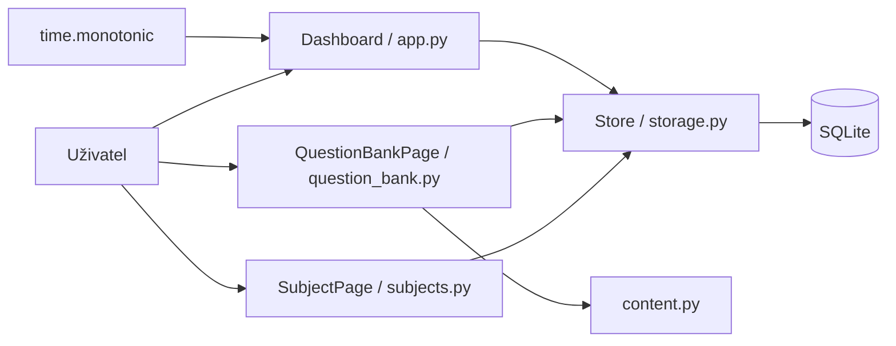

# Současná architektura

Stav k 14. listopadu 2026. Implementované jsou Dashboard a My Subjects; další kroky popisuje [plánovaná architektura](PLANNED_ARCHITECTURE.md).

## Technologie a soubory

Python, CustomTkinter 5.2.2, Pillow a standardní SQLite. Jeden proces a hlavní vlákno Tk; bez síťových požadavků a Ollama klienta. Vstup je `python soskuska/app.py`; instalovatelný balíček zatím není.

| Soubor | Odpovědnost |
| --- | --- |
| `soskuska/app.py` | Dashboard, navigace obrazovek, metriky, časovač, volba databáze a CLI |
| `soskuska/subjects.py` | My Subjects, inline formulář, validace a potvrzení smazání |
| `soskuska/storage.py` | Verze schématu, migrace, CRUD předmětů, úkoly, sezení a přehledy |
| `soskuska/scrolling.py` | Kompatibilita kolečka a trackpadu Tk 9 |
| `tests/test_storage.py`, `tests/test_subjects.py` | Úložiště, kompatibilita původní databáze, migrace a pravidla předmětů |
| `soskuska/check_dashboard.py` | Nativní integrační kontrola s dočasnými daty |
| `soskuska-local/index.html` | Historický vizuální návrh; není součástí běhu aplikace |

## Datový tok



Obrazovky volají `Store` přímo. Samostatná servisní/doménová vrstva a sdílený modul tématu zůstávají plánované. `SubjectPage` využívá stávající stylovací pomocné metody aplikace.

## Schéma a migrace

`PRAGMA user_version` nyní označuje verzi **3**. Otevření původní databáze verze 0 vytvoří/uzná původní tabulky a v jedné transakci doplní předměty a vazby. Databáze s novější verzí se odmítne otevřít místo pokusu o downgrade. Cizí klíče jsou zapnuté pro každé připojení.

```sql
CREATE TABLE tasks (
    day TEXT NOT NULL, name TEXT NOT NULL, done INTEGER NOT NULL,
    PRIMARY KEY (day, name)
);
CREATE TABLE subjects (
    id INTEGER PRIMARY KEY AUTOINCREMENT,
    name TEXT NOT NULL, name_key TEXT NOT NULL UNIQUE,
    description TEXT NOT NULL DEFAULT '', exam_date TEXT,
    created_at TEXT NOT NULL DEFAULT CURRENT_TIMESTAMP,
    updated_at TEXT NOT NULL DEFAULT CURRENT_TIMESTAMP
);
CREATE TABLE sessions (
    id INTEGER PRIMARY KEY, day TEXT NOT NULL,
    seconds INTEGER NOT NULL CHECK(seconds >= 0),
    subject_id INTEGER REFERENCES subjects(id) ON DELETE SET NULL,
    subject_name TEXT
);
CREATE INDEX sessions_subject ON sessions(subject_id);
CREATE TABLE topics (
    id INTEGER PRIMARY KEY AUTOINCREMENT,
    subject_id INTEGER NOT NULL REFERENCES subjects(id) ON DELETE CASCADE,
    name TEXT NOT NULL, name_key TEXT NOT NULL,
    UNIQUE(subject_id, name_key)
);
CREATE TABLE questions (
    id INTEGER PRIMARY KEY AUTOINCREMENT,
    subject_id INTEGER NOT NULL REFERENCES subjects(id) ON DELETE CASCADE,
    topic_id INTEGER REFERENCES topics(id) ON DELETE SET NULL,
    prompt TEXT NOT NULL,
    option_a TEXT NOT NULL, option_b TEXT NOT NULL,
    option_c TEXT NOT NULL, option_d TEXT NOT NULL,
    correct_option INTEGER NOT NULL CHECK(correct_option BETWEEN 0 AND 3),
    difficulty TEXT NOT NULL CHECK(difficulty IN ('Easy','Medium','Hard')),
    explanation TEXT NOT NULL DEFAULT '',
    created_at TEXT NOT NULL DEFAULT CURRENT_TIMESTAMP,
    updated_at TEXT NOT NULL DEFAULT CURRENT_TIMESTAMP
);
CREATE INDEX questions_subject ON questions(subject_id);
CREATE INDEX questions_topic ON questions(topic_id);
```

Staré úkoly a sezení se zachovají. Původní sezení nemají vymyšlený předmět: nové sloupce jsou `NULL`, UI je označí jako Unassigned session. Při smazání předmětu se zachová čas i název předmětu uložený u nového sezení; cizí klíč se nastaví na `NULL`. ID předmětu se znovu nepoužívá.

Název předmětu má 1–120 znaků; mezery se sjednotí, unikátní klíč používá Unicode NFKC a `casefold()`. Popis má nejvýše 1 000 znaků. Datum je volitelné, musí přesně odpovídat platnému `YYYY-MM-DD`. Minulé datum lze uložit, ale nezobrazí se mezi nadcházejícími zkouškami.

## Ukládání a časovač

| Platforma | Výchozí databáze |
| --- | --- |
| macOS | `~/Library/Application Support/SOSkuska/dashboard.sqlite3` |
| Windows | `%LOCALAPPDATA%\SOSkuska\dashboard.sqlite3`; náhradní základ `~/AppData/Local` |
| Linux | `$XDG_DATA_HOME/SOSkuska/dashboard.sqlite3`; náhradní základ `~/.local/share` |

Pokud nová databáze není a existuje původní `ExamPrep/dashboard.sqlite3`, použije se původní soubor bez přesunu nebo přepisu. `--data` má přednost. Data se nešifrují, nezálohují ani nesynchronizují. Zápisy běží na hlavním vlákně.

Časovač vyžaduje existující předmět. Po dobu sezení drží jeho ID a kopii názvu; přejmenování nemění historii. Má limit 900 sekund, měření přes `time.monotonic()`, aktualizaci přes `after(250, tick)`, pauzu a dokončení. Mazání aktivního předmětu UI zablokuje do dokončení sezení. Finish, dosažení limitu a běžné zavření ukládají čas. Při chybě zápisu se sezení pozastaví a lze zkusit Finish znovu; okno se nezavře s neuloženým sezením.

Čas není průběžně ukládaný a po pádu se nemusí obnovit. Sezení se připisuje ke dni uložení a nerozděluje se přes půlnoc. Změna dne za běhu obnoví přehled a dnešní checklist. Nový checklist používá klíče `review_subject` a `focus`; staré řádky zůstávají v databázi, ale nejsou mapované na nové úkoly.

## Skutečný Dashboard

Pevné vzorové předměty, procenta, profil, termíny i základy 24 h 35 min / 45 min byly odstraněné. Nová databáze je prázdná. Metriky jsou celkový čas, počet uložených sezení, série studijních dní a počet předmětů. Série může končit dnes nebo včera; starší přerušená série ukáže nulu. Cíl zůstává 60 minut denně; karta ukazuje uložené minuty, bar má přesnost na sekundy.

Karty ukazují počet sezení a uložený čas předmětu, ne smyšlený učební pokrok. Zkoušky pocházejí z uložených termínů, nedávná aktivita z posledních uložených sezení. Neexistující data mají prázdné stavy. AI, testy, kartičky, statistická obrazovka a nastavení zatím nejsou implementované.

## Rozložení a ovládání

Okno 1440 × 900, minimum 1024 × 700. Sidebar 230 px / sbalený 72 px; při zbylé šířce pod 1100 px se Dashboard přeuspořádá na metriky 2 × 2 a pravý panel pod obsah. My Subjects přepíná mezi jedním a dvěma sloupci při šířce 850 px. Dlouhé názvy se na kartách zalamují.

Obrazovky mají nezávislé vyhledávání přes `casefold()`. Ctrl+K / Cmd+K zaměří hledání aktivní obrazovky; Escape vymaže dotaz. Formuláře pro nový/upravený předmět i potvrzení smazání jsou inline. Podpora `TouchpadScroll`, kolečka a staršího Linux/X11 zůstává v adaptéru využívajícím privátní členy CustomTkinteru; při upgradu jej znovu ověřit.

## Ověření a zbývající omezení

32 testů úložiště prošlo; integrační skript prošel na macOS s Pythonem 3.12.13 / Tk 9.0 a dočasnou databází. Ověřil CRUD přes formulář, Unicode, hledání, prázdné stavy, navázání časovače, zachování historie, opětovné otevření, kompaktní režim a syntetické posouvání. Nenahrazuje ruční vizuální/hardwarové ověření; Windows/Linux nejsou ověřené.

Zbývají testy, kartičky, Ollama, překlady UI, nastavování cíle, úplná obnova po pádu, zálohy, balíčky a komplexní logování. První databázové operace mají chybová hlášení, ale úplné zpracování chyb při každém čtení ještě chybí.


Verze schématu se čte až po získání `BEGIN IMMEDIATE`, aby souběžné starty nepoužily zastaralou hodnotu. Rozložení My Subjects zpracovává skutečné Configure události CustomTkinteru; integrační kontrola ověřuje dva sloupce ve velkém okně a jeden v kompaktním.

## Banka témat a otázek

`soskuska/question_bank.py` obsahuje obrazovku QuestionBankPage; `soskuska/content.py` čistou validaci bez Tk. Obrazovka volá Store přímo. Schéma 3 přidává topics a questions; stávající tabulky ve výpisu výše zůstávají. Migrace 0/1/2 → 3 probíhá v jedné transakci a zachová předměty, úkoly i sezení.

Název tématu je jedinečný v rámci předmětu (1–120 znaků, normalizace mezer, NFKC/casefold). Otázka má text 1–2000 znaků, přesně čtyři různé odpovědi po normalizaci (1–500 znaků), correct_option 0–3, povinnou obtížnost a vysvětlení do 2000 znaků. Vazba na téma je volitelná; API a SQL triggery při zápisu otázky odmítají téma jiného předmětu. Indexy pokrývají subject_id a topic_id otázek. Témata ani otázky nelze přes UI přesouvat mezi předměty.

V My Subjects zvol u předmětu **Questions**. Přidej téma přes New topic a otázku přes New question. Každá otázka má čtyři různé povinné odpovědi A–D, právě jednu správnou odpověď, obtížnost Easy/Medium/Hard a volitelné vysvětlení. Téma je volitelné. Formulář zachová rozepsaný obsah při chybě validace nebo zápisu.

Témata lze přejmenovat a smazat; vyber téma ve filtru a použij Rename selected topic nebo Delete selected topic. Otázky lze upravovat a mazat. Hledání v textu otázky se kombinuje s filtrem tématu a obtížnosti. Počty na kartách předmětů vycházejí z uloženého obsahu. Smazání tématu ponechá jeho otázky v No topic. Smazání předmětu po výslovném upozornění odstraní jeho témata a otázky, ale zachová čas i historii studia.

Jde o editor obsahu: správná odpověď je viditelná. Spouštění a hodnocení procvičovacích testů, import a obrázky zatím nejsou implementované.

## Opravy po kontrole hlavní větve

Zavření okna i příkaz Quit v nabídce macOS používají stejné uložení sezení. Pokud uložení selže, aplikace zůstane otevřená se zachovaným pozastaveným časem; po odstranění problému lze zkusit Finish nebo Quit znovu.

Opuštění obrazovky My Subjects zruší rozpracované potvrzení smazání předmětu. Před smazáním se v jedné transakci porovná aktuální název a počty témat/otázek s posledním zobrazeným upozorněním. Pokud se změnily, aplikace nejprve zobrazí aktualizované upozornění a vyžádá nové potvrzení.

Při změně dne se aktualizuje i datum v záhlaví. Chyba čtení při obnově checklistu nebo přehledu nezastaví plánování časovače; obnova se opakuje a nový den se potvrdí až po úspěchu. Posouvání uvnitř dlouhého textového pole zůstává v tomto poli, včetně jeho krajů; stránku posuneš nad jinou částí okna. Krátké pole bez vlastního posuvu dál umožňuje posouvání stránky.

Pokud se sezení uložilo, ale následné načtení přehledu selže, aplikace opakuje pouze načtení i během stejného dne; záznam sezení znovu neukládá. Po úspěchu obnoví metriky i výběr předmětu a odstraní oznámení o opakování. Pokud se naopak sezení neuložilo, pokyn Press Finish zůstane viditelný i při chybě či úspěšné obnově denního přehledu. Gesta trackpadu nad posuvníkem a okrajem dlouhého editoru se předají jeho textovému poli.
