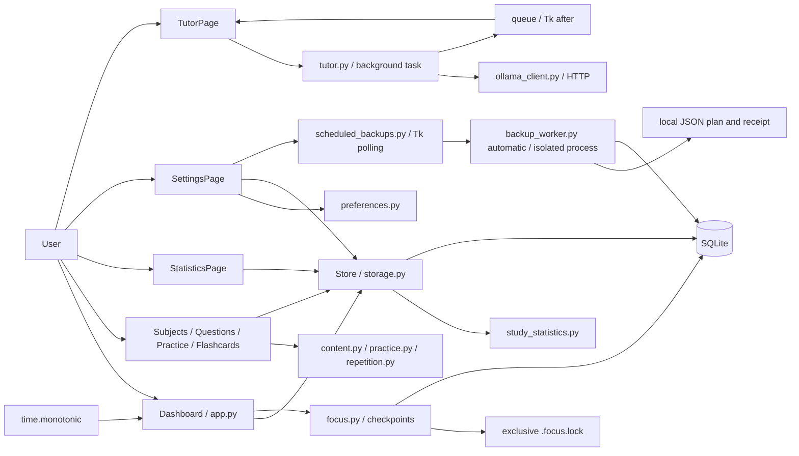

# Current architecture

[English](CURRENT_ARCHITECTURE.md) · [Čeština](cs/CURRENT_ARCHITECTURE.md) · [Slovenčina](sk/CURRENT_ARCHITECTURE.md) · [Русский](ru/CURRENT_ARCHITECTURE.md)

## v0.25.0

Completed results now offer Explain this question: preview one saved snapshot locally, prepare an editable clean Tutor draft, then explicitly Connect/Send. Existing work is preserved; the full 4,000-character bound, saved-turn history, Stop and save retry apply. Schema remains 10.

## v0.24.0 — Settings and shared data panels

Settings groups Study and Interface preferences side by side in wide windows and stacked in compact ones; AI preferences have a separate full-width card. Save/Reload feedback appears beside the controls as well as in the header. Resizing preserves the same fields, drafts and saved snapshots; saving remains explicit and active timers retain their original duration. Daily backup schedules, manual backup/restore and both CSV importers now use the shared card style, consistent insets and wrapped messages. Action groups use three columns in wide layouts or two in compact ones. Restore warnings appear above the destructive confirmation and Cancel controls. CSV preview/error fields have visible borders and keep their own scrolling. Preview, cancellation, atomic writes, isolated workers, restore closure and safety-copy rules are unchanged.

## v0.23.0 — Statistics and AI Tutor design

Statistics groups the period selector and Refresh in a header, with three summary cards side by side on wide screens or stacked in compact windows. Subject and daily activity remain below, with readable wrapped labels. Resizing preserves the existing report and does not query the database; failed Refresh keeps the prior snapshot. Definitions, weighted accuracy and self-rating counts are unchanged. AI Tutor groups server/model/language controls and saved-history controls into separate cards, side by side on wide screens and stacked in compact windows. The model selector has a full-width row. Conversation ownership, transcript, prompt and Send/Stop controls share a bordered reading/editing surface. Recovery feedback is repeated beside the retry/discard/interruption controls so confirmations remain readable after scrolling. Navigation and resizing keep drafts, widgets, history selection and active jobs. Connection remains explicit; opening history stays offline.

## v0.22.0 — Subjects and Question Bank design

Subjects and Question Bank now group titles, counts and actions in page headers and put labelled search/filter controls on shared surfaces. Subject actions use two rows; cards use two columns from 950 logical page pixels and one below. Resizing rearranges existing cards without querying the database. Question answer fields use two columns from 850 logical panel pixels and stack below; correct-answer previews are visually grouped in the authoring list only. Pagination remains 50 questions per page. Drafts, original edit snapshots, filters, topic identities, stale-state guards and CSV previews keep their existing behavior. Published version remains v0.25.0, schema 10.

## v0.21.0 — Flashcard review redesign

Flashcard review now separates the prompt and revealed answer into reading surfaces. Reveal is the primary action until the answer appears; Again / Hard / Good / Easy then replace it in the same footer, in four columns on wide screens or two on compact screens. Long text wraps and scrolls to the rating controls. Deck actions and empty states use the shared layout. A failed rating write keeps the revealed answer for retry. If the rating was saved but loading the next card fails, the old ratings are disabled and Refresh card only reloads the next card; the saved rating is not repeated. Scheduling, history, editor drafts and CSV preview behavior are preserved. Published version remains v0.25.0, schema 10.

**Published version: v0.25.0 · schema 10.** Practice history and container tests are implemented.

v0.17.0 adds focus-session crash recovery using schema **10**. Keep a backup before opening existing data: migration is transactional, but v0.16.0 cannot open a schema-10 database. [Focus-session recovery](FOCUS_RECOVERY.md).

UI language selection is available in v0.13.0: English, Czech, Slovak and Russian, saved separately from AI answer language and applied after restart. Current schema is 10.

## Technology and modules

Python, CustomTkinter 5.2.2, Pillow and standard-library SQLite. One process owns the Tk main thread, with optional Ollama jobs on background threads. Entry point: `python soskuska/app.py`; there is no installable package yet. HTML under `soskuska-local/` is a historical visual reference, not the runtime.

| Module | Responsibility |
| --- | --- |
| `soskuska/app.py` | Dashboard, navigation, metrics, timer, database selection and CLI |
| `soskuska/subjects.py` | Subject forms, validation and deletion confirmation |
| `soskuska/focus.py` | Durable focus checkpoints, ownership lease, atomic completion and discard |
| `soskuska/storage.py` | Schema version, transactional migrations, CRUD and stored study state |
| `soskuska/content.py` / `question_bank.py` | Pure question/topic validation and authoring screen |
| `soskuska/practice.py` / `practice_page.py` | Pure practice/deadline rules and test UI |
| `soskuska/repetition.py` / `flashcard_page.py` | Pure card rules/scheduling and flashcard UI |
| `soskuska/study_statistics.py` / `statistics_page.py` | Consistent history aggregates and report UI |
| `soskuska/ollama_client.py`, `tutor.py`, `tutor_page.py` | HTTP/HTTPS, bounded context/background jobs and local-history UI |
| `soskuska/preferences.py` / `settings_page.py` | Pure preference validation and explicit-save UI |
| `soskuska/automatic_backup.py` / `scheduled_backups.py` | Machine-local backup plan, daily receipt, exclusive helper and settings controls (v0.18.0) |
| `soskuska/scrolling.py` | Mouse wheel and Tk 9 trackpad compatibility |
| `tests/` / `soskuska/check_*.py` | Unit tests, frozen migration fixtures and native GUI checks using temporary data |

## Data flow



Screens call Store directly; separate service/domain layers and a shared theme module remain proposals. SubjectPage uses the app's existing styling helpers. Workers never call Tk or SQLite; queue events are handled on the main thread.

## Schema and migrations

`PRAGMA user_version` is **10**. Store obtains `BEGIN IMMEDIATE` before reading the version so concurrent launches cannot migrate from stale metadata. Migrations are transactional and preserve old tasks/sessions plus newer content/history. Foreign keys are enabled per connection. A newer schema is rejected rather than downgraded. Source of truth: `storage.py`; the SQL below describes the main tables and indexes.

### Tasks, subjects and question bank

```sql
CREATE TABLE tasks (
    day TEXT NOT NULL, name TEXT NOT NULL, done INTEGER NOT NULL,
    PRIMARY KEY (day, name)
);
CREATE TABLE subjects (
    id INTEGER PRIMARY KEY AUTOINCREMENT,
    name TEXT NOT NULL, name_key TEXT NOT NULL UNIQUE,
    description TEXT NOT NULL DEFAULT '', exam_date TEXT,
    created_at TEXT NOT NULL DEFAULT CURRENT_TIMESTAMP,
    updated_at TEXT NOT NULL DEFAULT CURRENT_TIMESTAMP
);
CREATE TABLE sessions (
    id INTEGER PRIMARY KEY, day TEXT NOT NULL,
    seconds INTEGER NOT NULL CHECK(seconds >= 0),
    subject_id INTEGER REFERENCES subjects(id) ON DELETE SET NULL,
    subject_name TEXT
);
CREATE INDEX sessions_subject ON sessions(subject_id);
CREATE TABLE topics (
    id INTEGER PRIMARY KEY AUTOINCREMENT,
    subject_id INTEGER NOT NULL REFERENCES subjects(id) ON DELETE CASCADE,
    name TEXT NOT NULL, name_key TEXT NOT NULL,
    UNIQUE(subject_id, name_key)
);
CREATE TABLE questions (
    id INTEGER PRIMARY KEY AUTOINCREMENT,
    subject_id INTEGER NOT NULL REFERENCES subjects(id) ON DELETE CASCADE,
    topic_id INTEGER REFERENCES topics(id) ON DELETE SET NULL,
    prompt TEXT NOT NULL,
    option_a TEXT NOT NULL, option_b TEXT NOT NULL,
    option_c TEXT NOT NULL, option_d TEXT NOT NULL,
    correct_option INTEGER NOT NULL CHECK(correct_option BETWEEN 0 AND 3),
    difficulty TEXT NOT NULL CHECK(difficulty IN ('Easy','Medium','Hard')),
    explanation TEXT NOT NULL DEFAULT '',
    created_at TEXT NOT NULL DEFAULT CURRENT_TIMESTAMP,
    updated_at TEXT NOT NULL DEFAULT CURRENT_TIMESTAMP
);
CREATE INDEX questions_subject ON questions(subject_id);
CREATE INDEX questions_topic ON questions(topic_id);
```

Legacy sessions get no invented subject: new links/snapshots are NULL and display as Unassigned session. Subject deletion keeps saved time/name snapshots and sets its reference to NULL. Subject IDs are not reused.

Subject names contain 1–120 characters, normalized whitespace and Unicode NFKC/casefold unique keys. Descriptions allow 1,000 characters; optional exam dates must exactly match a valid `YYYY-MM-DD`. Past dates can be stored but are excluded from upcoming exams.

Schema 3 introduced topics/questions, preserving earlier records. Topic names are unique within a subject (1–120 characters, same normalization). Questions have 1–2,000 characters, four distinct normalized answers of 1–500 characters, correct_option 0–3, Easy/Medium/Hard difficulty and explanation up to 2,000 characters. Optional topic ownership is enforced by API validation and SQL triggers. Subject/topic indexes support filtering. The UI does not move topics/questions between subjects.

Question authoring exposes the correct answer; it is not the running-test UI. Deleting a topic leaves questions unassigned. Subject deletion warns before cascading topics/questions and retains study history. Stale question forms compare all original editable content under the write lock; timestamp precision alone is insufficient. Conflicts retain drafts for copying/reloading/combining.

## Storage locations and focus timer

| Platform | Default database |
| --- | --- |
| macOS | `~/Library/Application Support/SOSkuska/dashboard.sqlite3` |
| Windows | `%LOCALAPPDATA%\SOSkuska\dashboard.sqlite3`; fallback base `~/AppData/Local` |
| Linux | `$XDG_DATA_HOME/SOSkuska/dashboard.sqlite3`; fallback base `~/.local/share` |

If the new database does not exist but legacy `ExamPrep/dashboard.sqlite3` does, use the legacy file without moving/copying/overwriting it. Explicit `--data` takes precedence. Data is neither encrypted nor synchronized automatically. Short SQLite writes run on the main thread.

Focus requires an existing subject and holds its ID/name snapshot during the session. It uses `time.monotonic()`, `after(250, tick)`, pause/resume and Finish, with a configurable 1–180 minute target (default 15). Active subject deletion is blocked. Finish, target completion and normal close save elapsed time. Failed writes pause the session and retain it for retry; both window close and native macOS Quit use the same handler and keep the app open if saving fails.

Focus checkpoints are saved every five seconds and on Pause; interrupted runs offer explicit paused recovery or confirmed discard. Sessions retain their local completion-day policy; no midnight splitting. See [Focus recovery](FOCUS_RECOVERY.md).

Read failures re-arm timer ticks and retry refresh independently of day changes. A committed session is never inserted again just because the subsequent summary read failed. Recovery refreshes metrics and subject choices and clears retry notices. An unsaved session's Press Finish instruction must remain visible during refresh failures/recovery.

Dashboard metrics use actual total time, saved sessions, subject count and study-day streak. A streak can end today or yesterday; an older broken streak shows zero. The daily goal is configurable (default 60 minutes), with saved minutes in text and seconds in the bar. Subject cards show time/session counts, not invented mastery. Exam dates and recent activity come from stored data; new databases are empty.

## Layout and scrolling

Target: 1440 × 900; minimum: 1024 × 700. **v0.19.0 redesign Step 2:** Today’s Study groups subject selection, Start Studying, timer/recovery/retry controls, daily progress and checklist. Subjects and labelled search follow it; lifetime metrics are a compact summary below the columns. The visible viewport breakpoint is 1100 logical CTk pixels, excluding the scrollbar: exams/recent sessions sit alongside in wide mode and stack below in compact mode; Dashboard subjects use two/one columns respectively. Sidebar remains 230 logical pixels, collapsed 72. My Subjects now uses a separate 950-logical-pixel page breakpoint. Long names wrap; new workspaces offer Create your first subject. Bounds are checked at 100/150% startup scaling in all four languages; native/live-DPI acceptance remains separate.

Search is independent per screen and uses casefold. Ctrl+K / Cmd+K focuses active search; Escape clears it. Screens without search must leave hidden drafts alone. Forms and deletion confirmations are inline. Navigation cancels pending subject deletion; name/content counts are compared under the write lock before deletion, requiring a refreshed warning if changed.

`scrolling.py` isolates private CustomTkinter access and supports wheel, older Linux/X11 events and Tk 9 TouchpadScroll packed deltas. Long text editors contain their own scroll, including at boundaries; short editors allow outer scrolling. Gestures over editor scrollbar/border canvases forward to the Text widget exactly once. Recheck this adapter when upgrading CustomTkinter.

## Practice Tests (introduced in v0.4.0)

Schema 4 added snapshotted attempts/items. A partial unique index permits only one unfinished attempt globally. Start, answer changes, position and completion are transactional. Deadlines are checked after obtaining the write lock. Late answers are rejected; failed answer writes restore the saved selection. Completion is idempotent, including retries after result-read failure.

Items copy prompt/options/correct answer/difficulty/topic name/explanation. Original subject/question references use ON DELETE SET NULL. Source deletion preserves unfinished/completed attempts; discarding only removes unfinished attempts and cascades their items. UTC ISO 8601 timestamps display in local time. Each question has equal score weight, no penalty, and unanswered items score zero. System-clock changes can affect deadlines; time continues while away/closed. Running UI never reveals correct answers. Background completion must not scroll another screen or change its draft.

```sql
CREATE TABLE practice_attempts (
                    id INTEGER PRIMARY KEY AUTOINCREMENT,
                    subject_id INTEGER REFERENCES subjects(id) ON DELETE SET NULL,
                    subject_name TEXT NOT NULL,
                    topic_name TEXT NOT NULL, difficulty TEXT,
                    status TEXT NOT NULL DEFAULT 'in_progress' CHECK(status IN ('in_progress','completed')),
                    question_count INTEGER NOT NULL CHECK(question_count BETWEEN 1 AND 100),
                    current_index INTEGER NOT NULL DEFAULT 0 CHECK(current_index >= 0 AND current_index < question_count),
                    time_limit_minutes INTEGER CHECK(time_limit_minutes BETWEEN 1 AND 180),
                    started_at TEXT NOT NULL, deadline_at TEXT, completed_at TEXT);
CREATE TABLE practice_items (
                    attempt_id INTEGER NOT NULL REFERENCES practice_attempts(id) ON DELETE CASCADE,
                    position INTEGER NOT NULL CHECK(position >= 0),
                    question_id INTEGER REFERENCES questions(id) ON DELETE SET NULL,
                    prompt TEXT NOT NULL, option_a TEXT NOT NULL, option_b TEXT NOT NULL,
                    option_c TEXT NOT NULL, option_d TEXT NOT NULL,
                    correct_option INTEGER NOT NULL CHECK(correct_option BETWEEN 0 AND 3),
                    selected_option INTEGER CHECK(selected_option BETWEEN 0 AND 3),
                    explanation TEXT NOT NULL, difficulty TEXT NOT NULL, topic_name TEXT,
                    PRIMARY KEY(attempt_id, position));
CREATE INDEX practice_items_question ON practice_items(question_id);
CREATE UNIQUE INDEX practice_one_active
                    ON practice_attempts(status) WHERE status='in_progress';
```

Discard obtains the write lock before checking the clock. An expired attempt is completed and retained rather than deleted. MissingPracticeError is terminal: clear stale state and show usable setup rather than retrying forever. SQLite errors remain retryable; Refresh subjects/navigation can recover a setup-read failure. History provides all completed results in pages of 20, with saved subject-name and local-date filters.

## Flashcards (introduced in v0.5.0)

Schema 5 added decks, flashcards and immutable review_events. Scheduling lives directly on cards. Revision and due status are checked under the write lock; rating, content snapshot and next due time commit together. Repeated rating of the same revision cannot add another event. History references use ON DELETE SET NULL and retain snapshots. Deck-to-subject uses SET NULL; card-to-deck uses CASCADE. Schema 4 and older content/results survive migration.

```sql
CREATE TABLE decks (
                    id INTEGER PRIMARY KEY AUTOINCREMENT,
                    subject_id INTEGER REFERENCES subjects(id) ON DELETE SET NULL,
                    subject_name TEXT NOT NULL, name TEXT NOT NULL,
                    name_key TEXT NOT NULL UNIQUE, description TEXT NOT NULL DEFAULT '');
CREATE TABLE flashcards (
                    id INTEGER PRIMARY KEY AUTOINCREMENT,
                    deck_id INTEGER NOT NULL REFERENCES decks(id) ON DELETE CASCADE,
                    front TEXT NOT NULL, back TEXT NOT NULL, due_at TEXT NOT NULL,
                    interval_days INTEGER NOT NULL DEFAULT 0 CHECK(interval_days BETWEEN 0 AND 365),
                    revision INTEGER NOT NULL DEFAULT 0 CHECK(revision >= 0),
                    review_count INTEGER NOT NULL DEFAULT 0 CHECK(review_count >= 0));
CREATE TABLE review_events (
                    id INTEGER PRIMARY KEY AUTOINCREMENT,
                    card_id INTEGER REFERENCES flashcards(id) ON DELETE SET NULL,
                    deck_id INTEGER REFERENCES decks(id) ON DELETE SET NULL,
                    card_revision INTEGER NOT NULL,
                    deck_name TEXT NOT NULL, subject_name TEXT NOT NULL,
                    front TEXT NOT NULL, back TEXT NOT NULL,
                    rating TEXT NOT NULL CHECK(rating IN ('Again','Hard','Good','Easy')),
                    reviewed_at TEXT NOT NULL, previous_due_at TEXT NOT NULL,
                    due_at TEXT NOT NULL, interval_days INTEGER NOT NULL,
                    UNIQUE(card_id,card_revision));
CREATE INDEX flashcards_due ON flashcards(deck_id,due_at,id);
CREATE INDEX review_events_deck ON review_events(deck_id,id);
```

See [Flashcards](FLASHCARDS.md) for exact custom scheduling and limits; this is not SM-2/FSRS or measured mastery. Reveal must precede rating. Advance only after commit; stale callbacks cannot rate the next card or hidden page. Failed writes retain revealed answers and drafts. Editing resets due time/interval while retaining history. New-deck subject choices refresh on load/Refresh/Save without losing title/description; renames retain ID selection, deletion requires an explicit replacement. Avoid binding persistent StringVars to repeatedly recreated CTkEntry widgets in CTk 5.2.2 because destroyed entries retain traces.

## Statistics (introduced in v0.6.0)

Store.statistics() reads sessions, completed attempts/items and review_events in one deferred read transaction. It does not mutate data or introduce a schema change. Refresh/reopening replaces the report; failures retain the prior snapshot. Configure bindings live with their widgets to avoid accumulating callbacks. See [Statistics](STATISTICS.md) for periods, weighting, time zones, name grouping and limits.

## AI Tutor (introduced in v0.7.0)

`tutor_page.py` owns widgets and local chat history; `tutor.py` builds bounded context and starts daemon jobs. `ollama_client.py` uses standard-library http.client/ssl for GET /api/tags and streaming POST /api/chat. Tk polls the queue every 50 ms. Shutdown cancels without joining on the UI thread; failed focus saves still prevent closing. The original v0.7.0 chat added no schema change; current history adds schema 7 without an external dependency.

No request starts on startup/navigation. Only this chat is sent to the visible server; no automatic database/files or cloud fallback. Endpoint changes require clearing existing chat. Stop signals cancellation; nonblocking socket reads/writes/TLS handshake poll at most every 100 ms. Only workers mutate/close sockets; DNS/TCP setup can delay cancellation. Keep one task active until its terminal event and ignore stale task events. Partial failed/stopped text remains visible but is excluded from later context.

See [AI Tutor](AI_TUTOR.md) for protocol/security choices, chat/model bounds, 30/180-second limits and saved history and interruption recovery. Tests use FakeOllama on loopback, not real models.

## Settings (introduced in v0.8.0)

SettingsPage validates through `preferences.py` and Store.preferences()/save_preferences(). Schema 6 adds the singleton row. `revision` plus BEGIN IMMEDIATE prevents stale overwrites. Frozen schema 5 migration tests check preservation/rollback.

```sql
CREATE TABLE preferences (
                    id INTEGER PRIMARY KEY CHECK(id=1),
                    focus_minutes INTEGER NOT NULL CHECK(focus_minutes BETWEEN 1 AND 180),
                    daily_goal_minutes INTEGER NOT NULL CHECK(daily_goal_minutes BETWEEN 1 AND 1440),
                    ollama_endpoint TEXT NOT NULL, ollama_model TEXT NOT NULL,
                    answer_language TEXT NOT NULL,
                    revision INTEGER NOT NULL DEFAULT 0 CHECK(revision>=0), ui_language TEXT NOT NULL DEFAULT 'English' CHECK(ui_language IN ('English','Czech','Slovak','Russian')), appearance_mode TEXT NOT NULL DEFAULT 'Dark' CHECK(appearance_mode IN ('Light','Dark','System')));
```

Save explicitly applies the whole form without requiring post-commit reads or network activity. Invalid stored values fall back safely and repair only on Save. Failed reads/writes/conflicts and navigation preserve drafts, including after first-load failure; Reload confirms replacement. Active/paused/unsaved focus sessions keep their target; the next session uses the new duration. Goal changes immediately without rewriting history.

Changed AI preferences require an idle Tutor. A different server requires New chat when chat exists; remembering the currently connected server retains chat ownership. New-server connection resolves the saved model preference; same-server refresh keeps an available manual override. Missing preferences require explicit selection. Study-only saves preserve temporary Tutor choices if persisted AI fields are unchanged. Other-window changes apply on Save/restart, not live. Answer language changes AI replies, not UI language. See [Settings](SETTINGS.md).

## Verification and remaining limits

The v0.8.0 baseline passed 126 unit tests and nine native macOS checks using disposable data (Python 3.12.13 / Tk 9.0). CI tests Python 3.12 on Ubuntu/Windows/macOS and GUI on Ubuntu/Xvfb. Processes are bounded at 60 seconds, jobs at 10 minutes; superseded ref runs cancel. Actions are pinned, token contents access is read-only, and there is no deployment/release step or automatic branch protection. See [Development](DEVELOPMENT.md).

Automated/synthetic checks do not establish manual platform UI or hardware gesture correctness; Linux does not test Aqua Quit/Tk 9 hardware behavior. Real Ollama quality/performance is unverified. Focus-session process-crash recovery is available in v0.17.0; remaining work includes wider application recovery, installers and comprehensive logging/error handling at every read.

## Backup and restore

Settings now includes manual local backup and validated restore, with a pre-restore safety copy. Current schema is 10. Restore closes the app; reopen it afterward. See [Backup and restore](BACKUP_RESTORE.md).

backup.py and backup_validation.py validate private standalone snapshots and application domains, then replace rows in one write transaction without copying source DDL. database_lock.py provides shared Store leases and exclusive restore leases (flock / Windows LockFileEx). backup_worker.py runs in an isolated process; backup_panel.py polls a temporary output file on Tk, avoiding pipe deadlocks and worker-thread Tk finalization. The current Store is closed and periodic callbacks pause for actual restore. The safety copy is taken while the write lock is held; final rows and ID sequences must match before commit.

Backup/restore validation: 156 unit tests and ten native macOS checks with disposable data. Tests include the independently reproduced review failures. CI runs the fifteen GUI checks on Ubuntu/Xvfb; Windows/macOS unit jobs exercise platform leases.

## Import questions from CSV

Question bank now supports UTF-8 CSV import into an existing subject, with a header-only template, paged preview, exact-duplicate rejection and one atomic save. Maximum 2 MiB / 500 records; question lists show 50 per page. Current schema is 10. [Question CSV import](QUESTION_CSV_IMPORT.md).

csv_import.py validates bounded canonical records; csv_import_worker.py runs isolated parse/read-only preflight/save/template jobs with file-backed output. Store.open_existing uses mode=ro/rw without creation or migration. Store.import_questions revalidates under BEGIN IMMEDIATE and inserts topics/questions in one transaction. A successful batch is consumed before UI report reads; refresh retry never imports again. Question-bank pagination applies filtering before selecting 50 visible cards.

## Import flashcards from CSV

Flashcards now supports UTF-8 CSV import into an existing deck: a header-only template, paged preview, exact-duplicate rejection and one atomic save. Maximum 2 MiB / 500 records. New cards are due immediately; existing schedules and review history are preserved. Current schema is 10. [Import flashcards from CSV](FLASHCARD_CSV_IMPORT.md).

`flashcard_csv_import.py` validates bounded front/back records; `flashcard_csv_import_worker.py` isolates parse/read-only preflight/save jobs. `CsvImportPanel` shares lifecycle and template publication with question import. `Store.import_flashcards` uses BEGIN IMMEDIATE, rechecks the displayed deck name and full-deck duplicates, then inserts all cards once with a shared current UTC due time. No existing schedule or review row is modified.

## Saved AI Tutor conversations

AI Tutor now saves conversations locally, including the original server/model and reply status. Open saved history without networking, reconnect explicitly to continue, or delete a selected conversation after confirmation. Released in v0.12.0 with schema 7, which migrates existing study data transactionally. [Saved AI Tutor conversations](TUTOR_HISTORY.md).

## Interface language

UI language selection is available in v0.13.0: English, Czech, Slovak and Russian, saved separately from AI answer language and applied after restart. Current schema is 10. [Interface language](UI_LANGUAGES.md).

`localization.py` owns pure catalog lookup/formatting; `localization_widgets.py` maps translated dropdown labels to canonical variables and cleans up traces. `i18n/en.json`, `cs.json`, `sk.json`, `ru.json` ship with the source. `preferences.ui_language` is a checked text field; startup builds the Translator once. No new external dependencies are required.

## Practice history

Practice history now supports pages of 20 across all completed attempts, historical subject-name and inclusive local-date filters, and reopening saved answer reviews. Filter drafts and the applied page survive navigation; failed reads keep prior results. Schema remains 8. [Practice history](PRACTICE_HISTORY.md).

## Windows portable build and acceptance

v0.15.0 adds an unsigned Windows x64 portable ZIP, built and checked by a fifth CI job. Bundled helper executables preserve isolated CSV/backup jobs; Python is not required on the target machine. Automated hosted Windows checks and the manual clean-machine checklist are separate; manual acceptance is not yet completed. Published version is v0.18.1, schema 10. [Windows portable build and acceptance](WINDOWS_PORTABLE.md) · [Checklist](WINDOWS_ACCEPTANCE.md).

## Appearance settings

v0.16.0 adds saved Light/Dark/System choices, applied on Save without rebuilding screens or losing active work. System follows Windows/macOS and uses Light on Linux. Current schema is 10. The user confirmed baseline testing complete and approved merging appearance PR #32 on 22 November 2026. [Appearance settings](APPEARANCE.md).

## Focus-session recovery

v0.17.0 adds focus-session crash recovery using schema **10**. Keep a backup before opening existing data: migration is transactional, but v0.16.0 cannot open a schema-10 database. [Focus-session recovery](FOCUS_RECOVERY.md).

`focus_runs` stores a 32-character run ID, original subject snapshot, target/elapsed seconds, pending/completed/discarded status, revision, UTC start/update/completion timestamps and an optional unique `sessions` link. A partial unique index permits one pending run. Zero-second completion has no session link. Completion and its history insert commit together. Subject deletion clears the live reference but retains the snapshot. Schema-9 migration/rollback uses a frozen fixture.

## Scheduled local backups

Scheduled local backups are available in **v0.18.0**. SQLite schema remains **10**. Manual backup/restore continues to work independently. [Scheduled local backups](SCHEDULED_BACKUPS.md).

## Main-branch review fixes

Fixes released in v0.18.1 through PR #38, tracked in [Astra review findings](REVIEW_FINDINGS.md). Schema remains 10 and the published version is v0.25.0. Subject edits compare their original content under the write lock; a conflict keeps your draft. Copy any changes you need before reopening Edit to load the latest version. Question/topic deletions recheck their displayed snapshot and require a refreshed confirmation after changes. Returning to the same subject preserves the active question/topic editor, filters and original editing identity, including read retries; a removed selected topic stays unavailable until you explicitly choose a replacement or No topic. Opening a different subject still resets the editor. A newer successful daily-backup receipt clears the old failure notice without another backup write.

## v0.20.0 — Practice redesign Step 3

Running tests now group progress/timing in a header and show a bar of saved answers. Full-width A–D rows highlight the saved choice, not correctness; background/text clicks save through the existing answer path. Previous/Next/Clear and Finish share a footer. Setup selectors share a card, and results/history use matching surfaces. Failed saves restore selection/style; hidden setup or off-page answer callbacks do not write. Long content wraps and scrolls at compact size. Scoring, deadlines, confirmations, resume, filters and retained snapshots remain unchanged; current schema is 10.


## Question explanations · v0.25.0

Completed Practice results, including reopened history, offer **Explain this question**. Open the local preview, then choose **Prepare in Tutor**. It uses the saved question snapshot (all four choices, selected answer or Unanswered, stored answer key and explanation), even after the original question/subject is deleted. Nothing connects or sends during preview/preparation. In Tutor, review the server, model and answer language, explicitly Connect if needed, then Send. The draft is editable and uses ordinary local chat history, Stop and save-retry paths.

Tutor must be an idle, clean New chat with an empty prompt and no pending confirmation or unsaved reply. Existing work is preserved; finish it or explicitly use the confirmed New chat action before retrying. A complete generated prompt above 4,000 characters is rejected with its measured length; nothing is truncated. The saved answer key and AI explanation may be wrong; scores and source content never change. Automatic asks for the supplied question language; explicit answer language overrides it. Prompt instructions stay in English and user content stays unchanged. No schema change (10), released version is v0.25.0.

Implementation: `question_explanation.py` builds/validates the bounded snapshot prompt; `practice_page.py` owns preview and stale-result checks; `tutor_page.py` guards draft insertion. Existing Send persists the prompt before HTTP. Automated checks use disposable data and loopback FakeOllama; real-model quality and native platform/DPI acceptance remain manual.


## AI study modes · unreleased

In a completed result, open **Explain this question**, then choose **Study mode** before **Prepare in Tutor**. **Explain answer** keeps the existing explanation; **Explain simply** requests short beginner-friendly steps and an example; **Give me a hint** requests one conceptual hint and omits your selected answer, stored key and explanation from the prompt; **Quiz me** asks one new follow-up at a time, waiting for your response before feedback. This is informal practice and never writes a scored attempt or changes source content.

Changing mode regenerates the exact local preview and invalidates its previous Prepare action. Nothing connects, sends or creates a conversation until the existing explicit controls are used. The sent prompt is saved in ordinary local chat history, with the existing language, 4,000-character bound, clean-chat guard, Stop and save-retry rules. Hint mode still includes all four choices: a model may infer/reveal the answer, and text already visible in completed results remains visible. Mode following and explanation quality require later real-model testing, explicitly deferred by the user. Automated checks use loopback FakeOllama. Version stays v0.25.0 / schema 10 until release.
