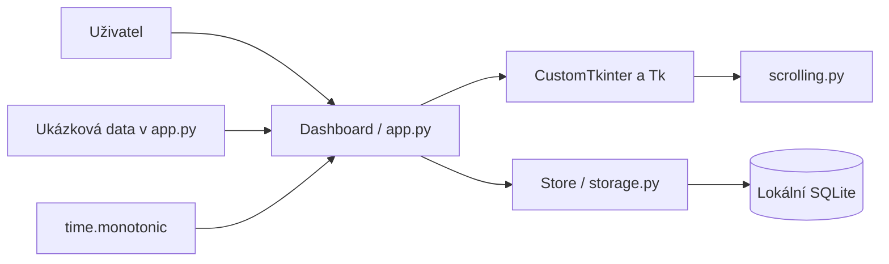

# Současná architektura

Stav k 10. listopadu 2026. Tento dokument popisuje existující kód. Budoucí návrh je v [plánované architektuře](PLANNED_ARCHITECTURE.md).

## Technologie a moduly

Python, CustomTkinter 5.2.2 a Pillow podle `soskuska/requirements.txt`; SQLite přes standardní modul `sqlite3`. Jeden proces, jedno vlákno, nativní smyčka událostí Tk. Bez síťových požadavků, Ollama klienta, cloudového účtu a webového serveru.

| Soubor | Odpovědnost |
| --- | --- |
| `soskuska/app.py` | Vstupní bod, `Dashboard`, UI, události, časovač, ukázkové metriky, cesta databáze a CLI |
| `soskuska/storage.py` | `Store`, otevření SQLite, založení tabulek, denní úkoly a součty sezení |
| `soskuska/scrolling.py` | `DashboardScrollFrame`, obsluha kolečka a přesných trackpadových událostí |
| `soskuska/check_dashboard.py` | Krátká nativní kontrola s dočasnou databází |
| `soskuska/run-macos.command` | Spuštění přes `.venv-macos` |
| `soskuska-local/index.html` | Starší samostatný vizuální návrh, není součást běhu aplikace |

Projekt zatím nemá `pyproject.toml`, instalovatelný balíček ani příkaz `soskuska`. Platný vstup je `python soskuska/app.py`.

## Datový tok



`Dashboard` přímo vytváří a volá `Store`. Samostatná servisní vrstva, model obrazovky ani router zatím neexistují. Barvy, fonty, rozložení a ukázkové předměty jsou převážně v `app.py`.

Při startu skript na macOS odmítne Tk starší než 8.6 ještě před vytvořením okna. Pak nastaví tmavý režim, otevře databázi, vytvoří widgety a spustí `mainloop()`.

## SQLite

```sql
CREATE TABLE tasks (
    day TEXT NOT NULL,
    name TEXT NOT NULL,
    done INTEGER NOT NULL,
    PRIMARY KEY (day, name)
);

CREATE TABLE sessions (
    id INTEGER PRIMARY KEY,
    day TEXT NOT NULL,
    seconds INTEGER NOT NULL CHECK(seconds >= 0)
);
```

Tabulky se vytvářejí přes `CREATE TABLE IF NOT EXISTS`. Verze schématu a migrace zatím chybí. Jediné připojení používá hlavní vlákno. Datum je místní den ve formátu ISO `YYYY-MM-DD`.

Úkoly mají klíče `cards` a `test`; jejich popisy jsou v kódu. Zaškrtnutí volá `save_task → Store.set_task → INSERT OR REPLACE`. Výchozí ukázkový stav `cards` je zaškrtnutý, `test` nezaškrtnutý.

| Platforma | Výchozí soubor |
| --- | --- |
| macOS | `~/Library/Application Support/SOSkuska/dashboard.sqlite3` |
| Windows | `%LOCALAPPDATA%\SOSkuska\dashboard.sqlite3`; náhradní základ `~/AppData/Local` |
| Linux | `$XDG_DATA_HOME/SOSkuska/dashboard.sqlite3`; náhradní základ `~/.local/share` |

`--data` přepíše cestu. Relativní cesta se vyhodnocuje vůči pracovnímu adresáři. Data nejsou aplikací šifrovaná, zálohovaná ani synchronizovaná.

## Časovač

- Pevný limit je 900 sekund. Start Studying a Resume session spouštějí tutéž funkci, nejde o obnovu dřívějšího učiva.
- `time.monotonic()` měří uplynulou dobu. `running_since` drží začátek běžícího úseku; `session_seconds` již uplynulý čas před pauzou.
- `after(250, tick)` aktualizuje text přibližně každých 250 ms. Měření nezávisí na počtu těchto volání.
- Pauza mění pouze stav v paměti. Finish, vypršení limitu nebo běžné zavření uloží celé sekundy, maximálně 900.
- Záznam sezení nemá předmět ani přesný čas začátku. Připíše se ke dni uložení; přes půlnoc se nerozděluje.
- Po uložení se obnoví minutové přehledy. Výchozí ukázkové hodnoty jsou 24 h 35 min celkem a 45 min dnes; ostatní metriky zůstávají pevné.
- Při pádu může rozpracované sezení zmizet. Stav časovače se po restartu neobnoví.

## Rozložení, vyhledávání a scrolling

Počáteční okno 1440 × 900, minimum 1024 × 700; titulek poskytuje systém. Sidebar má 230 px, sbalený 72 px. Široké rozložení se zapne při alespoň 1100 px po odečtení sidebaru: čtyři metriky vedle sebe a pravý přehled široký nejméně 300 px. V kompaktním režimu jsou metriky 2 × 2 a pravý přehled pod hlavním obsahem. Předměty zůstávají ve dvou sloupcích. Resize se zpracovává s odkladem 120 ms.

Vyhledávání porovnává podřetězec názvu pomocí `casefold()`. Hledá jen ve čtyřech vzorových předmětech, nikoli v databázi. Ctrl+K a na macOS Cmd+K zaměří hledání, Escape smaže dotaz. Všechny zkratky ještě nejsou ověřené na všech platformách.

`scrolling.py` doplňuje Tk 9 událost `TouchpadScroll`, rozbaluje podepsané 16bitové X/Y delty a nastavuje canvas krok na 1 px. Kolečko normalizuje přibližně na 40 px na krok; pro starší macOS a Linux/X11 má samostatné obsluhy. Posouvá pouze obsah pod cílovým widgetem; gesto nad sidebarem obsah neposune a čistě horizontální gesto ignoruje.

Adapter používá interní členy CustomTkinteru `_parent_canvas`, `_scrollbar`, `_shift_pressed`; při upgradu je nutná kontrola kompatibility. Formát události definuje [Tk TIP 684](https://core.tcl-lang.org/tips/doc/main/tip/684.md).

## Ověření a známé limity

Nativní kontrola prošla na macOS, Python 3.12.13 / Tk 9.0: mapované widgety, hledání, prázdný výsledek, sidebar, kompaktní režim, syntetické události kolečka/trackpadu, časovač a uložení času. Syntetické události nenahrazují ruční test gest na zařízení. Windows/Linux ani instalátor nejsou ověřené.

Předměty, procenta pokroku, profil, zkoušky, aktivita, streak, počet otázek a úspěšnost jsou ukázkové. Zkoušky se při startu generují relativně k dnešku. AI je odpojená a žádné připojení se nezkouší. Ostatní navigace pouze zobrazí oznámení.

Chybí automatické ošetření změny dne za běhu, obnova sezení po pádu, uživatelské chybové stavy pro zápis do databáze, migrace, import/export, zálohy, lokalizace, přepínání motivu, kompletní logování a distribuční balíčky.


Kompatibilita s původním názvem: pokud nová databáze v `SOSkuska` neexistuje a původní `ExamPrep/dashboard.sqlite3` existuje, aplikace použije tento původní soubor. Nic automaticky nekopíruje, nepřesouvá ani nepřepisuje. Explicitní `--data` má vždy přednost.
