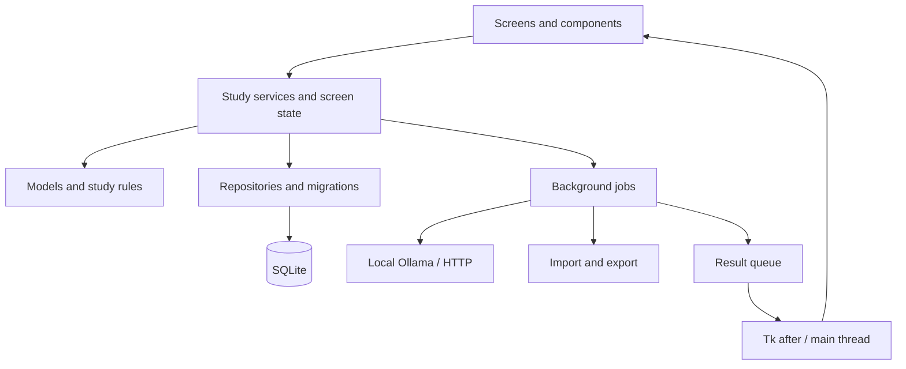

# Planned architecture

[English](PLANNED_ARCHITECTURE.md) · [Čeština](cs/PLANNED_ARCHITECTURE.md) · [Slovenčina](sk/PLANNED_ARCHITECTURE.md) · [Русский](ru/PLANNED_ARCHITECTURE.md)

**Future design, not a description of everything implemented today.** Proposed files/tables exist only where confirmed by [current architecture](CURRENT_ARCHITECTURE.md). A roadmap does not authorize implementing every feature at once.

As of 18 November 2026, v0.8.0 includes subjects/questions, focus sessions, practice, flashcards, statistics, optional session-only Ollama chat and persisted study/AI preferences. Schema 6 migration preserves previous data. [Settings](SETTINGS.md) does not automatically connect or save chat.

## Direction

Keep Python + CustomTkinter, local SQLite and optional Ollama. Windows/Linux remain primary targets with working macOS development. Ordinary study must not require a cloud account, paid API or running AI. Evolve the current Dashboard's visual style. Separate UI, study rules and persistence gradually as features need it; avoid introducing another UI framework or web backend.

## Proposed layers



| Layer | Responsibility |
| --- | --- |
| UI | Widgets, navigation, focus and state display; no SQL or blocking HTTP |
| Services | Study start, ratings, reports and AI context; no widget manipulation |
| Domain | Subjects, questions, answers and repetition rules independent of Tk |
| Persistence | Queries, transactions, mapping and migrations |
| Integrations | Ollama and file formats |

Screen state can remain a simple data structure; a large MVVM framework is unnecessary.

## Proposed files

```text
pyproject.toml
src/soskuska/
    __main__.py
    bootstrap.py
    domain/             models.py, repetition.py
    services/           dashboard.py, study.py, practice.py, tutor.py
    persistence/        database.py, migrations/, repositories/
    integrations/       ollama.py, import_export.py
    ui/
        app.py, theme.py, navigation.py
        components/
        screens/        dashboard, subjects, flashcards, practice,
                        tutor, statistics, settings
    i18n/               en.json, cs.json, sk.json, ru.json
tests/
docs/
```

Move incrementally in working steps. Until packaging exists, `python soskuska/app.py` remains the entry point; future `python -m soskuska` does not work yet.

## Proposed data model

| Area | Possible tables |
| --- | --- |
| Content | `subjects`, `topics`, `questions`, `answer_options` |
| Cards | `decks`, `flashcards`, `review_events`, `card_schedule` |
| Tests | `test_attempts`, `attempt_answers` |
| Study | `study_sessions` with subject and timing |
| Planning/settings | `exams`, `daily_tasks`, `settings` |
| AI | `conversations`, `messages`, attached-context references |
| Maintenance | Schema version / migration history |

These are proposed names, not replacements already performed. Define foreign keys, deletion rules, indexes and transactions. Preserve current tasks/sessions; never invent subjects for old time. A local profile should not need a server account.

Persist timestamps with explicit zones, preferably UTC, and aggregate calendar days locally. Design midnight splitting and crash recovery; monotonic time cannot survive process restart as the only saved value.

## Feature areas

- **Subjects/Dashboard:** subject/topic/question management, exams and actual session totals are implemented. New databases are empty; practice results and aggregate statistics already exist.
- **Flashcards:** decks, editing, reveal/rating, saved schedules and history exist. Rules in repetition.py are custom, not SM-2/FSRS. CSV import is implemented; advanced scheduling remains future work.
- **Practice:** filters, counts, timing, saved attempts, score and answer review exist. Question CSV import is implemented; richer practice history remains future work.
- **AI Tutor:** bounded Ollama HTTP client, discovered models, streaming and cancellation exist. Keep default local connection, visible configurable URL and no automatic cloud fallback. Distinguish unavailable service, no models, loading/ready/generating/stopped, memory error and missing model; connection failure alone cannot prove Ollama is not installed.
- **AI execution:** keep long operations off the Tk thread, results through queue/after, and no worker widget calls. Do not share SQLite connections without a design; short writes may stay on the main thread and future jobs should get their own connections.
- **Text/languages:** start with plain text, code blocks and Unicode math; advanced HTML/LaTeX is optional future work. Separate UI from AI answer language. UI translations should support English/Czech/Slovak/Russian, long text and Cyrillic; AI already supports these plus Automatic and manual override.
- **Statistics/settings/data:** basic reports and study/AI preferences exist. Future work includes richer charts (Matplotlib only if needed), appearance/UI-language settings, data management, import validation and scheduled backups. Manual backup/restore is now implemented.  The current manual restore closes the connection and creates a safety copy.

## Stages and completion criteria

| Stage | Scope | Completion evidence |
| --- | --- | --- |
| 1. Stabilize | Theme/UI separation, storage errors, migrations | Dashboard works and existing data survives |
| 2. Subjects | Subjects/topics/exams and actual reports | New subject survives restart; empty data is truthful |
| 3. Content/cards | Editor/import, decks, repetition | Rating creates history and next schedule |
| 4. Tests | Setup, execution, results and errors | Result can be reopened/recomputed from answers |
| 5. AI | Ollama client/chat | UI stays responsive; Stop works; offline state is clear |
| 6. Finish | Reports, languages, theme, backups, packaging | Verified installations on target systems |

Some stages are partly or substantially complete; use current architecture for status. Iterate with feedback against the semester assignment. This plan does not demand an immediate rewrite of Dashboard.

## Backup and restore

Settings now includes manual local backup and validated restore, with a pre-restore safety copy. Schema stays 6. Restore closes the app; reopen it afterward. See [Backup and restore](BACKUP_RESTORE.md).

## Import questions from CSV

Question bank now supports UTF-8 CSV import into an existing subject, with a header-only template, paged preview, exact-duplicate rejection and one atomic save. Maximum 2 MiB / 500 records; question lists show 50 per page. Schema stays 6. [Question CSV import](QUESTION_CSV_IMPORT.md).

## Import flashcards from CSV

Flashcards now supports UTF-8 CSV import into an existing deck: a header-only template, paged preview, exact-duplicate rejection and one atomic save. Maximum 2 MiB / 500 records. New cards are due immediately; existing schedules and review history are preserved. Schema stays 6. [Import flashcards from CSV](FLASHCARD_CSV_IMPORT.md).
