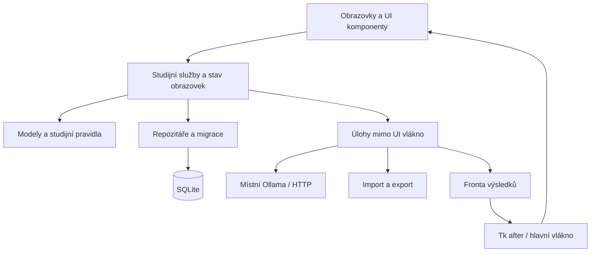

# Plánovaná architektura

**Budoucí návrh, nikoli dnešní implementace.** Zde uvedené moduly a tabulky zatím neexistují, pokud je nepotvrzuje [současná architektura](CURRENT_ARCHITECTURE.md). Tento plán sám neznamená zahájení implementace všech funkcí.

**Aktuální postup (14. listopadu 2026):** předměty, termíny, skutečný Dashboard a banka témat/otázek jsou implementované. Procvičování s vyhodnocením, kartičky a AI jsou další etapy. Samostatná servisní vrstva a instalátor zůstávají plánované.

## Směr

Zachovat Python + CustomTkinter, místní SQLite a volitelnou AI přes Ollamu. Primární platformy Windows/Linux, ponechat funkční vývoj na macOS. Běžné studium nesmí vyžadovat cloudový účet, placené API ani spuštěnou AI. Vizuální jazyk dál rozvíjet z dnešního Dashboardu.

Oddělovat UI, studijní pravidla a ukládání postupně podle potřeb konkrétních funkcí. Nevytvářet nový UI framework ani webový backend.

## Vrstvy



| Vrstva | Odpovědnost |
| --- | --- |
| UI | Widgety, navigace, zaměření, zobrazení stavů; bez SQL a blokujícího HTTP |
| Services | Spuštění studia, hodnocení, přehledy a kontext AI; bez manipulace widgety |
| Domain | Předměty, otázky, odpovědi a pravidla opakování; bez závislosti na Tk |
| Persistence | Dotazy, transakce, mapování dat a migrace |
| Integrations | Ollama a formáty souborů |

Stav obrazovky může zůstat jednoduchou datovou strukturou. Není potřeba hned zavádět rozsáhlý MVVM framework.

## Navrhované soubory

```text
pyproject.toml
src/soskuska/
    __main__.py
    bootstrap.py
    domain/             models.py, repetition.py
    services/           dashboard.py, study.py, practice.py, tutor.py
    persistence/        database.py, migrations/, repositories/
    integrations/       ollama.py, import_export.py
    ui/
        app.py, theme.py, navigation.py
        components/
        screens/        dashboard, subjects, flashcards, practice,
                        tutor, statistics, settings
    i18n/               en.json, cs.json, sk.json, ru.json
tests/
docs/
```

Přesun provádět po malých funkčních krocích. Do vytvoření balíčku zůstává platný dnešní příkaz `python soskuska/app.py`; budoucí `python -m soskuska` zatím nefunguje.

## Navrhovaný datový model

| Oblast | Návrh tabulek |
| --- | --- |
| Obsah | `subjects`, `topics`, `questions`, `answer_options` |
| Kartičky | `decks`, `flashcards`, `review_events`, `card_schedule` |
| Testy | `test_attempts`, `attempt_answers` |
| Studium | `study_sessions` s předmětem a časovými údaji |
| Plán a nastavení | `exams`, `daily_tasks`, `settings` |
| AI | `conversations`, `messages`, reference připojeného kontextu |
| Údržba | Verze schématu / evidence provedených migrací |

Konkrétní schémata musí doplnit cizí klíče, mazací pravidla, indexy a transakce. Migrace musí zachovat dnešní `tasks` a `sessions`; existující čas nesmí dostat vymyšlený předmět. Lokální profil nemá vyžadovat serverový účet.

Časové okamžiky ukládat s jasnou časovou zónou, ideálně UTC; denní součty počítat v místní zóně. Navrhnout rozdělení sezení přes půlnoc a obnovu po pádu. Monotónní čas se nedá přenést mezi spuštěními procesu, proto nebude jediným uloženým údajem.

## Funkční celky

**Předměty a skutečný Dashboard:** CRUD předmětů, termíny a skutečné součty sezení jsou implementované. Správa témat a otázek je implementovaná; další krok jsou procvičovací testy; úspěšnost odpovědí lze přidat až s jejich ukládáním. Nové databáze jsou prázdné, bez automatických demo dat.

**Kartičky:** balíčky, otočení otázky na odpověď, Again / Hard / Good / Easy. Plánování opakování oddělit do čistého modulu a testovat. Konkrétní algoritmus teprve zvolit; dnešní aplikace žádný nemá.

**Testy:** nastavení témat, počtu otázek, obtížnosti a času; rozehraný pokus, vyhodnocení a kontrola chyb. Odpovědi a dokončení pokusu ukládat transakčně, aby se výsledky daly zpětně ověřit.

**AI Tutor:** samostatný Ollama klient s časovým limitem, seznamem dostupných modelů, streamováním a zrušením generování. Výchozí spojení místní, adresa nastavitelná a viditelná; žádný automatický cloudový fallback. Modely načítat z Ollamy, nevyžadovat jeden pevný model.

AI stavy: nedostupná služba, žádný model, načítání, připraveno, generování, zastaveno, nedostatek paměti, model nenalezen. Samotné selhání připojení nesmí být vydáváno za jistotu, že Ollama není nainstalovaná.

Dlouhé operace běží mimo hlavní UI vlákno. Výsledky přicházejí přes frontu a `after`; pracovní vlákno nesmí volat widgety. SQLite připojení bez návrhu nesdílet mezi vlákny. První řešení může ponechat krátké zápisy v hlavním vlákně; případné pracovní úlohy dostanou vlastní připojení.

AI odpovědi nejdříve jako text, monospaced bloky kódu a Unicode matematika; pokročilé HTML/LaTeX není podmínka. Jazyk UI oddělit od jazyka odpovědi AI. Plánované jazyky: English, Czech, Slovak, Russian; AI navíc Automatic s možností ručního přepsání chybné detekce. Počítat s delšími texty a Cyrilicí.

**Statistiky a nastavení:** jednoduché Matplotlib grafy až nad skutečnými měřeními. Nastavení vzhledu, jazyka, studia, AI a správy dat. Import nejprve validovat; zálohy vytvářet jako konzistentní SQLite kopie. Obnovu provádět se zavřeným připojením a možností návratu k předchozímu souboru.

## Etapy a kritéria dokončení

| Etapa | Rozsah | Výsledek |
| --- | --- | --- |
| 1. Stabilizace | Oddělit téma/UI, chyby úložiště, migrace | Dashboard funguje a existující data zůstanou zachovaná |
| 2. Předměty | Správa předmětů, témat, zkoušek, skutečné přehledy | Nový předmět přežije restart; prázdná data se zobrazí pravdivě |
| 3. Obsah a kartičky | Editor/import, balíčky, opakování | Odpověď vytvoří záznam a plán příštího opakování |
| 4. Testy | Nastavení, průchod, výsledky a chyby | Výsledek lze otevřít a znovu spočítat z odpovědí |
| 5. AI | Ollama klient a chat | UI nezamrzá, generování jde zastavit, offline stav je srozumitelný |
| 6. Dokončení | Statistiky, jazyky, motiv, zálohy a balíčky | Ověřené instalace na cílových systémech |

Obrazovky rozvíjet iterativně po zpětné vazbě podle původního zadání. Tento návrh nevyžaduje okamžitý přepis nynějšího Dashboardu.
