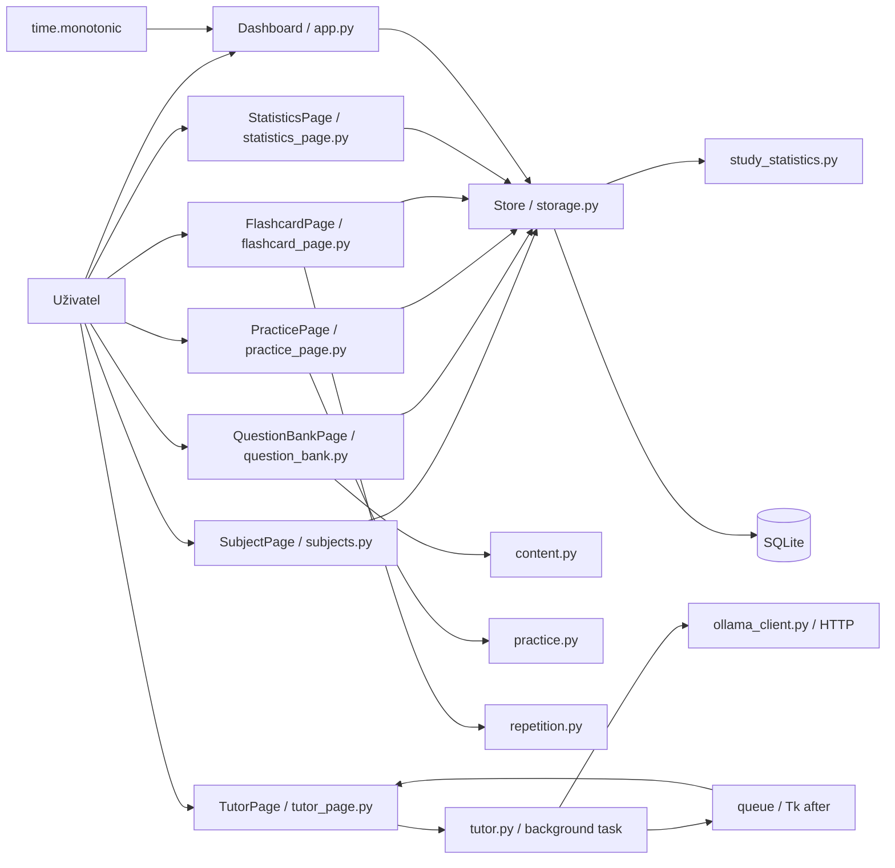

# Současná architektura

[English](../CURRENT_ARCHITECTURE.md) · [Čeština](CURRENT_ARCHITECTURE.md) · [Slovenčina](../sk/CURRENT_ARCHITECTURE.md) · [Русский](../ru/CURRENT_ARCHITECTURE.md)

Stav k 18. listopadu 2026. Implementované jsou Dashboard, My Subjects, Question bank, Practice Tests, Flashcards, Statistics a volitelný AI Tutor a Settings; další kroky popisuje [plánovaná architektura](PLANNED_ARCHITECTURE.md).

## Technologie a soubory

Python, CustomTkinter 5.2.2, Pillow a standardní SQLite. Jeden proces a hlavní vlákno Tk; s volitelným Ollama klientem ve vedlejším vlákně. Vstup je `python soskuska/app.py`; instalovatelný balíček zatím není.

| Soubor | Odpovědnost |
| --- | --- |
| `soskuska/app.py` | Dashboard, navigace obrazovek, metriky, časovač, volba databáze a CLI |
| `soskuska/subjects.py` | My Subjects, inline formulář, validace a potvrzení smazání |
| `soskuska/storage.py` | Verze schématu, migrace, CRUD předmětů, úkoly, sezení a přehledy |
| `soskuska/scrolling.py` | Kompatibilita kolečka a trackpadu Tk 9 |
| `tests/test_storage.py`, `tests/test_subjects.py` | Úložiště, kompatibilita původní databáze, migrace a pravidla předmětů |
| `soskuska/check_dashboard.py` | Nativní integrační kontrola s dočasnými daty |
| `soskuska/statistics_page.py` / `soskuska/study_statistics.py` | Obrazovka Statistics a konzistentní agregace uložené historie |
| `soskuska/tutor_page.py`, `soskuska/tutor.py`, `soskuska/ollama_client.py` | Session chat, fronta úloh a volitelný Ollama klient |
| `soskuska-local/index.html` | Historický vizuální návrh; není součástí běhu aplikace |

## Datový tok



Obrazovky volají `Store` přímo. Samostatná servisní/doménová vrstva a sdílený modul tématu zůstávají plánované. `SubjectPage` využívá stávající stylovací pomocné metody aplikace.

## Schéma a migrace

`PRAGMA user_version` nyní označuje verzi **6**. Otevření původní databáze verze 0 vytvoří/uzná původní tabulky a v jedné transakci doplní předměty a vazby. Databáze s novější verzí se odmítne otevřít místo pokusu o downgrade. Cizí klíče jsou zapnuté pro každé připojení.

```sql
CREATE TABLE tasks (
    day TEXT NOT NULL, name TEXT NOT NULL, done INTEGER NOT NULL,
    PRIMARY KEY (day, name)
);
CREATE TABLE subjects (
    id INTEGER PRIMARY KEY AUTOINCREMENT,
    name TEXT NOT NULL, name_key TEXT NOT NULL UNIQUE,
    description TEXT NOT NULL DEFAULT '', exam_date TEXT,
    created_at TEXT NOT NULL DEFAULT CURRENT_TIMESTAMP,
    updated_at TEXT NOT NULL DEFAULT CURRENT_TIMESTAMP
);
CREATE TABLE sessions (
    id INTEGER PRIMARY KEY, day TEXT NOT NULL,
    seconds INTEGER NOT NULL CHECK(seconds >= 0),
    subject_id INTEGER REFERENCES subjects(id) ON DELETE SET NULL,
    subject_name TEXT
);
CREATE INDEX sessions_subject ON sessions(subject_id);
CREATE TABLE topics (
    id INTEGER PRIMARY KEY AUTOINCREMENT,
    subject_id INTEGER NOT NULL REFERENCES subjects(id) ON DELETE CASCADE,
    name TEXT NOT NULL, name_key TEXT NOT NULL,
    UNIQUE(subject_id, name_key)
);
CREATE TABLE questions (
    id INTEGER PRIMARY KEY AUTOINCREMENT,
    subject_id INTEGER NOT NULL REFERENCES subjects(id) ON DELETE CASCADE,
    topic_id INTEGER REFERENCES topics(id) ON DELETE SET NULL,
    prompt TEXT NOT NULL,
    option_a TEXT NOT NULL, option_b TEXT NOT NULL,
    option_c TEXT NOT NULL, option_d TEXT NOT NULL,
    correct_option INTEGER NOT NULL CHECK(correct_option BETWEEN 0 AND 3),
    difficulty TEXT NOT NULL CHECK(difficulty IN ('Easy','Medium','Hard')),
    explanation TEXT NOT NULL DEFAULT '',
    created_at TEXT NOT NULL DEFAULT CURRENT_TIMESTAMP,
    updated_at TEXT NOT NULL DEFAULT CURRENT_TIMESTAMP
);
CREATE INDEX questions_subject ON questions(subject_id);
CREATE INDEX questions_topic ON questions(topic_id);
```

Staré úkoly a sezení se zachovají. Původní sezení nemají vymyšlený předmět: nové sloupce jsou `NULL`, UI je označí jako Unassigned session. Při smazání předmětu se zachová čas i název předmětu uložený u nového sezení; cizí klíč se nastaví na `NULL`. ID předmětu se znovu nepoužívá.

Název předmětu má 1–120 znaků; mezery se sjednotí, unikátní klíč používá Unicode NFKC a `casefold()`. Popis má nejvýše 1 000 znaků. Datum je volitelné, musí přesně odpovídat platnému `YYYY-MM-DD`. Minulé datum lze uložit, ale nezobrazí se mezi nadcházejícími zkouškami.

## Ukládání a časovač

| Platforma | Výchozí databáze |
| --- | --- |
| macOS | `~/Library/Application Support/SOSkuska/dashboard.sqlite3` |
| Windows | `%LOCALAPPDATA%\SOSkuska\dashboard.sqlite3`; náhradní základ `~/AppData/Local` |
| Linux | `$XDG_DATA_HOME/SOSkuska/dashboard.sqlite3`; náhradní základ `~/.local/share` |

Pokud nová databáze není a existuje původní `ExamPrep/dashboard.sqlite3`, použije se původní soubor bez přesunu nebo přepisu. `--data` má přednost. Data se nešifrují, nezálohují ani nesynchronizují. Zápisy běží na hlavním vlákně.

Časovač vyžaduje existující předmět. Po dobu sezení drží jeho ID a kopii názvu; přejmenování nemění historii. Má nastavitelný limit 1–180 minut (výchozí 15), měření přes `time.monotonic()`, aktualizaci přes `after(250, tick)`, pauzu a dokončení. Mazání aktivního předmětu UI zablokuje do dokončení sezení. Finish, dosažení limitu a běžné zavření ukládají čas. Při chybě zápisu se sezení pozastaví a lze zkusit Finish znovu; okno se nezavře s neuloženým sezením.

Čas není průběžně ukládaný a po pádu se nemusí obnovit. Sezení se připisuje ke dni uložení a nerozděluje se přes půlnoc. Změna dne za běhu obnoví přehled a dnešní checklist. Nový checklist používá klíče `review_subject` a `focus`; staré řádky zůstávají v databázi, ale nejsou mapované na nové úkoly.

## Skutečný Dashboard

Pevné vzorové předměty, procenta, profil, termíny i základy 24 h 35 min / 45 min byly odstraněné. Nová databáze je prázdná. Metriky jsou celkový čas, počet uložených sezení, série studijních dní a počet předmětů. Série může končit dnes nebo včera; starší přerušená série ukáže nulu. Cíl je nastavitelný (výchozí 60 minut denně); karta ukazuje uložené minuty, bar má přesnost na sekundy.

Karty ukazují počet sezení a uložený čas předmětu, ne smyšlený učební pokrok. Zkoušky pocházejí z uložených termínů, nedávná aktivita z posledních uložených sezení. Neexistující data mají prázdné stavy. Nastavení je implementované; AI Tutor má volitelný chat; Statistics má vlastní obrazovku.

## Rozložení a ovládání

Okno 1440 × 900, minimum 1024 × 700. Sidebar 230 px / sbalený 72 px; při zbylé šířce pod 1100 px se Dashboard přeuspořádá na metriky 2 × 2 a pravý panel pod obsah. My Subjects přepíná mezi jedním a dvěma sloupci při šířce 850 px. Dlouhé názvy se na kartách zalamují.

Obrazovky mají nezávislé vyhledávání přes `casefold()`. Ctrl+K / Cmd+K zaměří hledání aktivní obrazovky; Escape vymaže dotaz. Formuláře pro nový/upravený předmět i potvrzení smazání jsou inline. Podpora `TouchpadScroll`, kolečka a staršího Linux/X11 zůstává v adaptéru využívajícím privátní členy CustomTkinteru; při upgradu jej znovu ověřit.

## Ověření a zbývající omezení

126 testů úložiště prošlo; integrační skript prošel na macOS s Pythonem 3.12.13 / Tk 9.0 a dočasnou databází. Ověřil CRUD přes formulář, Unicode, hledání, prázdné stavy, navázání časovače, zachování historie, opětovné otevření, kompaktní režim a syntetické posouvání. Nenahrazuje ruční vizuální/hardwarové ověření; Windows/Linux nejsou ověřené.

Zbývá ukládání AI konverzací, překlady UI, úplná obnova po pádu, zálohy, balíčky a komplexní logování. První databázové operace mají chybová hlášení, ale úplné zpracování chyb při každém čtení ještě chybí.


Verze schématu se čte až po získání `BEGIN IMMEDIATE`, aby souběžné starty nepoužily zastaralou hodnotu. Rozložení My Subjects zpracovává skutečné Configure události CustomTkinteru; integrační kontrola ověřuje dva sloupce ve velkém okně a jeden v kompaktním.

## Banka témat a otázek

`soskuska/question_bank.py` obsahuje obrazovku QuestionBankPage; `soskuska/content.py` čistou validaci bez Tk. Obrazovka volá Store přímo. Schéma 3 přidává topics a questions; stávající tabulky ve výpisu výše zůstávají. Migrace 0/1/2 → 3 probíhá v jedné transakci a zachová předměty, úkoly i sezení.

Název tématu je jedinečný v rámci předmětu (1–120 znaků, normalizace mezer, NFKC/casefold). Otázka má text 1–2000 znaků, přesně čtyři různé odpovědi po normalizaci (1–500 znaků), correct_option 0–3, povinnou obtížnost a vysvětlení do 2000 znaků. Vazba na téma je volitelná; API a SQL triggery při zápisu otázky odmítají téma jiného předmětu. Indexy pokrývají subject_id a topic_id otázek. Témata ani otázky nelze přes UI přesouvat mezi předměty.

V My Subjects zvol u předmětu **Questions**. Přidej téma přes New topic a otázku přes New question. Každá otázka má čtyři různé povinné odpovědi A–D, právě jednu správnou odpověď, obtížnost Easy/Medium/Hard a volitelné vysvětlení. Téma je volitelné. Formulář zachová rozepsaný obsah při chybě validace nebo zápisu.

Témata lze přejmenovat a smazat; vyber téma ve filtru a použij Rename selected topic nebo Delete selected topic. Otázky lze upravovat a mazat. Hledání v textu otázky se kombinuje s filtrem tématu a obtížnosti. Počty na kartách předmětů vycházejí z uloženého obsahu. Smazání tématu ponechá jeho otázky v No topic. Smazání předmětu po výslovném upozornění odstraní jeho témata a otázky, ale zachová čas i historii studia.

Jde o editor obsahu: správná odpověď je viditelná. Procvičování a hodnocení najdeš v Practice Tests. Import a obrázky zatím nejsou implementované.

## Opravy po kontrole hlavní větve

Zavření okna i příkaz Quit v nabídce macOS používají stejné uložení sezení. Pokud uložení selže, aplikace zůstane otevřená se zachovaným pozastaveným časem; po odstranění problému lze zkusit Finish nebo Quit znovu.

Opuštění obrazovky My Subjects zruší rozpracované potvrzení smazání předmětu. Před smazáním se v jedné transakci porovná aktuální název a počty témat/otázek s posledním zobrazeným upozorněním. Pokud se změnily, aplikace nejprve zobrazí aktualizované upozornění a vyžádá nové potvrzení.

Při změně dne se aktualizuje i datum v záhlaví. Chyba čtení při obnově checklistu nebo přehledu nezastaví plánování časovače; obnova se opakuje a nový den se potvrdí až po úspěchu. Posouvání uvnitř dlouhého textového pole zůstává v tomto poli, včetně jeho krajů; stránku posuneš nad jinou částí okna. Krátké pole bez vlastního posuvu dál umožňuje posouvání stránky.

Pokud se sezení uložilo, ale následné načtení přehledu selže, aplikace opakuje pouze načtení i během stejného dne; záznam sezení znovu neukládá. Po úspěchu obnoví metriky i výběr předmětu a odstraní oznámení o opakování. Pokud se naopak sezení neuložilo, pokyn Press Finish zůstane viditelný i při chybě či úspěšné obnově denního přehledu. Gesta trackpadu nad posuvníkem a okrajem dlouhého editoru se předají jeho textovému poli.

## Practice Tests — procvičování (v0.4.0)

`practice_page.py` obsahuje obrazovku a vlastní neblokující Tk callback; `practice.py` čistou validaci a UTC časová pravidla. Schéma 4 přidává practice_attempts a practice_items v transakční migraci z verze 3 i starších verzí. Rozpracovaný pokus je v databázi nejvýše jeden (částečný unikátní index). Start, změny odpovědí, pozice a dokončení používají transakce; po termínu nelze odpověď uložit. Dokončení je idempotentní, takže opakování po chybě čtení výsledku nepřidá druhý výsledek. Chyba zápisu odpovědi vrátí výběr na poslední uloženou hodnotu.

practice_items ukládá text, všechny čtyři možnosti, správnou odpověď, obtížnost, název tématu a vysvětlení jako kopie. Odkazy na původní předmět/otázku používají ON DELETE SET NULL. Mazání předmětu ponechá dokončené i rozpracované pokusy; zahodit lze jen rozpracovaný pokus a jeho položky se smažou kaskádou. Časové údaje jsou UTC ISO 8601, v UI se dokončení převádí do místního času. Skóre se počítá ze snímků: každá otázka má stejnou váhu, bez penalizace, nevyplněná odpověď má nulu. Časový limit používá systémové UTC hodiny; ruční změna času může změnit zbývající dobu. Ctrl+K / Cmd+K a Escape na obrazovce testů nemění skryté hledání jiné obrazovky.

```sql
CREATE TABLE practice_attempts (
                    id INTEGER PRIMARY KEY AUTOINCREMENT,
                    subject_id INTEGER REFERENCES subjects(id) ON DELETE SET NULL,
                    subject_name TEXT NOT NULL,
                    topic_name TEXT NOT NULL, difficulty TEXT,
                    status TEXT NOT NULL DEFAULT 'in_progress' CHECK(status IN ('in_progress','completed')),
                    question_count INTEGER NOT NULL CHECK(question_count BETWEEN 1 AND 100),
                    current_index INTEGER NOT NULL DEFAULT 0 CHECK(current_index >= 0 AND current_index < question_count),
                    time_limit_minutes INTEGER CHECK(time_limit_minutes BETWEEN 1 AND 180),
                    started_at TEXT NOT NULL, deadline_at TEXT, completed_at TEXT);
CREATE TABLE practice_items (
                    attempt_id INTEGER NOT NULL REFERENCES practice_attempts(id) ON DELETE CASCADE,
                    position INTEGER NOT NULL CHECK(position >= 0),
                    question_id INTEGER REFERENCES questions(id) ON DELETE SET NULL,
                    prompt TEXT NOT NULL, option_a TEXT NOT NULL, option_b TEXT NOT NULL,
                    option_c TEXT NOT NULL, option_d TEXT NOT NULL,
                    correct_option INTEGER NOT NULL CHECK(correct_option BETWEEN 0 AND 3),
                    selected_option INTEGER CHECK(selected_option BETWEEN 0 AND 3),
                    explanation TEXT NOT NULL, difficulty TEXT NOT NULL, topic_name TEXT,
                    PRIMARY KEY(attempt_id, position));
CREATE INDEX practice_items_question ON practice_items(question_id);
CREATE UNIQUE INDEX practice_one_active
                    ON practice_attempts(status) WHERE status='in_progress';
```

## Průběžná integrace (CI)

GitHub Actions kontroluje pull requesty do main, nové commity na main a ruční spuštění. Workflow `.github/workflows/ci.yml` instaluje závislosti, ověřuje jejich kompatibilitu, syntaxi Pythonu a všechny jednotkové testy s Pythonem 3.12 na Ubuntu, Windows a macOS. Samostatná úloha spouští devět nativních kontrolních skriptů na Ubuntu pod virtuálním displejem Xvfb; každý proces má limit 60 sekund. Celá úloha má limit 10 minut. Novější běh stejné větve zruší předchozí. Token má pouze čtení obsahu; workflow nic nenasazuje ani nevydává.

Výsledky a logy jsou v [Actions](https://github.com/turcinv/SOSkuska/actions/workflows/ci.yml) a v kontrolách PR. Červený stav otevři a přečti první neúspěšný krok. Po opravě pushni do stejné větve a kontroly se spustí znovu. Ruční spuštění Run workflow je dostupné po sloučení workflow do výchozí větve. Branch protection tímto není zapnutá.

Automatické testy nejsou ruční ověření Windows/macOS/Linux ani fyzického trackpadu. Linuxový CI běh neověřuje nativní nabídku Quit v macOS ani Tk 9 gesta; ty je potřeba dál kontrolovat na Macu.

## Kartičky a opakování (v0.5.0)

`flashcard_page.py` obsahuje obrazovku, `repetition.py` čistou validaci a pravidla. Schéma 5 přidává decks, flashcards a review_events. Termín a interval jsou přímo u kartičky. Zápis hodnocení, snímku obou stran a dalšího termínu je jedna transakce; kontrola revize i splatnosti probíhá pod zápisovým zámkem. Opakované hodnocení stejné revize nevytvoří další záznam. Odkazy z historie mají ON DELETE SET NULL, kopie obsahu zůstávají. Balíčky mají k předmětu ON DELETE SET NULL, kartičky k balíčku ON DELETE CASCADE. Migrace z verze 4 a starších zachová existující data a výsledky testů.

[Podrobný návod a pravidla](FLASHCARDS.md).

```sql
CREATE TABLE decks (
                    id INTEGER PRIMARY KEY AUTOINCREMENT,
                    subject_id INTEGER REFERENCES subjects(id) ON DELETE SET NULL,
                    subject_name TEXT NOT NULL, name TEXT NOT NULL,
                    name_key TEXT NOT NULL UNIQUE, description TEXT NOT NULL DEFAULT '');
CREATE TABLE flashcards (
                    id INTEGER PRIMARY KEY AUTOINCREMENT,
                    deck_id INTEGER NOT NULL REFERENCES decks(id) ON DELETE CASCADE,
                    front TEXT NOT NULL, back TEXT NOT NULL, due_at TEXT NOT NULL,
                    interval_days INTEGER NOT NULL DEFAULT 0 CHECK(interval_days BETWEEN 0 AND 365),
                    revision INTEGER NOT NULL DEFAULT 0 CHECK(revision >= 0),
                    review_count INTEGER NOT NULL DEFAULT 0 CHECK(review_count >= 0));
CREATE TABLE review_events (
                    id INTEGER PRIMARY KEY AUTOINCREMENT,
                    card_id INTEGER REFERENCES flashcards(id) ON DELETE SET NULL,
                    deck_id INTEGER REFERENCES decks(id) ON DELETE SET NULL,
                    card_revision INTEGER NOT NULL,
                    deck_name TEXT NOT NULL, subject_name TEXT NOT NULL,
                    front TEXT NOT NULL, back TEXT NOT NULL,
                    rating TEXT NOT NULL CHECK(rating IN ('Again','Hard','Good','Easy')),
                    reviewed_at TEXT NOT NULL, previous_due_at TEXT NOT NULL,
                    due_at TEXT NOT NULL, interval_days INTEGER NOT NULL,
                    UNIQUE(card_id,card_revision));
CREATE INDEX flashcards_due ON flashcards(deck_id,due_at,id);
CREATE INDEX review_events_deck ON review_events(deck_id,id);
```

## Statistiky (v0.6.0)

StatisticsPage volá Store.statistics(); study_statistics.py čte sessions, dokončené practice_attempts s practice_items a review_events v jedné konzistentní čtecí transakci. Nemění schéma 5 ani data. UI se obnovuje při návratu nebo přes Refresh, při chybě ponechá předchozí report. Vazby Configure mají životnost svých widgetů. Ctrl+K / Cmd+K a Escape nemění hledání skrytých obrazovek.

[Podrobná pravidla](STATISTICS.md).

## Opravy souběžných změn (v0.6.2)

Discard test získá zápisový zámek a potom ověří termín. Pokud mezitím vypršel, pokus i odpovědi se zachovají jako dokončený výsledek místo smazání; selhání zápisu ponechá původní data pro opakování. Pokud jiná instance rozpracovaný test odstraní, Finish zastaví opakování a obnoví nastavení. Chyby SQLite se dál dají opakovat; po chybě načtení nastavení použij Refresh subjects nebo návrat na obrazovku.

Editor otázek ukládá kopii původního obsahu. Při uložení ji porovná s aktuální otázkou pod zápisovým zámkem. Novější text, možnosti, správná odpověď, obtížnost, téma nebo vysvětlení se nepřepíšou starým formulářem. Při konfliktu zůstane rozepsaný obsah; před opětovným otevřením Edit si jej zkopíruj a změny spoj s aktuální verzí. Schéma databáze zůstává 5.

Formulář New deck obnoví nabídku předmětů při návratu, přes Refresh i před uložením, bez ztráty názvu a popisu. Přejmenovaný předmět zůstane vybraný podle ID. Pokud byl vybraný předmět smazán, Choose a subject vyžaduje výslovně zvolit jiný; formulář jej sám nenahradí jiným existujícím předmětem.

## AI Tutor s Ollamou (v0.7.0)

tutor_page.py drží session chat a widgety. tutor.py sestavuje omezený kontext a spouští daemon pracovní vlákno; výsledky předává přes queue, zpracovanou Tk after každých 50 ms. ollama_client.py používá standardní http.client/ssl, GET /api/tags a streamované POST /api/chat. Pracovní vlákna nevolají Tk ani SQLite. Ukončení přeruší síťový úkol bez čekání v UI; neúspěšné uložení focus sezení dál brání zavření. Schéma zůstává 5, nové externí závislosti nejsou potřeba.

[Návod AI Tutor](AI_TUTOR.md).

## Nastavení

Chat zůstává jen v paměti a zavřením se odstraní. Volby spojení lze výslovně uložit v [Settings](SETTINGS.md); bez Save jsou dočasné.

[Nastavení](SETTINGS.md).

Nastavení se ukládá transakčně ve schématu 6 s ochranou před přepsáním změn jiného okna. Migrace z verze 5 zachová všechny předchozí tabulky i data; starší aplikace novější schéma odmítne otevřít.

`settings_page.py` → `preferences.py` / `Store.preferences()` / `Store.save_preferences()`. `revision` + `BEGIN IMMEDIATE`.

```sql
CREATE TABLE preferences (
    id INTEGER PRIMARY KEY CHECK(id = 1),
    focus_minutes INTEGER NOT NULL CHECK(focus_minutes BETWEEN 1 AND 180),
    daily_goal_minutes INTEGER NOT NULL CHECK(daily_goal_minutes BETWEEN 1 AND 1440),
    ollama_endpoint TEXT NOT NULL, ollama_model TEXT NOT NULL,
    answer_language TEXT NOT NULL,
    revision INTEGER NOT NULL DEFAULT 0 CHECK(revision >= 0)
);
```
