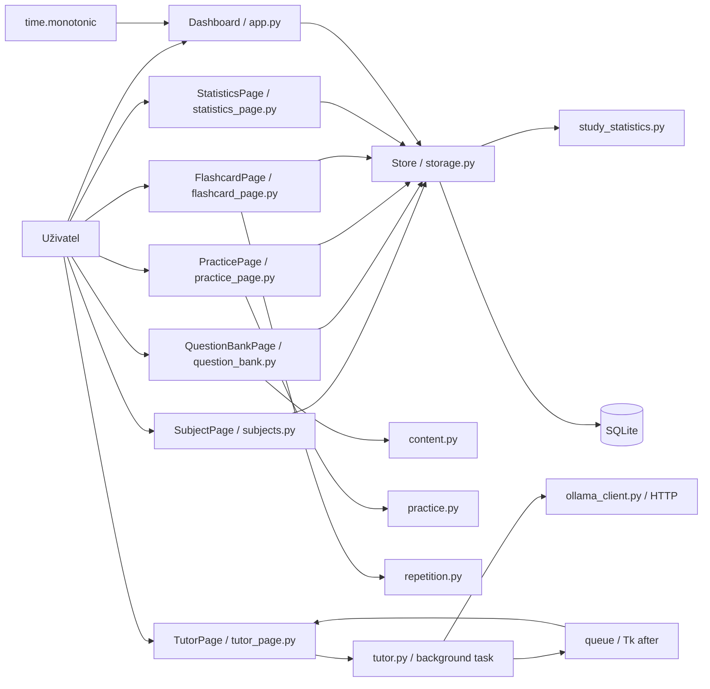

# Současná architektura

[English](../CURRENT_ARCHITECTURE.md) · [Čeština](CURRENT_ARCHITECTURE.md) · [Slovenčina](../sk/CURRENT_ARCHITECTURE.md) · [Русский](../ru/CURRENT_ARCHITECTURE.md)

## v0.30.1

Na základě vyhodnocení se skutečným modelem (`tools/evaluate_ai.py`, záznam v `agents/design/ai-note-generation/EVALUATION.md`) přibyly tyto změny. Generované otázky nyní vracejí `correct_answer` a tři `wrong_answers` a správnou odpověď umístí `note_generation.answer_position`. Poznámky jsou označené jako data a zadání se za nimi opakuje. `note_support` označí návrhy ve stejném jazyce, jejichž odpověď nebyla v poznámkách jasně nalezena; panel je zobrazí nezaškrtnuté s varováním. Ostatní studijní režimy výslovně uvádějí jazyk odpovědi; prompt Explain answer se nemění. Schéma zůstává 10.

## v0.30.0

`note_generation.py` sestavuje prompt s poznámkami, JSON schéma Ollamy a převádí odpovědi na kanonické importní řádky (bez Tk/SQLite). `ai_generation_panel.py` je panel vlastněný Tk, sdílený kartičkami a bankou otázek: explicitní Generovat spustí pracovní vlákno `TutorTask` se strukturovaným `format`, teplotou 0,3, limitem odpovědi 40 000 znaků a limitem 5 minut. Zkontrolovaný výběr se ukládá ve vlákně Tk přes `Store.import_flashcards` / `import_questions`, které pod BEGIN IMMEDIATE znovu ověřují identitu/název cíle a duplicity. Poznámky se nikdy neukládají. Změny preferencí AI a obnovení čekají na nečinný generátor; zavření ruší bez čekání na vlákno. [Návod](AI_NOTE_GENERATION.md). Schéma zůstává 10.

## v0.29.0

`theme.py` přebírá paletu značky Charcoal/Lavender/Violet/Cream; tam, kde bílý text vyžaduje kontrast 4,5:1, používá sytější levandulové výplně, a přibyla nová role `outline`. `build_brand_assets.py` vykresluje logo s kočkou čtoucí knihu. `studio_widgets.py` kreslí ikony souhrnných dlaždic, packu, avatar maskota, scénu banneru a výzdobu postranního panelu lokálně pomocí Pillow; bez sítě, databáze a externích souborů. Banner na Dashboardu uvádí vybraný nebo aktivní uložený předmět; scéna se zobrazuje jen v širokém rozložení. Karta „Přidat předmět“ otevře prázdný formulář a nikdy nenahradí rozpracovaný koncept otevřeného předmětu. Metriky zůstávají stávající skutečné hodnoty. Schéma zůstává 10.

## v0.28.0

Postranní panel používá místní CTkImage; každé okno uchovává vlastní obrázky ikon Tk. Soubory se hledají vůči branding.py i v zabalené aplikaci, bez sítě a databázových operací. Balíček Windows obsahuje grafiku a ICO. ICNS je připraven pro budoucí balíček macOS; spuštění ze zdrojů může v Docku zachovat ikonu Pythonu. Schéma zůstává 10.

## v0.27.0

První fáze studijního prostoru přináší novou kompozici Dashboardu, tmavou navigaci s místními ikonami, souhrnné dlaždice, živé kruhové hodiny, karty předmětů a měsíční přehled uložených termínů. Sdílený Dark/Light vzhled platí v celé aplikaci; kompozice ostatních stránek navážou později. Uživatel schválil sloučení a vydání této fáze. Schéma zůstává 10.

## v0.26.1

Starší editory balíčku/tématu zachovají koncept a atomicky odmítnou konfliktní zápis. Chyba obnovení po uložení balíčku opakuje pouze čtení. Sdílený převod časů opravuje splatnost obnovených kartiček a Statistiky, zachová mikrosekundy i uložené řádky. Obnova vyžaduje schéma 10; bez migrace.

## v0.26.0

Náhledy dokončených otázek nabízejí Vysvětlit jednoduše, Dát nápovědu a Procvičit mě vedle kompatibilního režimu Vysvětlit odpověď. Nápověda vynechá uložené údaje o odpovědi; doplňující otázky využívají běžný nebodovaný chat. Souhlas patří konkrétnímu režimu, příprava i odeslání zůstávají výslovné a test skutečného modelu je odložen. Schéma zůstává 10.

## v0.25.0

Dokončené výsledky nyní nabízejí Vysvětlit tuto otázku: místní náhled uloženého snímku, upravitelný koncept v čistém Tutorovi a výslovné Připojit/Odeslat. Stávající práce je zachována; platí limit 4 000 znaků, historie, Zastavit a opakování uložení. Schéma zůstává 10.

## v0.24.0 — nastavení a společné datové panely

Nastavení seskupuje studijní předvolby a rozhraní vedle sebe v širokém okně a pod sebou v kompaktním; AI má vlastní kartu přes celou šířku. Zpráva pro Uložit/Načíst se zobrazuje u ovládání i v záhlaví. Změna velikosti zachová stejné prvky, koncepty a uložené snímky; ukládání zůstává výslovné a aktivní časovače zachovají původní délku. Plán denních záloh, ruční záloha/obnova a oba importy CSV používají společný vzhled karet, odsazení a zalomené zprávy. Skupiny akcí mají tři sloupce v širokém rozložení, jinak dva. Varování obnovy je nad tlačítkem nevratného potvrzení a Zrušit. Pole náhledu/chyb CSV mají viditelné okraje a vlastní posouvání. Pravidla náhledu, zrušení, atomického zápisu, oddělených procesů, zavření po obnově a bezpečnostní kopie se nemění.

## v0.23.0 — vzhled statistik a AI Tutora

Statistiky seskupují výběr období a Obnovit do záhlaví. Tři souhrnné karty jsou vedle sebe v širokém okně, jinak pod sebou. Aktivita předmětů a dnů zůstává níže s čitelně zalomenými popisky. Změna velikosti zachová existující přehled bez dotazu na databázi; chyba obnovení ponechá předchozí snímek. Definice, vážená úspěšnost a počty vlastních hodnocení se nemění. AI Tutor odděluje ovládání serveru/modelu/jazyka a uložené historie do karet, vedle sebe v širokém okně a pod sebou v kompaktním. Výběr modelu má celý řádek. Vlastník konverzace, přepis, otázka a Odeslat/Zastavit sdílejí ohraničenou plochu pro čtení a psaní. Zpráva o obnově se opakuje u tlačítek opakování, zahození a přerušení, aby bylo potvrzení čitelné po posunu stránky. Navigace a změna velikosti zachovají koncepty, prvky, výběr historie a běžící úlohy. Připojení je výslovné; otevření historie zůstává offline.

## v0.22.0 — vzhled předmětů a banky otázek

Předměty a banka otázek nyní seskupují názvy, počty a akce v záhlaví a označené hledání a filtry na společných plochách. Akce předmětu mají dva řádky; kartičky mají dva sloupce od 950 logických pixelů stránky, jinak jeden. Změna velikosti přeskládá existující kartičky bez dotazu na databázi. Pole odpovědí mají dva sloupce od 850 logických pixelů panelu, jinak jsou pod sebou; náhled správné odpovědi je zvýrazněný pouze v seznamu pro úpravy. Stránkování zůstává po 50 otázkách. Koncepty, původní snímky úprav, filtry, identita témat, kontroly zastaralého stavu a náhled CSV zachovávají dosavadní chování. Vydaná verze zůstává v0.30.1, schéma 10.

## v0.21.0 — nový vzhled opakování kartiček

Opakování kartiček nyní odděluje otázku a odhalenou odpověď do čtecích ploch. Hlavní akcí je odhalení odpovědi; poté ji na stejném místě nahradí hodnocení Again / Hard / Good / Easy, ve čtyřech sloupcích v širokém okně nebo ve dvou v kompaktním. Dlouhý text se zalamuje a k hodnocení lze posunout stránku. Akce balíčku a prázdné stavy používají společné rozvržení. Selhání zápisu zachová odhalenou odpověď pro opakování. Když se hodnocení uloží, ale načtení další kartičky selže, stará hodnocení se vypnou a Obnovit kartičku pouze znovu načte další kartičku; uložené hodnocení se neopakuje. Plánování, historie, rozepsané úpravy a náhled CSV zůstávají zachovány. Vydaná verze zůstává v0.30.1, schéma 10.

**Vydaná verze: v0.30.1 · schéma 10.** Historie testů a testy v kontejneru jsou implementované.

v0.17.0 přidává obnovu soustředění po pádu se schématem **10**. Před otevřením původních dat vytvoř zálohu: migrace je transakční, ale v0.16.0 databázi schématu 10 neotevře. [Obnova soustředění po pádu](FOCUS_RECOVERY.md).

Výběr jazyka rozhraní je dostupný ve v0.13.0: angličtina, čeština, slovenština a ruština. Ukládá se zvlášť od jazyka AI a použije se po restartu. Aktuální schéma je 10.

## Technologie a soubory

Python, CustomTkinter 5.2.2, Pillow a standardní SQLite. Jeden proces a hlavní vlákno Tk; s volitelným Ollama klientem ve vedlejším vlákně. Vstup je `python soskuska/app.py`; instalovatelný balíček zatím není.

| Soubor | Odpovědnost |
| --- | --- |
| `soskuska/app.py` | Dashboard, navigace obrazovek, metriky, časovač, volba databáze a CLI |
| `soskuska/subjects.py` | My Subjects, inline formulář, validace a potvrzení smazání |
| `soskuska/storage.py` | Verze schématu, migrace, CRUD předmětů, úkoly, sezení a přehledy |
| `soskuska/scrolling.py` | Kompatibilita kolečka a trackpadu Tk 9 |
| `tests/test_storage.py`, `tests/test_subjects.py` | Úložiště, kompatibilita původní databáze, migrace a pravidla předmětů |
| `soskuska/check_dashboard.py` | Nativní integrační kontrola s dočasnými daty |
| `soskuska/statistics_page.py` / `soskuska/study_statistics.py` | Obrazovka Statistics a konzistentní agregace uložené historie |
| `soskuska/tutor_page.py`, `soskuska/tutor.py`, `soskuska/ollama_client.py` | Místní historie chatu, fronta úloh a volitelný Ollama klient |
| `soskuska-local/index.html` | Historický vizuální návrh; není součástí běhu aplikace |

## Datový tok



Obrazovky volají `Store` přímo. Samostatná servisní/doménová vrstva a sdílený modul tématu zůstávají plánované. `SubjectPage` využívá stávající stylovací pomocné metody aplikace.

## Schéma a migrace

`PRAGMA user_version` nyní označuje verzi **10**. Otevření původní databáze verze 0 vytvoří/uzná původní tabulky a v jedné transakci doplní předměty a vazby. Databáze s novější verzí se odmítne otevřít místo pokusu o downgrade. Cizí klíče jsou zapnuté pro každé připojení.

```sql
CREATE TABLE tasks (
    day TEXT NOT NULL, name TEXT NOT NULL, done INTEGER NOT NULL,
    PRIMARY KEY (day, name)
);
CREATE TABLE subjects (
    id INTEGER PRIMARY KEY AUTOINCREMENT,
    name TEXT NOT NULL, name_key TEXT NOT NULL UNIQUE,
    description TEXT NOT NULL DEFAULT '', exam_date TEXT,
    created_at TEXT NOT NULL DEFAULT CURRENT_TIMESTAMP,
    updated_at TEXT NOT NULL DEFAULT CURRENT_TIMESTAMP
);
CREATE TABLE sessions (
    id INTEGER PRIMARY KEY, day TEXT NOT NULL,
    seconds INTEGER NOT NULL CHECK(seconds >= 0),
    subject_id INTEGER REFERENCES subjects(id) ON DELETE SET NULL,
    subject_name TEXT
);
CREATE INDEX sessions_subject ON sessions(subject_id);
CREATE TABLE topics (
    id INTEGER PRIMARY KEY AUTOINCREMENT,
    subject_id INTEGER NOT NULL REFERENCES subjects(id) ON DELETE CASCADE,
    name TEXT NOT NULL, name_key TEXT NOT NULL,
    UNIQUE(subject_id, name_key)
);
CREATE TABLE questions (
    id INTEGER PRIMARY KEY AUTOINCREMENT,
    subject_id INTEGER NOT NULL REFERENCES subjects(id) ON DELETE CASCADE,
    topic_id INTEGER REFERENCES topics(id) ON DELETE SET NULL,
    prompt TEXT NOT NULL,
    option_a TEXT NOT NULL, option_b TEXT NOT NULL,
    option_c TEXT NOT NULL, option_d TEXT NOT NULL,
    correct_option INTEGER NOT NULL CHECK(correct_option BETWEEN 0 AND 3),
    difficulty TEXT NOT NULL CHECK(difficulty IN ('Easy','Medium','Hard')),
    explanation TEXT NOT NULL DEFAULT '',
    created_at TEXT NOT NULL DEFAULT CURRENT_TIMESTAMP,
    updated_at TEXT NOT NULL DEFAULT CURRENT_TIMESTAMP
);
CREATE INDEX questions_subject ON questions(subject_id);
CREATE INDEX questions_topic ON questions(topic_id);
```

Staré úkoly a sezení se zachovají. Původní sezení nemají vymyšlený předmět: nové sloupce jsou `NULL`, UI je označí jako Unassigned session. Při smazání předmětu se zachová čas i název předmětu uložený u nového sezení; cizí klíč se nastaví na `NULL`. ID předmětu se znovu nepoužívá.

Název předmětu má 1–120 znaků; mezery se sjednotí, unikátní klíč používá Unicode NFKC a `casefold()`. Popis má nejvýše 1 000 znaků. Datum je volitelné, musí přesně odpovídat platnému `YYYY-MM-DD`. Minulé datum lze uložit, ale nezobrazí se mezi nadcházejícími zkouškami.

## Ukládání a časovač

| Platforma | Výchozí databáze |
| --- | --- |
| macOS | `~/Library/Application Support/SOSkuska/dashboard.sqlite3` |
| Windows | `%LOCALAPPDATA%\SOSkuska\dashboard.sqlite3`; náhradní základ `~/AppData/Local` |
| Linux | `$XDG_DATA_HOME/SOSkuska/dashboard.sqlite3`; náhradní základ `~/.local/share` |

Pokud nová databáze není a existuje původní `ExamPrep/dashboard.sqlite3`, použije se původní soubor bez přesunu nebo přepisu. `--data` má přednost. Data se nešifrují ani automaticky nesynchronizují. Zápisy běží na hlavním vlákně.

Časovač vyžaduje existující předmět. Po dobu sezení drží jeho ID a kopii názvu; přejmenování nemění historii. Má nastavitelný limit 1–180 minut (výchozí 15), měření přes `time.monotonic()`, aktualizaci přes `after(250, tick)`, pauzu a dokončení. Mazání aktivního předmětu UI zablokuje do dokončení sezení. Finish, dosažení limitu a běžné zavření ukládají čas. Při chybě zápisu se sezení pozastaví a lze zkusit Finish znovu; okno se nezavře s neuloženým sezením.

Start Studying nejprve vytvoří rozpracovaný záznam. Aplikace ukládá celé uplynulé sekundy přibližně každých pět sekund a ihned při Pause. Zachová původní název předmětu, cíl a ověřený čas; hodnotu monotónních hodin mezi procesy nepřenáší. Po pádu nebo vynuceném ukončení Dashboard nabídne Recover paused, Discard checkpoint a Refresh (popisky se překládají podle jazyka rozhraní). Obnova začíná pozastavená, zachová původní cíl i po změně Settings a nepočítá dobu zavření jako studium. Resume pokračuje; Finish uloží čas. Rozpracovaný čas není ve Statistics. Zahození vyžaduje druhé potvrzení a nepřidává historii. Navigace, Escape, Refresh a Recover potvrzení ruší. Chyba čtení vypne zastaralé akce do úspěšného Refresh. [Obnova soustředění po pádu](FOCUS_RECOVERY.md).

## Skutečný Dashboard

Pevné vzorové předměty, procenta, profil, termíny i základy 24 h 35 min / 45 min byly odstraněné. Nová databáze je prázdná. Metriky jsou celkový čas, počet uložených sezení, série studijních dní a počet předmětů. Série může končit dnes nebo včera; starší přerušená série ukáže nulu. Cíl je nastavitelný (výchozí 60 minut denně); karta ukazuje uložené minuty, bar má přesnost na sekundy.

Karty ukazují počet sezení a uložený čas předmětu, ne smyšlený učební pokrok. Zkoušky pocházejí z uložených termínů, nedávná aktivita z posledních uložených sezení. Neexistující data mají prázdné stavy. Nastavení je implementované; AI Tutor má volitelný chat; Statistics má vlastní obrazovku.

## Rozložení a ovládání

1440 × 900 / 1024 × 700. **v0.19.0, redesign, krok 2:** Today’s Study sdružuje výběr předmětu, Start Studying, časovač/obnovu/opakování zápisu, denní pokrok a checklist. Následují předměty a označené hledání; souhrn metrik je pod sloupci. Hranice viditelné plochy je 1100 logických CTk pixelů bez posuvníku: zkoušky/poslední sezení jsou vedle v širokém režimu a pod obsahem v kompaktním; Dashboard má dva/jeden sloupec předmětů. Sidebar zůstává 230 logických pixelů, sbalený 72. My Subjects nyní používá vlastní hranici 950 logických pixelů stránky. Dlouhá jména se zalamují; prázdný prostor nabízí vytvoření prvního předmětu. Meze se ověřují při počátečním měřítku 100/150 % ve všech čtyřech jazycích; nativní/živé DPI kontroly jsou oddělené.

Obrazovky mají nezávislé vyhledávání přes `casefold()`. Ctrl+K / Cmd+K zaměří hledání aktivní obrazovky; Escape vymaže dotaz. Formuláře pro nový/upravený předmět i potvrzení smazání jsou inline. Podpora `TouchpadScroll`, kolečka a staršího Linux/X11 zůstává v adaptéru využívajícím privátní členy CustomTkinteru; při upgradu jej znovu ověřit.

## Ověření a zbývající omezení

188 testů úložiště prošlo; integrační skript prošel na macOS s Pythonem 3.12.13 / Tk 9.0 a dočasnou databází. Ověřil CRUD přes formulář, Unicode, hledání, prázdné stavy, navázání časovače, zachování historie, opětovné otevření, kompaktní režim a syntetické posouvání. Nenahrazuje ruční vizuální/hardwarové ověření; Windows/Linux nejsou ověřené.

Zbývají úplná obnova po pádu, balíčky a komplexní logování. První databázové operace mají chybová hlášení, ale úplné zpracování chyb při každém čtení ještě chybí.


Verze schématu se čte až po získání `BEGIN IMMEDIATE`, aby souběžné starty nepoužily zastaralou hodnotu. Rozložení My Subjects zpracovává skutečné Configure události CustomTkinteru; integrační kontrola ověřuje dva sloupce ve velkém okně a jeden v kompaktním.

## Banka témat a otázek

`soskuska/question_bank.py` obsahuje obrazovku QuestionBankPage; `soskuska/content.py` čistou validaci bez Tk. Obrazovka volá Store přímo. Schéma 3 přidává topics a questions; stávající tabulky ve výpisu výše zůstávají. Migrace 0/1/2 → 3 probíhá v jedné transakci a zachová předměty, úkoly i sezení.

Název tématu je jedinečný v rámci předmětu (1–120 znaků, normalizace mezer, NFKC/casefold). Otázka má text 1–2000 znaků, přesně čtyři různé odpovědi po normalizaci (1–500 znaků), correct_option 0–3, povinnou obtížnost a vysvětlení do 2000 znaků. Vazba na téma je volitelná; API a SQL triggery při zápisu otázky odmítají téma jiného předmětu. Indexy pokrývají subject_id a topic_id otázek. Témata ani otázky nelze přes UI přesouvat mezi předměty.

V My Subjects zvol u předmětu **Questions**. Přidej téma přes New topic a otázku přes New question. Každá otázka má čtyři různé povinné odpovědi A–D, právě jednu správnou odpověď, obtížnost Easy/Medium/Hard a volitelné vysvětlení. Téma je volitelné. Formulář zachová rozepsaný obsah při chybě validace nebo zápisu.

Témata lze přejmenovat a smazat; vyber téma ve filtru a použij Rename selected topic nebo Delete selected topic. Otázky lze upravovat a mazat. Hledání v textu otázky se kombinuje s filtrem tématu a obtížnosti. Počty na kartách předmětů vycházejí z uloženého obsahu. Smazání tématu ponechá jeho otázky v No topic. Smazání předmětu po výslovném upozornění odstraní jeho témata a otázky, ale zachová čas i historii studia.

Jde o editor obsahu: správná odpověď je viditelná. Procvičování a hodnocení najdeš v Practice Tests. Import otázek z CSV je dostupný; obrázky zatím nejsou implementované.

## Opravy po kontrole hlavní větve

Zavření okna i příkaz Quit v nabídce macOS používají stejné uložení sezení. Pokud uložení selže, aplikace zůstane otevřená se zachovaným pozastaveným časem; po odstranění problému lze zkusit Finish nebo Quit znovu.

Opuštění obrazovky My Subjects zruší rozpracované potvrzení smazání předmětu. Před smazáním se v jedné transakci porovná aktuální název a počty témat/otázek s posledním zobrazeným upozorněním. Pokud se změnily, aplikace nejprve zobrazí aktualizované upozornění a vyžádá nové potvrzení.

Při změně dne se aktualizuje i datum v záhlaví. Chyba čtení při obnově checklistu nebo přehledu nezastaví plánování časovače; obnova se opakuje a nový den se potvrdí až po úspěchu. Posouvání uvnitř dlouhého textového pole zůstává v tomto poli, včetně jeho krajů; stránku posuneš nad jinou částí okna. Krátké pole bez vlastního posuvu dál umožňuje posouvání stránky.

Pokud se sezení uložilo, ale následné načtení přehledu selže, aplikace opakuje pouze načtení i během stejného dne; záznam sezení znovu neukládá. Po úspěchu obnoví metriky i výběr předmětu a odstraní oznámení o opakování. Pokud se naopak sezení neuložilo, pokyn Press Finish zůstane viditelný i při chybě či úspěšné obnově denního přehledu. Gesta trackpadu nad posuvníkem a okrajem dlouhého editoru se předají jeho textovému poli.

## Practice Tests — procvičování (v0.4.0)

`practice_page.py` obsahuje obrazovku a vlastní neblokující Tk callback; `practice.py` čistou validaci a UTC časová pravidla. Schéma 4 přidává practice_attempts a practice_items v transakční migraci z verze 3 i starších verzí. Rozpracovaný pokus je v databázi nejvýše jeden (částečný unikátní index). Start, změny odpovědí, pozice a dokončení používají transakce; po termínu nelze odpověď uložit. Dokončení je idempotentní, takže opakování po chybě čtení výsledku nepřidá druhý výsledek. Chyba zápisu odpovědi vrátí výběr na poslední uloženou hodnotu.

practice_items ukládá text, všechny čtyři možnosti, správnou odpověď, obtížnost, název tématu a vysvětlení jako kopie. Odkazy na původní předmět/otázku používají ON DELETE SET NULL. Mazání předmětu ponechá dokončené i rozpracované pokusy; zahodit lze jen rozpracovaný pokus a jeho položky se smažou kaskádou. Časové údaje jsou UTC ISO 8601, v UI se dokončení převádí do místního času. Skóre se počítá ze snímků: každá otázka má stejnou váhu, bez penalizace, nevyplněná odpověď má nulu. Časový limit používá systémové UTC hodiny; ruční změna času může změnit zbývající dobu. Ctrl+K / Cmd+K a Escape na obrazovce testů nemění skryté hledání jiné obrazovky.

```sql
CREATE TABLE practice_attempts (
                    id INTEGER PRIMARY KEY AUTOINCREMENT,
                    subject_id INTEGER REFERENCES subjects(id) ON DELETE SET NULL,
                    subject_name TEXT NOT NULL,
                    topic_name TEXT NOT NULL, difficulty TEXT,
                    status TEXT NOT NULL DEFAULT 'in_progress' CHECK(status IN ('in_progress','completed')),
                    question_count INTEGER NOT NULL CHECK(question_count BETWEEN 1 AND 100),
                    current_index INTEGER NOT NULL DEFAULT 0 CHECK(current_index >= 0 AND current_index < question_count),
                    time_limit_minutes INTEGER CHECK(time_limit_minutes BETWEEN 1 AND 180),
                    started_at TEXT NOT NULL, deadline_at TEXT, completed_at TEXT);
CREATE TABLE practice_items (
                    attempt_id INTEGER NOT NULL REFERENCES practice_attempts(id) ON DELETE CASCADE,
                    position INTEGER NOT NULL CHECK(position >= 0),
                    question_id INTEGER REFERENCES questions(id) ON DELETE SET NULL,
                    prompt TEXT NOT NULL, option_a TEXT NOT NULL, option_b TEXT NOT NULL,
                    option_c TEXT NOT NULL, option_d TEXT NOT NULL,
                    correct_option INTEGER NOT NULL CHECK(correct_option BETWEEN 0 AND 3),
                    selected_option INTEGER CHECK(selected_option BETWEEN 0 AND 3),
                    explanation TEXT NOT NULL, difficulty TEXT NOT NULL, topic_name TEXT,
                    PRIMARY KEY(attempt_id, position));
CREATE INDEX practice_items_question ON practice_items(question_id);
CREATE UNIQUE INDEX practice_one_active
                    ON practice_attempts(status) WHERE status='in_progress';
```

## Průběžná integrace (CI)

GitHub Actions kontroluje pull requesty do main, nové commity na main a ruční spuštění. Workflow `.github/workflows/ci.yml` instaluje závislosti, ověřuje jejich kompatibilitu, syntaxi Pythonu a všechny jednotkové testy s Pythonem 3.12 na Ubuntu, Windows a macOS. Samostatná úloha spouští čtrnáct nativních kontrolních skriptů na Ubuntu pod virtuálním displejem Xvfb; každý proces má limit 60 sekund. Celá úloha má limit 10 minut. Novější běh stejné větve zruší předchozí. Token má pouze čtení obsahu; workflow nic nenasazuje ani nevydává.

Výsledky a logy jsou v [Actions](https://github.com/turcinv/SOSkuska/actions/workflows/ci.yml) a v kontrolách PR. Červený stav otevři a přečti první neúspěšný krok. Po opravě pushni do stejné větve a kontroly se spustí znovu. Ruční spuštění Run workflow je dostupné po sloučení workflow do výchozí větve. Branch protection tímto není zapnutá.

Automatické testy nejsou ruční ověření Windows/macOS/Linux ani fyzického trackpadu. Linuxový CI běh neověřuje nativní nabídku Quit v macOS ani Tk 9 gesta; ty je potřeba dál kontrolovat na Macu.

## Kartičky a opakování (v0.5.0)

`flashcard_page.py` obsahuje obrazovku, `repetition.py` čistou validaci a pravidla. Schéma 5 přidává decks, flashcards a review_events. Termín a interval jsou přímo u kartičky. Zápis hodnocení, snímku obou stran a dalšího termínu je jedna transakce; kontrola revize i splatnosti probíhá pod zápisovým zámkem. Opakované hodnocení stejné revize nevytvoří další záznam. Odkazy z historie mají ON DELETE SET NULL, kopie obsahu zůstávají. Balíčky mají k předmětu ON DELETE SET NULL, kartičky k balíčku ON DELETE CASCADE. Migrace z verze 4 a starších zachová existující data a výsledky testů.

[Podrobný návod a pravidla](FLASHCARDS.md).

```sql
CREATE TABLE decks (
                    id INTEGER PRIMARY KEY AUTOINCREMENT,
                    subject_id INTEGER REFERENCES subjects(id) ON DELETE SET NULL,
                    subject_name TEXT NOT NULL, name TEXT NOT NULL,
                    name_key TEXT NOT NULL UNIQUE, description TEXT NOT NULL DEFAULT '');
CREATE TABLE flashcards (
                    id INTEGER PRIMARY KEY AUTOINCREMENT,
                    deck_id INTEGER NOT NULL REFERENCES decks(id) ON DELETE CASCADE,
                    front TEXT NOT NULL, back TEXT NOT NULL, due_at TEXT NOT NULL,
                    interval_days INTEGER NOT NULL DEFAULT 0 CHECK(interval_days BETWEEN 0 AND 365),
                    revision INTEGER NOT NULL DEFAULT 0 CHECK(revision >= 0),
                    review_count INTEGER NOT NULL DEFAULT 0 CHECK(review_count >= 0));
CREATE TABLE review_events (
                    id INTEGER PRIMARY KEY AUTOINCREMENT,
                    card_id INTEGER REFERENCES flashcards(id) ON DELETE SET NULL,
                    deck_id INTEGER REFERENCES decks(id) ON DELETE SET NULL,
                    card_revision INTEGER NOT NULL,
                    deck_name TEXT NOT NULL, subject_name TEXT NOT NULL,
                    front TEXT NOT NULL, back TEXT NOT NULL,
                    rating TEXT NOT NULL CHECK(rating IN ('Again','Hard','Good','Easy')),
                    reviewed_at TEXT NOT NULL, previous_due_at TEXT NOT NULL,
                    due_at TEXT NOT NULL, interval_days INTEGER NOT NULL,
                    UNIQUE(card_id,card_revision));
CREATE INDEX flashcards_due ON flashcards(deck_id,due_at,id);
CREATE INDEX review_events_deck ON review_events(deck_id,id);
```

## Statistiky (v0.6.0)

StatisticsPage volá Store.statistics(); study_statistics.py čte sessions, dokončené practice_attempts s practice_items a review_events v jedné konzistentní čtecí transakci. Nemění strukturu databáze ani data. UI se obnovuje při návratu nebo přes Refresh, při chybě ponechá předchozí report. Vazby Configure mají životnost svých widgetů. Ctrl+K / Cmd+K a Escape nemění hledání skrytých obrazovek.

[Podrobná pravidla](STATISTICS.md).

## Opravy souběžných změn (v0.6.2)

Discard test získá zápisový zámek a potom ověří termín. Pokud mezitím vypršel, pokus i odpovědi se zachovají jako dokončený výsledek místo smazání; selhání zápisu ponechá původní data pro opakování. Pokud jiná instance rozpracovaný test odstraní, Finish zastaví opakování a obnoví nastavení. Chyby SQLite se dál dají opakovat; po chybě načtení nastavení použij Refresh subjects nebo návrat na obrazovku.

Editor otázek ukládá kopii původního obsahu. Při uložení ji porovná s aktuální otázkou pod zápisovým zámkem. Novější text, možnosti, správná odpověď, obtížnost, téma nebo vysvětlení se nepřepíšou starým formulářem. Při konfliktu zůstane rozepsaný obsah; před opětovným otevřením Edit si jej zkopíruj a změny spoj s aktuální verzí. Tato oprava nepřidává migraci; aktuální schéma je 10.

Formulář New deck obnoví nabídku předmětů při návratu, přes Refresh i před uložením, bez ztráty názvu a popisu. Přejmenovaný předmět zůstane vybraný podle ID. Pokud byl vybraný předmět smazán, Choose a subject vyžaduje výslovně zvolit jiný; formulář jej sám nenahradí jiným existujícím předmětem.

## AI Tutor s Ollamou (v0.7.0)

tutor_page.py drží místní chat a widgety. tutor.py sestavuje omezený kontext a spouští daemon pracovní vlákno; výsledky předává přes queue, zpracovanou Tk after každých 50 ms. ollama_client.py používá standardní http.client/ssl, GET /api/tags a streamované POST /api/chat. Pracovní vlákna nevolají Tk ani SQLite. Ukončení přeruší síťový úkol bez čekání v UI; neúspěšné uložení focus sezení dál brání zavření. Historie používá schéma 7 bez nové externí závislosti.

[Návod AI Tutor](AI_TUTOR.md).

## Nastavení

Konverzace se ukládají do místní databáze a záloh. Volby spojení lze výslovně uložit v [Settings](SETTINGS.md); bez Save jsou dočasné.

[Nastavení](SETTINGS.md).

Nastavení se ukládá transakčně ve schématu 6 s ochranou před přepsáním změn jiného okna. Migrace z verze 5 zachová všechny předchozí tabulky i data; starší aplikace novější schéma odmítne otevřít.

`settings_page.py` → `preferences.py` / `Store.preferences()` / `Store.save_preferences()`. `revision` + `BEGIN IMMEDIATE`.

```sql
CREATE TABLE preferences (
                    id INTEGER PRIMARY KEY CHECK(id=1),
                    focus_minutes INTEGER NOT NULL CHECK(focus_minutes BETWEEN 1 AND 180),
                    daily_goal_minutes INTEGER NOT NULL CHECK(daily_goal_minutes BETWEEN 1 AND 1440),
                    ollama_endpoint TEXT NOT NULL, ollama_model TEXT NOT NULL,
                    answer_language TEXT NOT NULL,
                    revision INTEGER NOT NULL DEFAULT 0 CHECK(revision>=0), ui_language TEXT NOT NULL DEFAULT 'English' CHECK(ui_language IN ('English','Czech','Slovak','Russian')), appearance_mode TEXT NOT NULL DEFAULT 'Dark' CHECK(appearance_mode IN ('Light','Dark','System')));
```

## Záloha a obnova

Settings nyní nabízí ruční místní zálohu a ověřenou obnovu s bezpečnostní kopií před nahrazením. Aktuální schéma je 10. Obnova zavře aplikaci; potom ji spusť znovu. Viz [Záloha a obnova](BACKUP_RESTORE.md).

backup.py a backup_validation.py ověřují soukromé samostatné snímky a aplikační hodnoty; řádky nahrazují v jedné transakci bez převzetí cizího DDL. database_lock.py drží sdílené zámky Store a výhradní zámek obnovy (flock / Windows LockFileEx). backup_worker.py běží v odděleném procesu; backup_panel.py přes Tk čte dočasný výstupní soubor, takže nehrozí plná roura ani finalizace Tk z pracovního vlákna. Při obnově se Store zavře a periodické callbacky pozastaví. Bezpečnostní kopie vznikne pod zápisovým zámkem; před commitem se ověří konečné řádky a ID sekvence.

## Import otázek z CSV

Banka otázek nyní podporuje import UTF-8 CSV do existujícího předmětu: šablona s hlavičkou, stránkovaný náhled, odmítnutí přesných duplicit a jedno atomické uložení. Maximum 2 MiB / 500 záznamů; seznam ukazuje 50 otázek na stránku. Aktuální schéma je 10. [Import otázek z CSV](QUESTION_CSV_IMPORT.md).

csv_import.py ověřuje omezené normalizované záznamy; csv_import_worker.py izoluje parsování, kontrolu pouze pro čtení, uložení a šablonu s výstupem do souboru. Store.open_existing používá mode=ro/rw bez vytváření či migrace. Store.import_questions znovu ověří dávku pod BEGIN IMMEDIATE a uloží témata/otázky jednou transakcí. Úspěšná dávka se zneplatní před čtením přehledů; opakovaná obnova nic neimportuje. Stránkování filtruje celý seznam a pak vykreslí 50 karet.

## Import kartiček z CSV

Flashcards nyní podporuje import UTF-8 CSV do existujícího balíčku: šablonu s hlavičkou, stránkovaný náhled, odmítnutí přesných duplicit a jedno atomické uložení. Maximum 2 MiB / 500 záznamů. Nové kartičky jsou ihned splatné; původní termíny a historie hodnocení zůstávají zachované. Aktuální schéma je 10. [Import kartiček z CSV](FLASHCARD_CSV_IMPORT.md).

`flashcard_csv_import.py` validuje omezené záznamy front/back; `flashcard_csv_import_worker.py` izoluje čtení, kontrolu pouze pro čtení a uložení. `CsvImportPanel` sdílí životní cyklus a publikaci šablon s importem otázek. `Store.import_flashcards` pod BEGIN IMMEDIATE znovu ověří zobrazený název balíčku a duplicity v celém balíčku a vloží všechny kartičky jednou s aktuálním UTC termínem. Původní termíny a hodnocení nemění.

## Uložené konverzace AI Tutor

AI Tutor nyní ukládá konverzace lokálně včetně původního serveru/modelu a stavu odpovědi. Historii lze otevřít bez sítě, výslovně se připojit pro pokračování nebo vybranou konverzaci po potvrzení smazat. Vydáno ve v0.12.0 se schématem 7, které transakčně migruje původní studijní data. [Uložené konverzace AI Tutor](TUTOR_HISTORY.md).

## Jazyk rozhraní

Výběr jazyka rozhraní je dostupný ve v0.13.0: angličtina, čeština, slovenština a ruština. Ukládá se zvlášť od jazyka AI a použije se po restartu. Aktuální schéma je 10. [Jazyk rozhraní](UI_LANGUAGES.md).

## Historie testů

Historie testů nyní nabízí všechny dokončené pokusy po 20 na stránku, filtr uloženého názvu předmětu a místních dat včetně obou hranic a otevření uloženého rozboru odpovědí. Koncepty filtrů a použitá stránka přežijí navigaci; chyba čtení zachová předchozí výsledky. Schéma zůstává 8. [Historie testů](PRACTICE_HISTORY.md).

## Přenosná verze Windows a přejímka

v0.15.0 přidává nepodepsaný přenosný ZIP pro Windows x64, sestavený a ověřený pátou úlohou CI. Přibalený pomocný program zachová oddělené CSV/zálohovací procesy; cílový počítač nepotřebuje Python. Automatické hostované kontroly a ruční seznam pro čistý počítač jsou oddělené; ruční přejímka zatím není dokončená. Vydaná verze je v0.18.1, schéma 10. [Přenosná verze Windows a přejímka](WINDOWS_PORTABLE.md) · [Kontrolní seznam](WINDOWS_ACCEPTANCE.md).

## Nastavení vzhledu

v0.16.0 přidává uložené Light/Dark/System, použité po Save bez obnovy obrazovek a ztráty aktivní práce. System sleduje Windows/macOS, na Linuxu používá Light. Aktuální schéma je 10. Uživatel 22. listopadu 2026 potvrdil dokončení testování základu a schválil sloučení PR #32. [Nastavení vzhledu](APPEARANCE.md).

## Obnova soustředění po pádu

v0.17.0 přidává obnovu soustředění po pádu se schématem **10**. Před otevřením původních dat vytvoř zálohu: migrace je transakční, ale v0.16.0 databázi schématu 10 neotevře. [Obnova soustředění po pádu](FOCUS_RECOVERY.md).

`focus_runs`: `id`, `subject_id`, `subject_name`, `target_seconds`, `elapsed_seconds`, `status` (pending/completed/discarded), `revision`, `started_at`, `updated_at`, `completed_at`, `session_id`. Dokončení vloží studijní relaci a označí kontrolní bod v jedné transakci; opakování nevytvoří druhou relaci. Nula sekund nepřidá statistiku. Čas patří místnímu dni dokončení, i po obnově; přes půlnoc se nedělí. Přejmenování/smazání předmětu zachová původní historický název; smazání odstraní jen živý odkaz.

## Plánované místní zálohy

Plánované místní zálohy jsou dostupné ve **v0.18.0**. Schéma SQLite zůstává **10**. Ruční záloha a obnova fungují samostatně. [Plánované místní zálohy](SCHEDULED_BACKUPS.md).

## Opravy po revizi hlavní větve

Opravy vydané ve v0.18.1 přes PR #38 sleduje [záznam revize Astra](REVIEW_FINDINGS.md). Schéma zůstává 10 a vydaná verze je v0.30.1. Úpravy předmětu porovnají původní obsah pod zápisovým zámkem; konflikt zachová koncept. Před opětovným otevřením úprav pro načtení nejnovější verze si potřebné změny zkopíruj. Smazání otázky/tématu porovná zobrazený obsah a po změně vyžaduje nové potvrzení. Návrat ke stejnému předmětu zachová editor otázky/tématu, filtry i původní identitu, také při opakování čtení; smazané vybrané téma zůstane nedostupné, dokud výslovně nevybereš jiné téma nebo možnost Bez tématu. Jiný předmět editor stále resetuje. Novější potvrzení úspěšné denní zálohy odstraní staré oznámení chyby bez dalšího zápisu zálohy.

## v0.20.0 — redesign testů, krok 3

Běžící test sdružuje postup/čas v záhlaví a ukazuje počet uložených odpovědí lištou. Řádky A–D přes celou šířku zvýrazní uložený výběr, nikoli správnost; kliknutí na pozadí/text používá původní ukládání. Previous/Next/Clear a Finish sdílejí patičku. Nastavení je ve společné kartě, výsledky/historie mají sjednocené plochy. Chyba zápisu vrátí výběr/vzhled; skryté odpovědi při nastavení či jiné stránce nezapisují. Dlouhý obsah se zalamuje a posouvá. Skóre, termíny, potvrzení, pokračování, filtry a snímky zůstávají; aktuální schéma je 10.


## Vysvětlení otázek · v0.25.0

Dokončené výsledky Practice včetně historie nabízejí **Vysvětlit tuto otázku**. Otevřete místní náhled a zvolte **Připravit v Tutorovi**. Použije se uložený snímek otázky, čtyři možnosti, vaše odpověď nebo Unanswered, uložený klíč a vysvětlení, i po smazání původního obsahu. Náhled ani příprava nic nepřipojují a neodesílají. V Tutorovi zkontrolujte server, model a jazyk, podle potřeby výslovně použijte Connect a poté Send. Upravitelný koncept využívá běžnou místní historii, Stop a opakování uložení.

Tutor musí být nečinný, v čistém New chat s prázdným dotazem a bez čekajícího potvrzení či neuložené odpovědi. Stávající práce zůstává zachována; dokončete ji nebo výslovně potvrďte New chat a opakujte akci. Celý dotaz přes 4 000 znaků je odmítnut s uvedením délky, bez zkracování. Klíč i AI se mohou mýlit; skóre ani zdrojová data se nemění. Automatic požaduje jazyk dodané otázky; výslovná volba jazyka má přednost. Pokyny dotazu jsou anglicky, obsah uživatele se nemění. Schéma zůstává 10 a vydaná verze je v0.30.1.

Implementace: `question_explanation.py` sestavuje omezený dotaz ze snímku, `practice_page.py` řídí náhled a kontrolu aktuálního výsledku, `tutor_page.py` chrání vložení konceptu. Send uloží dotaz před HTTP. Automatické testy používají dočasná data a místní FakeOllama; kvalita modelu a nativní ověření platformy/DPI zůstávají ruční.


## Studijní režimy AI · v0.26.0

V dokončeném výsledku otevřete **Vysvětlit tuto otázku** a před **Připravit v Tutorovi** vyberte **Studijní režim**. **Vysvětlit odpověď** zachová dosavadní vysvětlení; **Vysvětlit jednoduše** požaduje krátké kroky pro začátečníka a příklad; **Dát nápovědu** požaduje jednu pojmovou nápovědu a z dotazu vynechá vaši odpověď, uložený klíč i vysvětlení; **Procvičit mě** klade jednu novou doplňující otázku a před zpětnou vazbou čeká na odpověď. Jde o neformální procvičování bez zápisu bodovaného testu nebo změny zdrojů.

Změna režimu obnoví přesný místní náhled a zneplatní jeho předchozí akci přípravy. Připojení, odeslání a vytvoření konverzace vyžadují stávající výslovné ovládání. Odeslaný dotaz se ukládá do běžné místní historie; platí dosavadní jazyk, limit 4 000 znaků, ochrana čistého chatu, Zastavit a opakování uložení. Nápověda stále obsahuje čtyři možnosti: model může odpověď odvodit či prozradit a již zobrazené výsledky zůstávají viditelné. Kvalita a dodržení režimu vyžadují pozdější test skutečného modelu, který uživatel výslovně odložil. Automatické testy používají místní FakeOllama. Vydaná verze je v0.30.1, schéma 10.


## Opravy po revizi Astra · v0.26.1

Editory balíčku a tématu nyní porovnávají původní upravovaný snímek pod zápisovým zámkem. Konflikt zachová koncept a zobrazí upozornění; před opětovným otevřením úpravy balíčku nebo přejmenování tématu zkopírujte potřebné změny. Varování balíčku je také u Uložit. Po potvrzeném uložení balíčku změní chyba načtení tlačítko na Obnovit balíček a opakuje jen čtení, nikoli zápis.

Počty, seřazené fronty, hodnocení a kontroly opakování kartiček porovnávají skutečné časové okamžiky včetně obnovených posunů a mikrosekund. Statistiky a historie sdílejí převod povolených časů ISO na místní den, včetně posunů se sekundami. Uložené časy se nepřepisují. Přesné celočíselné klíče UTC pokrývají celý přijatý rozsah; pokud systém nezvládne místní převod krajního data, použije se den UTC omezený na podporovaný kalendář. Obnova vyžaduje samostatnou zálohu schématu 10; popis migrací zůstává historický. Vydaná verze je v0.30.1, schéma 10. Test skutečného modelu zůstává odložený.


## Nový studijní prostor · v0.27.0

Nová kompozice Dashboardu nahrazuje předchozí postupné úpravy: čtyři souhrnné dlaždice, výrazná část soustředění s živými kruhovými hodinami, karty předmětů s monogramy a měsíční přehled uložených termínů. Postranní panel používá místně kreslené ikony a vlastní tmavé barvy; sdílené plochy a párový Dark/Light vzhled se mění v celé aplikaci. Tato fáze zavádí Dashboard a společný rámec; ostatní stránky navážou po vizuální zpětné vazbě. [Ukázky a rozsah](../agents/design/study-studio-dashboard/README.md).

Hodiny ukazují skutečný zbývající čas a původní cíl aktivního sezení. Kalendář používá úplný snímek předmětů; nejbližší zkoušky zachovají přesná data a limit pěti položek. Klávesové hledání, chyba uložení a obnova soustředění posunou ovládání do viditelné části kompaktního okna; čekající posun zruší navigace či hledání. Změna rozložení nečte data. Schéma zůstává 10, vydaná verze v0.30.1. Kontejnerové a simulované měřítko neověřují nativní platformu; test skutečného modelu zůstává odložený.
