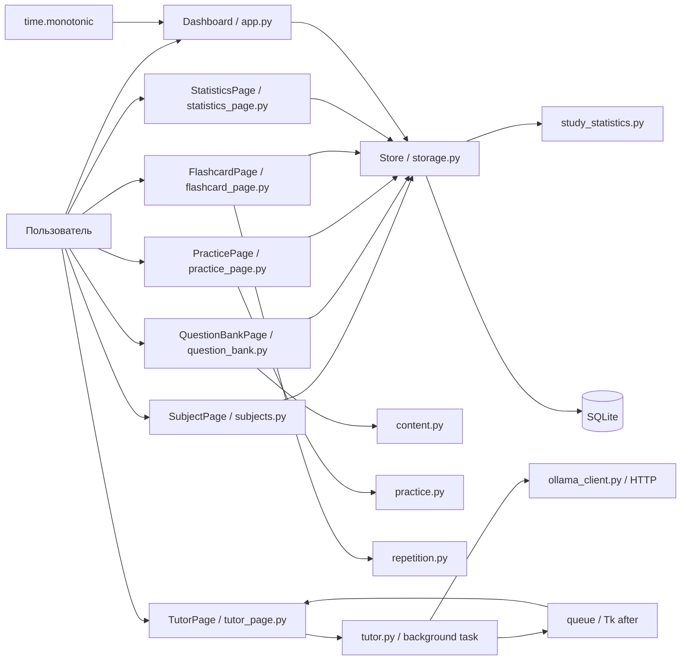

# Текущая архитектура

[English](../CURRENT_ARCHITECTURE.md) · [Čeština](../cs/CURRENT_ARCHITECTURE.md) · [Slovenčina](../sk/CURRENT_ARCHITECTURE.md) · [Русский](CURRENT_ARCHITECTURE.md)

**Опубликованная версия: v0.16.0 · схема 9.** История тестов и тесты в контейнере реализованы.

Выбор языка интерфейса доступен в v0.13.0: английский, чешский, словацкий и русский. Выбор сохраняется отдельно от языка AI и применяется после перезапуска. Текущая схема — 9.

## Технологии и файлы

Python, CustomTkinter 5.2.2, Pillow и стандартная SQLite. Один процесс и главный поток Tk; с необязательным клиентом Ollama в отдельном потоке. Точка входа — `python soskuska/app.py`; устанавливаемого пакета пока нет.

| Файл | Назначение |
| --- | --- |
| `soskuska/app.py` | Dashboard, навигация экранов, метрики, таймер, выбор базы и CLI |
| `soskuska/subjects.py` | My Subjects, встроенная форма, валидация и подтверждение удаления |
| `soskuska/storage.py` | Версия схемы, миграции, CRUD предметов, задачи, занятия и сводки |
| `soskuska/scrolling.py` | Совместимость колеса и трекпада Tk 9 |
| `tests/test_storage.py`, `tests/test_subjects.py` | Хранилище, совместимость прежней базы, миграции и правила предметов |
| `soskuska/check_dashboard.py` | Нативная интеграционная проверка с временными данными |
| `soskuska/statistics_page.py` / `soskuska/study_statistics.py` | Экран Statistics и согласованные агрегации сохранённой истории |
| `soskuska/tutor_page.py`, `soskuska/tutor.py`, `soskuska/ollama_client.py` | Локальная история, очередь задач и необязательный клиент Ollama |
| `soskuska-local/index.html` | Исторический визуальный макет; не участвует в работе приложения |

## Поток данных



Экраны напрямую вызывают `Store`. Отдельные сервисный/предметный слои и общий модуль темы пока запланированы. `SubjectPage` использует существующие вспомогательные методы приложения для оформления.

## Схема и миграции

`PRAGMA user_version` теперь обозначает версию **9**. Открытие прежней базы версии 0 создаёт/распознаёт прежние таблицы и в одной транзакции добавляет предметы и связи. База более новой версии не открывается вместо попытки понижения версии. Внешние ключи включены для каждого соединения.

```sql
CREATE TABLE tasks (
    day TEXT NOT NULL, name TEXT NOT NULL, done INTEGER NOT NULL,
    PRIMARY KEY (day, name)
);
CREATE TABLE subjects (
    id INTEGER PRIMARY KEY AUTOINCREMENT,
    name TEXT NOT NULL, name_key TEXT NOT NULL UNIQUE,
    description TEXT NOT NULL DEFAULT '', exam_date TEXT,
    created_at TEXT NOT NULL DEFAULT CURRENT_TIMESTAMP,
    updated_at TEXT NOT NULL DEFAULT CURRENT_TIMESTAMP
);
CREATE TABLE sessions (
    id INTEGER PRIMARY KEY, day TEXT NOT NULL,
    seconds INTEGER NOT NULL CHECK(seconds >= 0),
    subject_id INTEGER REFERENCES subjects(id) ON DELETE SET NULL,
    subject_name TEXT
);
CREATE INDEX sessions_subject ON sessions(subject_id);
CREATE TABLE topics (
    id INTEGER PRIMARY KEY AUTOINCREMENT,
    subject_id INTEGER NOT NULL REFERENCES subjects(id) ON DELETE CASCADE,
    name TEXT NOT NULL, name_key TEXT NOT NULL,
    UNIQUE(subject_id, name_key)
);
CREATE TABLE questions (
    id INTEGER PRIMARY KEY AUTOINCREMENT,
    subject_id INTEGER NOT NULL REFERENCES subjects(id) ON DELETE CASCADE,
    topic_id INTEGER REFERENCES topics(id) ON DELETE SET NULL,
    prompt TEXT NOT NULL,
    option_a TEXT NOT NULL, option_b TEXT NOT NULL,
    option_c TEXT NOT NULL, option_d TEXT NOT NULL,
    correct_option INTEGER NOT NULL CHECK(correct_option BETWEEN 0 AND 3),
    difficulty TEXT NOT NULL CHECK(difficulty IN ('Easy','Medium','Hard')),
    explanation TEXT NOT NULL DEFAULT '',
    created_at TEXT NOT NULL DEFAULT CURRENT_TIMESTAMP,
    updated_at TEXT NOT NULL DEFAULT CURRENT_TIMESTAMP
);
CREATE INDEX questions_subject ON questions(subject_id);
CREATE INDEX questions_topic ON questions(topic_id);
```

Прежние задачи и занятия сохраняются. Старым занятиям не назначается выдуманный предмет: новые столбцы — `NULL`, UI показывает Unassigned session. При удалении предмета сохраняются время и название, записанное у нового занятия; внешний ключ становится `NULL`. ID предмета повторно не используется.

Название содержит 1–120 символов; пробелы нормализуются, уникальный ключ использует Unicode NFKC и `casefold()`. Описание — до 1 000 символов. Дата необязательна и должна точно соответствовать корректному `YYYY-MM-DD`. Прошедшую дату можно сохранить, но в ближайших экзаменах она не появится.

## Хранение и таймер

| Платформа | База по умолчанию |
| --- | --- |
| macOS | `~/Library/Application Support/SOSkuska/dashboard.sqlite3` |
| Windows | `%LOCALAPPDATA%\SOSkuska\dashboard.sqlite3`; резервная основа `~/AppData/Local` |
| Linux | `$XDG_DATA_HOME/SOSkuska/dashboard.sqlite3`; резервная основа `~/.local/share` |

Если новой базы нет, а прежняя `ExamPrep/dashboard.sqlite3` существует, используется прежний файл без перемещения или перезаписи. `--data` имеет приоритет. Данные не шифруются и автоматически не синхронизируются. Записи выполняются в главном потоке.

Таймер требует существующий предмет. На время занятия сохраняет его ID и копию названия; переименование не меняет историю. Лимит настраивается: 1–180 минут (по умолчанию 15), измерение через `time.monotonic()`, обновление через `after(250, tick)`, доступны пауза и завершение. UI запрещает удаление активного предмета до завершения занятия. Finish, достижение лимита и обычное закрытие сохраняют время. При ошибке записи занятие приостанавливается: можно повторить Finish; окно не закроется с несохранённым занятием.

Время не сохраняется непрерывно и после сбоя может не восстановиться. Занятие относится ко дню сохранения и не разделяется через полночь. Смена дня во время работы обновляет сводку и сегодняшний список задач. Новый список использует ключи `review_subject` и `focus`; прежние строки остаются в базе, но не сопоставляются новым задачам.

## Dashboard с реальными данными

Фиксированные примеры предметов, процентов, профиля, дат и исходные 24 ч 35 мин / 45 мин удалены. Новая база пустая. Метрики — общее время, число сохранённых занятий, серия учебных дней и число предметов. Серия может заканчиваться сегодня или вчера; более старая прерванная серия показывает ноль. Цель настраивается (по умолчанию 60 минут в день); карточка показывает сохранённые минуты, полоса учитывает секунды.

Карточки показывают количество занятий и сохранённое время предмета, а не выдуманный учебный прогресс. Экзамены берутся из сохранённых дат, недавняя активность — из последних занятий. Для отсутствующих данных предусмотрены пустые состояния. Настройки реализованы; у AI Tutor есть необязательный чат; у Statistics есть отдельный экран.

## Расположение и управление

Окно 1440 × 900, минимум 1024 × 700. Боковая панель 230 px / свёрнутая 72 px; при оставшейся ширине менее 1100 px Dashboard перестраивается на метрики 2 × 2 и правую панель под содержимым. My Subjects переключает один/два столбца при ширине 850 px. Длинные названия на карточках переносятся.

Экраны имеют независимый поиск через `casefold()`. Ctrl+K / Cmd+K переводит фокус в поиск активного экрана; Escape очищает запрос. Формы нового/изменяемого предмета и подтверждение удаления встроены в экран. Поддержка `TouchpadScroll`, колеса и прежнего Linux/X11 остаётся в адаптере с внутренними полями CustomTkinter; при обновлении его нужно проверить снова.

## Проверки и оставшиеся ограничения

188 тест хранилища прошли; интеграционный скрипт прошёл на macOS с Python 3.12.13 / Tk 9.0 и временной базой. Проверены CRUD через форму, Unicode, поиск, пустые состояния, связь таймера, сохранение истории, повторное открытие, компактный режим и синтетическая прокрутка. Это не заменяет ручную визуальную/аппаратную проверку; Windows/Linux не проверены.

Остаются полное восстановление после сбоя, дистрибутивы и полноценное журналирование. Основные операции записи имеют сообщения об ошибках, но полная обработка ошибок при каждом чтении ещё не реализована.


Версия схемы читается только после получения блокировки через `BEGIN IMMEDIATE`, чтобы одновременные запуски не использовали устаревшее значение. My Subjects обрабатывает реальные события Configure от CustomTkinter; интеграционная проверка подтверждает два столбца в широком окне и один в компактном.

## Банк тем и вопросов

`soskuska/question_bank.py` содержит экран QuestionBankPage; `soskuska/content.py` — чистую валидацию без Tk. Экран напрямую вызывает Store. Схема 3 добавляет topics и questions; существующие таблицы в листинге выше остаются. Миграция 0/1/2 → 3 выполняется в одной транзакции и сохраняет предметы, задачи и занятия.

Название темы уникально в пределах предмета (1–120 символов, нормализация пробелов, NFKC/casefold). Вопрос содержит текст 1–2000 символов, ровно четыре разных после нормализации ответа (1–500 символов), correct_option 0–3, обязательную сложность и объяснение до 2000 символов. Связь с темой необязательна; API и SQL-триггеры при записи вопроса отклоняют тему другого предмета. Индексы покрывают subject_id и topic_id вопросов. Перемещение тем и вопросов между предметами через UI не поддерживается.

В My Subjects выбери **Questions** у предмета. Добавь тему через New topic и вопрос через New question. Каждый вопрос содержит четыре разных обязательных ответа A–D, ровно один правильный ответ, сложность Easy/Medium/Hard и необязательное объяснение. Тема необязательна. При ошибке валидации или записи форма сохраняет введённые данные.

Темы можно переименовывать и удалять: выбери тему в фильтре и используй Rename selected topic или Delete selected topic. Вопросы можно изменять и удалять. Поиск по тексту вопроса сочетается с фильтрами темы и сложности. Счётчики в карточках предметов отражают сохранённое содержимое. При удалении темы её вопросы остаются в No topic. Удаление предмета после явного предупреждения удаляет его темы и вопросы, но сохраняет время и историю занятий.

Это редактор содержимого: правильный ответ виден. Тренировки и оценивание доступны в Practice Tests. Импорт вопросов из CSV доступен; изображения пока не реализованы.

## Исправления после проверки основной ветки

Закрытие окна и команда Quit в меню macOS используют одно сохранение занятия. Если запись не удалась, приложение остаётся открытым с сохранённым временем на паузе; после устранения проблемы можно повторить Finish или Quit.

При уходе с экрана My Subjects незавершённое подтверждение удаления предмета отменяется. Перед удалением в одной транзакции сравниваются актуальное название и число тем/вопросов с последним показанным предупреждением. Если они изменились, приложение сначала показывает обновлённое предупреждение и требует повторного подтверждения.

При смене дня обновляется также дата в заголовке. Ошибка чтения при обновлении списка задач или сводки не останавливает планирование таймера; обновление повторяется, и новый день фиксируется только после успеха. Прокрутка внутри длинного текстового поля остаётся в нём, включая его границы; страницу можно прокрутить над другой частью окна. Короткое поле без собственной прокрутки по-прежнему позволяет прокручивать страницу.

Если занятие сохранилось, но последующее чтение сводки не удалось, приложение повторяет только чтение даже в тот же день; запись занятия не дублируется. После успеха обновляются метрики и выбор предмета, а сообщение о повторе снимается. Если же занятие не сохранилось, инструкция Press Finish остаётся видимой даже при ошибке или успешном обновлении дневной сводки. Жесты трекпада над полосой прокрутки и краем длинного редактора передаются его текстовому полю.

## Practice Tests — тренировки (v0.4.0)

`practice_page.py` содержит экран и собственный неблокирующий Tk callback; `practice.py` — чистую валидацию и правила времени UTC. Схема 4 добавляет practice_attempts и practice_items в транзакционной миграции с версии 3 и более ранних версий. В базе допускается максимум одна незавершённая попытка (частичный уникальный индекс). Начало, изменение ответов, позиции и завершение используют транзакции; после срока ответ сохранить нельзя. Завершение идемпотентно, поэтому повтор после ошибки чтения результата не добавит второй результат. Ошибка записи ответа возвращает выбор к последнему сохранённому значению.

practice_items хранит копии текста, всех четырёх вариантов, правильного ответа, сложности, названия темы и объяснения. Ссылки на исходный предмет/вопрос используют ON DELETE SET NULL. Удаление предмета сохраняет завершённые и незавершённые попытки; отбросить можно только незавершённую попытку, её элементы удаляются каскадом. Время хранится как UTC ISO 8601, завершение отображается в местном времени. Оценка вычисляется из снимков: все вопросы имеют равный вес, штрафов нет, пропуск даёт ноль. Лимит использует системные часы UTC; ручное изменение времени может изменить остаток. Ctrl+K / Cmd+K и Escape на экране тестов не меняют скрытый поиск другого экрана.

```sql
CREATE TABLE practice_attempts (
                    id INTEGER PRIMARY KEY AUTOINCREMENT,
                    subject_id INTEGER REFERENCES subjects(id) ON DELETE SET NULL,
                    subject_name TEXT NOT NULL,
                    topic_name TEXT NOT NULL, difficulty TEXT,
                    status TEXT NOT NULL DEFAULT 'in_progress' CHECK(status IN ('in_progress','completed')),
                    question_count INTEGER NOT NULL CHECK(question_count BETWEEN 1 AND 100),
                    current_index INTEGER NOT NULL DEFAULT 0 CHECK(current_index >= 0 AND current_index < question_count),
                    time_limit_minutes INTEGER CHECK(time_limit_minutes BETWEEN 1 AND 180),
                    started_at TEXT NOT NULL, deadline_at TEXT, completed_at TEXT);
CREATE TABLE practice_items (
                    attempt_id INTEGER NOT NULL REFERENCES practice_attempts(id) ON DELETE CASCADE,
                    position INTEGER NOT NULL CHECK(position >= 0),
                    question_id INTEGER REFERENCES questions(id) ON DELETE SET NULL,
                    prompt TEXT NOT NULL, option_a TEXT NOT NULL, option_b TEXT NOT NULL,
                    option_c TEXT NOT NULL, option_d TEXT NOT NULL,
                    correct_option INTEGER NOT NULL CHECK(correct_option BETWEEN 0 AND 3),
                    selected_option INTEGER CHECK(selected_option BETWEEN 0 AND 3),
                    explanation TEXT NOT NULL, difficulty TEXT NOT NULL, topic_name TEXT,
                    PRIMARY KEY(attempt_id, position));
CREATE INDEX practice_items_question ON practice_items(question_id);
CREATE UNIQUE INDEX practice_one_active
                    ON practice_attempts(status) WHERE status='in_progress';
```

## Непрерывная интеграция (CI)

GitHub Actions проверяет pull request в main, новые коммиты в main и ручной запуск. Workflow `.github/workflows/ci.yml` устанавливает зависимости, проверяет их совместимость, синтаксис Python и все модульные тесты с Python 3.12 на Ubuntu, Windows и macOS. Отдельная задача запускает четырнадцать нативных проверочных скриптов на Ubuntu под виртуальным дисплеем Xvfb; каждый процесс ограничен 60 секундами. Вся задача ограничена 10 минутами. Новый запуск той же ветки отменяет предыдущий. Токен имеет только право чтения содержимого; workflow ничего не развёртывает и не выпускает.

Результаты и логи доступны в [Actions](https://github.com/turcinv/SOSkuska/actions/workflows/ci.yml) и проверках PR. Открой красный статус и прочитай первый неуспешный шаг. После исправления отправь коммит в ту же ветку, и проверки запустятся снова. Ручной Run workflow доступен после слияния workflow в ветку по умолчанию. Защита ветки этим не включается.

Автоматические тесты не заменяют ручную проверку Windows/macOS/Linux и физического трекпада. Linux CI не проверяет настоящее меню Quit в macOS и жесты Tk 9; их нужно продолжать проверять на Mac.

## Карточки и повторение (v0.5.0)

`flashcard_page.py` содержит экран, `repetition.py` — чистую валидацию и правила. Схема 5 добавляет decks, flashcards и review_events. Срок и интервал хранятся прямо у карточки. Запись оценки, снимка обеих сторон и следующего срока — одна транзакция; ревизия и доступность проверяются под блокировкой записи. Повторная оценка той же ревизии не создаёт вторую запись. Ссылки из истории используют ON DELETE SET NULL, копии содержимого остаются. Связь колоды с предметом использует ON DELETE SET NULL, карточки с колодой — ON DELETE CASCADE. Миграция с версии 4 и более ранних версий сохраняет существующие данные и результаты тестов.

[Подробная инструкция и правила](FLASHCARDS.md).

```sql
CREATE TABLE decks (
                    id INTEGER PRIMARY KEY AUTOINCREMENT,
                    subject_id INTEGER REFERENCES subjects(id) ON DELETE SET NULL,
                    subject_name TEXT NOT NULL, name TEXT NOT NULL,
                    name_key TEXT NOT NULL UNIQUE, description TEXT NOT NULL DEFAULT '');
CREATE TABLE flashcards (
                    id INTEGER PRIMARY KEY AUTOINCREMENT,
                    deck_id INTEGER NOT NULL REFERENCES decks(id) ON DELETE CASCADE,
                    front TEXT NOT NULL, back TEXT NOT NULL, due_at TEXT NOT NULL,
                    interval_days INTEGER NOT NULL DEFAULT 0 CHECK(interval_days BETWEEN 0 AND 365),
                    revision INTEGER NOT NULL DEFAULT 0 CHECK(revision >= 0),
                    review_count INTEGER NOT NULL DEFAULT 0 CHECK(review_count >= 0));
CREATE TABLE review_events (
                    id INTEGER PRIMARY KEY AUTOINCREMENT,
                    card_id INTEGER REFERENCES flashcards(id) ON DELETE SET NULL,
                    deck_id INTEGER REFERENCES decks(id) ON DELETE SET NULL,
                    card_revision INTEGER NOT NULL,
                    deck_name TEXT NOT NULL, subject_name TEXT NOT NULL,
                    front TEXT NOT NULL, back TEXT NOT NULL,
                    rating TEXT NOT NULL CHECK(rating IN ('Again','Hard','Good','Easy')),
                    reviewed_at TEXT NOT NULL, previous_due_at TEXT NOT NULL,
                    due_at TEXT NOT NULL, interval_days INTEGER NOT NULL,
                    UNIQUE(card_id,card_revision));
CREATE INDEX flashcards_due ON flashcards(deck_id,due_at,id);
CREATE INDEX review_events_deck ON review_events(deck_id,id);
```

## Статистика (v0.6.0)

StatisticsPage вызывает Store.statistics(); study_statistics.py читает sessions, завершённые practice_attempts с practice_items и review_events в одной согласованной транзакции чтения. Схема 5 и данные не меняются. UI обновляется при возвращении или через Refresh, при ошибке сохраняет предыдущий отчёт. Обработчики Configure живут вместе со своими виджетами. Ctrl+K / Cmd+K и Escape не меняют поиск скрытых экранов.

[Подробные правила](STATISTICS.md).

## Исправления конкурентных изменений (v0.6.2)

Discard test получает блокировку записи и затем проверяет срок. Если он уже истёк, попытка и ответы сохраняются как завершённый результат вместо удаления; ошибка записи сохраняет исходные данные для повтора. Если другой экземпляр удалил незавершённый тест, Finish прекращает повторы и восстанавливает настройку. Ошибки SQLite по-прежнему допускают повтор; после ошибки загрузки настройки используй Refresh subjects или вернись на экран.

Редактор вопросов сохраняет копию исходного содержимого. При сохранении она сравнивается с текущим вопросом под блокировкой записи. Новый текст, варианты, правильный ответ, сложность, тема и объяснение не перезаписываются старой формой. При конфликте черновик остаётся; перед повторным открытием Edit скопируй его и объедини изменения с текущей версией. Схема базы остаётся 5.

Форма New deck обновляет список предметов при возвращении, через Refresh и перед сохранением без потери названия и описания. Переименованный предмет остаётся выбранным по ID. Если выбранный предмет удалён, Choose a subject требует явно выбрать другой; форма не подставляет другой существующий предмет автоматически.

## AI Tutor с Ollama (v0.7.0)

tutor_page.py хранит локальную историю и виджеты. tutor.py собирает ограниченный контекст и запускает фоновый daemon-поток; результаты поступают через queue, которую Tk after обрабатывает каждые 50 мс. ollama_client.py использует стандартные http.client/ssl, GET /api/tags и потоковый POST /api/chat. Рабочие потоки не обращаются к Tk и SQLite. Закрытие прерывает сетевую задачу без ожидания в UI; неудачное сохранение focus-занятия по-прежнему препятствует закрытию. История использует схему 7 без новых внешних зависимостей.

[Руководство AI Tutor](AI_TUTOR.md).

## Настройки

Беседы сохраняются в локальной базе и резервных копиях. Параметры подключения можно явно сохранить в [Settings](SETTINGS.md); без Save они временные.

[Настройки](SETTINGS.md).

Настройки сохраняются транзакционно в схеме 6 с защитой от перезаписи изменений другого окна. Миграция с версии 5 сохраняет все прежние таблицы и данные; старое приложение откажется открывать новую схему.

`settings_page.py` → `preferences.py` / `Store.preferences()` / `Store.save_preferences()`. `revision` + `BEGIN IMMEDIATE`.

```sql
CREATE TABLE preferences (
                    id INTEGER PRIMARY KEY CHECK(id=1),
                    focus_minutes INTEGER NOT NULL CHECK(focus_minutes BETWEEN 1 AND 180),
                    daily_goal_minutes INTEGER NOT NULL CHECK(daily_goal_minutes BETWEEN 1 AND 1440),
                    ollama_endpoint TEXT NOT NULL, ollama_model TEXT NOT NULL,
                    answer_language TEXT NOT NULL,
                    revision INTEGER NOT NULL DEFAULT 0 CHECK(revision>=0), ui_language TEXT NOT NULL DEFAULT 'English' CHECK(ui_language IN ('English','Czech','Slovak','Russian')), appearance_mode TEXT NOT NULL DEFAULT 'Dark' CHECK(appearance_mode IN ('Light','Dark','System')));
```

## Резервное копирование и восстановление

Settings теперь предлагает ручное локальное копирование и проверенное восстановление со страховочной копией перед заменой. Текущая схема — 9. Восстановление закрывает приложение; затем запусти его снова. См. [Резервное копирование](BACKUP_RESTORE.md).

backup.py и backup_validation.py проверяют частные самостоятельные снимки и прикладные значения; строки заменяются одной транзакцией без выполнения исходного DDL. database_lock.py держит разделяемые блокировки Store и исключительную блокировку восстановления (flock / Windows LockFileEx). backup_worker.py работает отдельным процессом; backup_panel.py читает временный файл вывода через Tk, избегая заполненной трубы и финализации Tk из рабочего потока. Store закрывается, периодические callback приостанавливаются. Страховочная копия создаётся под блокировкой записи; перед commit проверяются итоговые строки и последовательности ID.

## Импорт вопросов из CSV

Банк вопросов теперь поддерживает UTF-8 CSV для существующего предмета: шаблон с заголовками, просмотр по страницам, отклонение точных дубликатов и одно атомарное сохранение. Максимум 2 MiB / 500 записей; список показывает 50 вопросов на страницу. Текущая схема — 9. [Импорт вопросов из CSV](QUESTION_CSV_IMPORT.md).

csv_import.py проверяет ограниченные нормализованные записи; csv_import_worker.py изолирует разбор, проверку только для чтения, сохранение и шаблон с выводом в файл. Store.open_existing использует mode=ro/rw без создания/миграции. Store.import_questions проверяет группу под BEGIN IMMEDIATE и записывает темы/вопросы одной транзакцией. Успешная группа исключается из повторной отправки до чтения отчётов; повтор обновления ничего не импортирует. Пагинация фильтрует весь список и затем рисует 50 карточек.

## Импорт карточек из CSV

Flashcards теперь поддерживает импорт UTF-8 CSV в существующую колоду: шаблон с заголовками, просмотр по страницам, отклонение точных дубликатов и одно атомарное сохранение. Максимум 2 MiB / 500 записей. Новые карточки сразу доступны для повторения; прежние сроки и история оценок сохраняются. Текущая схема — 9. [Импорт карточек из CSV](FLASHCARD_CSV_IMPORT.md).

`flashcard_csv_import.py` проверяет ограниченные записи front/back; `flashcard_csv_import_worker.py` изолирует чтение, проверку только для чтения и сохранение. `CsvImportPanel` разделяет жизненный цикл и публикацию шаблонов с импортом вопросов. `Store.import_flashcards` под BEGIN IMMEDIATE проверяет показанное имя колоды и дубликаты во всей колоде, затем одной транзакцией вставляет карточки с текущим сроком UTC. Прежние сроки и оценки не изменяются.

## Сохранённые беседы AI Tutor

AI Tutor теперь сохраняет беседы локально вместе с исходным сервером/моделью и состоянием ответа. Историю можно открыть без сети, явно подключиться для продолжения или удалить выбранную беседу с подтверждением. Выпущено в v0.12.0 со схемой 7, которая транзакционно переносит прежние учебные данные. [Сохранённые беседы AI Tutor](TUTOR_HISTORY.md).

## Язык интерфейса

Выбор языка интерфейса доступен в v0.13.0: английский, чешский, словацкий и русский. Выбор сохраняется отдельно от языка AI и применяется после перезапуска. Текущая схема — 9. [Язык интерфейса](UI_LANGUAGES.md).

## История тестов

История тестов теперь показывает все завершённые попытки по 20 на странице, поддерживает фильтры сохранённого названия предмета и местных дат с обеими границами и открытие сохранённого разбора ответов. Черновики фильтров и страница сохраняются при навигации; ошибка чтения сохраняет прежние результаты. Схема остаётся 8. [История тестов](PRACTICE_HISTORY.md).

## Переносимая сборка Windows и приёмка

v0.15.0 добавляет неподписанный переносимый ZIP для Windows x64, собираемый и проверяемый пятой задачей CI. Встроенный помощник сохраняет изоляцию CSV/резервных задач; целевому компьютеру не нужен Python. Автоматические размещённые проверки и ручной список для чистого компьютера разделены; ручная приёмка ещё не выполнена. Опубликованная версия — v0.16.0, схема 9. [Переносимая сборка Windows и приёмка](WINDOWS_PORTABLE.md) · [Контрольный список](WINDOWS_ACCEPTANCE.md).

## Настройка оформления

v0.16.0 добавляет сохранённые Light/Dark/System с применением по Save без перестройки экранов и потери работы. System следует Windows/macOS, в Linux использует Light. Текущая схема — 9. Пользователь 22 ноября 2026 года подтвердил завершение проверки базового выпуска и разрешил слияние PR #32. [Настройка оформления](APPEARANCE.md).
