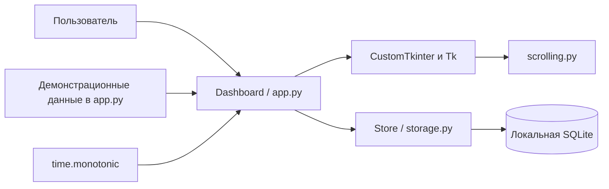

# Текущая архитектура

Состояние на 10 ноября 2026 года. Документ описывает существующий код. Будущая структура приведена в [планируемой архитектуре](PLANNED_ARCHITECTURE.md).

## Технологии и модули

Python, CustomTkinter 5.2.2 и Pillow согласно `soskuska/requirements.txt`; SQLite через стандартный модуль `sqlite3`. Один процесс, один поток, нативный цикл событий Tk. Нет сетевых запросов, клиента Ollama, облачной учётной записи или веб-сервера.

| Файл | Назначение |
| --- | --- |
| `soskuska/app.py` | Точка входа, `Dashboard`, UI, события, таймер, демонстрационные метрики, путь базы и CLI |
| `soskuska/storage.py` | `Store`, открытие SQLite, создание таблиц, ежедневные задачи и суммы времени занятий |
| `soskuska/scrolling.py` | `DashboardScrollFrame`, обработка колеса мыши и точных событий трекпада |
| `soskuska/check_dashboard.py` | Короткая нативная проверка с временной базой |
| `soskuska/run-macos.command` | Запуск через `.venv-macos` |
| `soskuska-local/index.html` | Отдельный старый визуальный макет, не участвует в работе приложения |

В проекте пока нет `pyproject.toml`, устанавливаемого пакета или команды `soskuska`. Рабочая точка входа — `python soskuska/app.py`.

## Поток данных



`Dashboard` непосредственно создаёт и вызывает `Store`. Отдельного сервисного слоя, модели экрана или маршрутизатора пока нет. Цвета, шрифты, расположение элементов и демонстрационные предметы в основном находятся в `app.py`.

При запуске скрипт на macOS отказывается работать с Tk ниже версии 8.6 ещё до создания окна. Затем включает тёмный режим, открывает базу, создаёт элементы интерфейса и запускает `mainloop()`.

## SQLite

```sql
CREATE TABLE tasks (
    day TEXT NOT NULL,
    name TEXT NOT NULL,
    done INTEGER NOT NULL,
    PRIMARY KEY (day, name)
);

CREATE TABLE sessions (
    id INTEGER PRIMARY KEY,
    day TEXT NOT NULL,
    seconds INTEGER NOT NULL CHECK(seconds >= 0)
);
```

Таблицы создаются через `CREATE TABLE IF NOT EXISTS`. Версионирования схемы и миграций пока нет. Единственное соединение использует главный поток. Дата — местный календарный день в формате ISO `YYYY-MM-DD`.

Ключи задач — `cards` и `test`; их описания находятся в коде. Отметка вызывает `save_task → Store.set_task → INSERT OR REPLACE`. В демонстрационном начальном состоянии `cards` отмечена, `test` — нет.

| Платформа | Файл по умолчанию |
| --- | --- |
| macOS | `~/Library/Application Support/SOSkuska/dashboard.sqlite3` |
| Windows | `%LOCALAPPDATA%\SOSkuska\dashboard.sqlite3`; резервная основа `~/AppData/Local` |
| Linux | `$XDG_DATA_HOME/SOSkuska/dashboard.sqlite3`; резервная основа `~/.local/share` |

`--data` переопределяет путь. Относительный путь считается от рабочего каталога. Приложение не шифрует данные, не создаёт резервные копии и не синхронизирует их.

## Таймер

- Фиксированный предел — 900 секунд. Start Studying и Resume session вызывают одну функцию, а не восстанавливают прежний учебный материал.
- `time.monotonic()` измеряет прошедшее время. `running_since` хранит начало текущего активного отрезка; `session_seconds` — время, прошедшее до паузы.
- `after(250, tick)` обновляет текст примерно каждые 250 мс. Измерение не зависит от числа этих вызовов.
- Пауза меняет только состояние в памяти. Finish, истечение лимита или обычное закрытие сохраняет целые секунды, максимум 900.
- Запись занятия не содержит предмета или точного времени начала. Она относится ко дню сохранения; переход через полночь не разделяется.
- После сохранения обновляются минутные сводки. Исходные демонстрационные значения — 24 ч 35 мин всего и 45 мин сегодня; остальные метрики остаются фиксированными.
- При сбое незаконченное занятие может потеряться. После перезапуска состояние таймера не восстанавливается.

## Расположение элементов, поиск и прокрутка

Начальное окно — 1440 × 900, минимальное — 1024 × 700; заголовок предоставляет система. Боковая панель имеет ширину 230 px, свёрнутая — 72 px. Широкий режим включается при остаточной ширине не менее 1100 px после вычитания панели: четыре метрики в ряд и правая сводка шириной не менее 300 px. В компактном режиме метрики размещаются 2 × 2, правая сводка — под основным содержимым. Предметы остаются в двух столбцах. Изменение размера обрабатывается с задержкой 120 мс.

Поиск проверяет подстроку названия через `casefold()`. Работает только с четырьмя демонстрационными предметами, а не с базой. Ctrl+K и на macOS Cmd+K переводят фокус в поиск, Escape очищает запрос. Все сочетания ещё не проверены на всех платформах.

`scrolling.py` добавляет событие Tk 9 `TouchpadScroll`, распаковывает знаковые 16-битные X/Y-дельты и устанавливает шаг canvas в 1 px. Колесо нормализуется примерно до 40 px за один шаг; для более старого macOS и Linux/X11 есть отдельные обработчики. Прокручивается только содержимое, которому принадлежит целевой элемент; жест над боковой панелью не сдвигает содержимое, чисто горизонтальный жест игнорируется.

Адаптер использует внутренние поля CustomTkinter `_parent_canvas`, `_scrollbar`, `_shift_pressed`; при обновлении нужна проверка совместимости. Формат события определён в [Tk TIP 684](https://core.tcl-lang.org/tips/doc/main/tip/684.md).

## Проверки и известные ограничения

Нативная проверка прошла на macOS, Python 3.12.13 / Tk 9.0: отображаемые элементы, поиск, пустой результат, боковая панель, компактный режим, синтетические события колеса/трекпада, таймер и сохранение времени. Синтетические события не заменяют ручную проверку жестов на устройстве. Windows/Linux и установщик не проверены.

Предметы, проценты прогресса, профиль, экзамены, активность, серия учебных дней, число вопросов и точность ответов — демонстрационные. Экзамены при запуске вычисляются относительно текущей даты. AI отключён, попыток подключения нет. Остальные пункты навигации лишь показывают сообщение.

Не реализованы автоматическая обработка смены дня во время работы, восстановление занятия после сбоя, пользовательские сообщения об ошибках записи в базу, миграции, импорт/экспорт, резервные копии, локализация, переключение темы, полноценное журналирование и дистрибутивы.


Совместимость с прежним названием: если новой базы в `SOSkuska` нет, а прежняя `ExamPrep/dashboard.sqlite3` существует, приложение использует прежний файл. Оно ничего автоматически не копирует, не перемещает и не перезаписывает. Явный `--data` всегда имеет приоритет.
