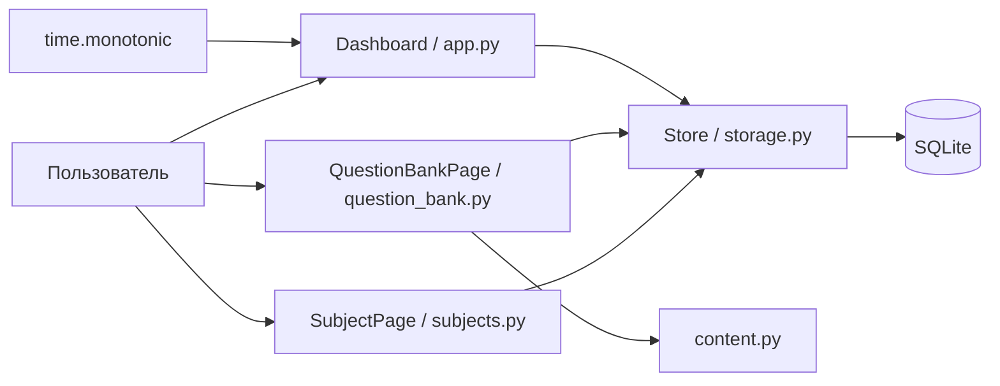

# Текущая архитектура

Состояние на 14 ноября 2026 года. Реализованы Dashboard и My Subjects; следующие шаги описаны в [планируемой архитектуре](PLANNED_ARCHITECTURE.md).

## Технологии и файлы

Python, CustomTkinter 5.2.2, Pillow и стандартная SQLite. Один процесс и главный поток Tk; без сетевых запросов и клиента Ollama. Точка входа — `python soskuska/app.py`; устанавливаемого пакета пока нет.

| Файл | Назначение |
| --- | --- |
| `soskuska/app.py` | Dashboard, навигация экранов, метрики, таймер, выбор базы и CLI |
| `soskuska/subjects.py` | My Subjects, встроенная форма, валидация и подтверждение удаления |
| `soskuska/storage.py` | Версия схемы, миграции, CRUD предметов, задачи, занятия и сводки |
| `soskuska/scrolling.py` | Совместимость колеса и трекпада Tk 9 |
| `tests/test_storage.py`, `tests/test_subjects.py` | Хранилище, совместимость прежней базы, миграции и правила предметов |
| `soskuska/check_dashboard.py` | Нативная интеграционная проверка с временными данными |
| `soskuska-local/index.html` | Исторический визуальный макет; не участвует в работе приложения |

## Поток данных



Экраны напрямую вызывают `Store`. Отдельные сервисный/предметный слои и общий модуль темы пока запланированы. `SubjectPage` использует существующие вспомогательные методы приложения для оформления.

## Схема и миграции

`PRAGMA user_version` теперь обозначает версию **3**. Открытие прежней базы версии 0 создаёт/распознаёт прежние таблицы и в одной транзакции добавляет предметы и связи. База более новой версии не открывается вместо попытки понижения версии. Внешние ключи включены для каждого соединения.

```sql
CREATE TABLE tasks (
    day TEXT NOT NULL, name TEXT NOT NULL, done INTEGER NOT NULL,
    PRIMARY KEY (day, name)
);
CREATE TABLE subjects (
    id INTEGER PRIMARY KEY AUTOINCREMENT,
    name TEXT NOT NULL, name_key TEXT NOT NULL UNIQUE,
    description TEXT NOT NULL DEFAULT '', exam_date TEXT,
    created_at TEXT NOT NULL DEFAULT CURRENT_TIMESTAMP,
    updated_at TEXT NOT NULL DEFAULT CURRENT_TIMESTAMP
);
CREATE TABLE sessions (
    id INTEGER PRIMARY KEY, day TEXT NOT NULL,
    seconds INTEGER NOT NULL CHECK(seconds >= 0),
    subject_id INTEGER REFERENCES subjects(id) ON DELETE SET NULL,
    subject_name TEXT
);
CREATE INDEX sessions_subject ON sessions(subject_id);
CREATE TABLE topics (
    id INTEGER PRIMARY KEY AUTOINCREMENT,
    subject_id INTEGER NOT NULL REFERENCES subjects(id) ON DELETE CASCADE,
    name TEXT NOT NULL, name_key TEXT NOT NULL,
    UNIQUE(subject_id, name_key)
);
CREATE TABLE questions (
    id INTEGER PRIMARY KEY AUTOINCREMENT,
    subject_id INTEGER NOT NULL REFERENCES subjects(id) ON DELETE CASCADE,
    topic_id INTEGER REFERENCES topics(id) ON DELETE SET NULL,
    prompt TEXT NOT NULL,
    option_a TEXT NOT NULL, option_b TEXT NOT NULL,
    option_c TEXT NOT NULL, option_d TEXT NOT NULL,
    correct_option INTEGER NOT NULL CHECK(correct_option BETWEEN 0 AND 3),
    difficulty TEXT NOT NULL CHECK(difficulty IN ('Easy','Medium','Hard')),
    explanation TEXT NOT NULL DEFAULT '',
    created_at TEXT NOT NULL DEFAULT CURRENT_TIMESTAMP,
    updated_at TEXT NOT NULL DEFAULT CURRENT_TIMESTAMP
);
CREATE INDEX questions_subject ON questions(subject_id);
CREATE INDEX questions_topic ON questions(topic_id);
```

Прежние задачи и занятия сохраняются. Старым занятиям не назначается выдуманный предмет: новые столбцы — `NULL`, UI показывает Unassigned session. При удалении предмета сохраняются время и название, записанное у нового занятия; внешний ключ становится `NULL`. ID предмета повторно не используется.

Название содержит 1–120 символов; пробелы нормализуются, уникальный ключ использует Unicode NFKC и `casefold()`. Описание — до 1 000 символов. Дата необязательна и должна точно соответствовать корректному `YYYY-MM-DD`. Прошедшую дату можно сохранить, но в ближайших экзаменах она не появится.

## Хранение и таймер

| Платформа | База по умолчанию |
| --- | --- |
| macOS | `~/Library/Application Support/SOSkuska/dashboard.sqlite3` |
| Windows | `%LOCALAPPDATA%\SOSkuska\dashboard.sqlite3`; резервная основа `~/AppData/Local` |
| Linux | `$XDG_DATA_HOME/SOSkuska/dashboard.sqlite3`; резервная основа `~/.local/share` |

Если новой базы нет, а прежняя `ExamPrep/dashboard.sqlite3` существует, используется прежний файл без перемещения или перезаписи. `--data` имеет приоритет. Данные не шифруются, не резервируются и не синхронизируются. Записи выполняются в главном потоке.

Таймер требует существующий предмет. На время занятия сохраняет его ID и копию названия; переименование не меняет историю. Лимит — 900 секунд, измерение через `time.monotonic()`, обновление через `after(250, tick)`, доступны пауза и завершение. UI запрещает удаление активного предмета до завершения занятия. Finish, достижение лимита и обычное закрытие сохраняют время. При ошибке записи занятие приостанавливается: можно повторить Finish; окно не закроется с несохранённым занятием.

Время не сохраняется непрерывно и после сбоя может не восстановиться. Занятие относится ко дню сохранения и не разделяется через полночь. Смена дня во время работы обновляет сводку и сегодняшний список задач. Новый список использует ключи `review_subject` и `focus`; прежние строки остаются в базе, но не сопоставляются новым задачам.

## Dashboard с реальными данными

Фиксированные примеры предметов, процентов, профиля, дат и исходные 24 ч 35 мин / 45 мин удалены. Новая база пустая. Метрики — общее время, число сохранённых занятий, серия учебных дней и число предметов. Серия может заканчиваться сегодня или вчера; более старая прерванная серия показывает ноль. Цель пока 60 минут в день; карточка показывает сохранённые минуты, полоса учитывает секунды.

Карточки показывают количество занятий и сохранённое время предмета, а не выдуманный учебный прогресс. Экзамены берутся из сохранённых дат, недавняя активность — из последних занятий. Для отсутствующих данных предусмотрены пустые состояния. AI, тесты, карточки, экран статистики и настройки пока не реализованы.

## Расположение и управление

Окно 1440 × 900, минимум 1024 × 700. Боковая панель 230 px / свёрнутая 72 px; при оставшейся ширине менее 1100 px Dashboard перестраивается на метрики 2 × 2 и правую панель под содержимым. My Subjects переключает один/два столбца при ширине 850 px. Длинные названия на карточках переносятся.

Экраны имеют независимый поиск через `casefold()`. Ctrl+K / Cmd+K переводит фокус в поиск активного экрана; Escape очищает запрос. Формы нового/изменяемого предмета и подтверждение удаления встроены в экран. Поддержка `TouchpadScroll`, колеса и прежнего Linux/X11 остаётся в адаптере с внутренними полями CustomTkinter; при обновлении его нужно проверить снова.

## Проверки и оставшиеся ограничения

30 тестов хранилища прошли; интеграционный скрипт прошёл на macOS с Python 3.12.13 / Tk 9.0 и временной базой. Проверены CRUD через форму, Unicode, поиск, пустые состояния, связь таймера, сохранение истории, повторное открытие, компактный режим и синтетическая прокрутка. Это не заменяет ручную визуальную/аппаратную проверку; Windows/Linux не проверены.

Остаются тесты, карточки, Ollama, переводы UI, настройка цели, полное восстановление после сбоя, резервные копии, дистрибутивы и полноценное журналирование. Основные операции записи имеют сообщения об ошибках, но полная обработка ошибок при каждом чтении ещё не реализована.


Версия схемы читается только после получения блокировки через `BEGIN IMMEDIATE`, чтобы одновременные запуски не использовали устаревшее значение. My Subjects обрабатывает реальные события Configure от CustomTkinter; интеграционная проверка подтверждает два столбца в широком окне и один в компактном.

## Банк тем и вопросов

`soskuska/question_bank.py` содержит экран QuestionBankPage; `soskuska/content.py` — чистую валидацию без Tk. Экран напрямую вызывает Store. Схема 3 добавляет topics и questions; существующие таблицы в листинге выше остаются. Миграция 0/1/2 → 3 выполняется в одной транзакции и сохраняет предметы, задачи и занятия.

Название темы уникально в пределах предмета (1–120 символов, нормализация пробелов, NFKC/casefold). Вопрос содержит текст 1–2000 символов, ровно четыре разных после нормализации ответа (1–500 символов), correct_option 0–3, обязательную сложность и объяснение до 2000 символов. Связь с темой необязательна; API и SQL-триггеры при записи вопроса отклоняют тему другого предмета. Индексы покрывают subject_id и topic_id вопросов. Перемещение тем и вопросов между предметами через UI не поддерживается.

В My Subjects выбери **Questions** у предмета. Добавь тему через New topic и вопрос через New question. Каждый вопрос содержит четыре разных обязательных ответа A–D, ровно один правильный ответ, сложность Easy/Medium/Hard и необязательное объяснение. Тема необязательна. При ошибке валидации или записи форма сохраняет введённые данные.

Темы можно переименовывать и удалять: выбери тему в фильтре и используй Rename selected topic или Delete selected topic. Вопросы можно изменять и удалять. Поиск по тексту вопроса сочетается с фильтрами темы и сложности. Счётчики в карточках предметов отражают сохранённое содержимое. При удалении темы её вопросы остаются в No topic. Удаление предмета после явного предупреждения удаляет его темы и вопросы, но сохраняет время и историю занятий.

Это редактор содержимого: правильный ответ виден. Запуск и оценивание тренировочных тестов, импорт и изображения пока не реализованы.
