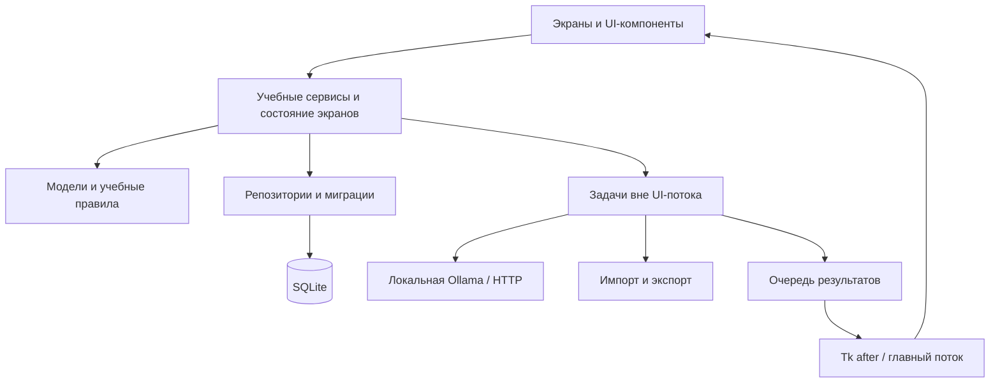

# Планируемая архитектура

[English](../PLANNED_ARCHITECTURE.md) · [Čeština](../cs/PLANNED_ARCHITECTURE.md) · [Slovenčina](../sk/PLANNED_ARCHITECTURE.md) · [Русский](PLANNED_ARCHITECTURE.md)

**Будущий проект, а не текущая реализация.** Указанные модули и таблицы пока не существуют, если они не описаны в [текущей архитектуре](CURRENT_ARCHITECTURE.md). Сам этот план не означает начало реализации всех функций.

**Текущий прогресс (18 ноября 2026 года):** В AI Tutor подключи свой сервер Ollama через Connect / refresh, выбери модель и язык ответа и задай вопрос. Ответ поступает постепенно; Stop останавливает его. Остальные экраны доступны во время генерации и без Ollama. Чат сохраняется в локальной базе и доступен после перезапуска; см. руководство по истории.

Настройки сохраняются в той же базе, что и учебные данные. [Settings](SETTINGS.md). Настройки сохраняются транзакционно в схеме 6 с защитой от перезаписи изменений другого окна. Миграция с версии 5 сохраняет все прежние таблицы и данные; старое приложение откажется открывать новую схему.
## Направление

Сохранить Python + CustomTkinter, локальную SQLite и необязательный AI через Ollama. Основные платформы — Windows/Linux; разработка на macOS должна продолжать работать. Обычные занятия не должны требовать облачной учётной записи, платного API или запущенного AI. Визуальный стиль развивать на основе нынешнего Dashboard.

Разделять UI, учебную логику и хранение постепенно, по мере необходимости для конкретных функций. Не создавать новый UI-фреймворк или веб-бэкенд.

## Слои



| Слой | Назначение |
| --- | --- |
| UI | Элементы интерфейса, навигация, фокус и отображение состояний; без SQL и блокирующего HTTP |
| Services | Запуск занятий, оценивание, сводки и AI-контекст; без управления элементами интерфейса |
| Domain | Предметы, вопросы, ответы и правила повторения; без зависимости от Tk |
| Persistence | Запросы, транзакции, отображение данных и миграции |
| Integrations | Ollama и форматы файлов |

Состояние экрана может оставаться простой структурой данных. Сразу вводить большой MVVM-фреймворк не требуется.

## Предлагаемые файлы

```text
pyproject.toml
src/soskuska/
    __main__.py
    bootstrap.py
    domain/             models.py, repetition.py
    services/           dashboard.py, study.py, practice.py, tutor.py
    persistence/        database.py, migrations/, repositories/
    integrations/       ollama.py, import_export.py
    ui/
        app.py, theme.py, navigation.py
        components/
        screens/        dashboard, subjects, flashcards, practice,
                        tutor, statistics, settings
    i18n/               en.json, cs.json, sk.json, ru.json
tests/
docs/
```

Перенос выполнять небольшими работающими шагами. До создания пакета действует нынешняя команда `python soskuska/app.py`; будущая `python -m soskuska` пока не работает.

## Предлагаемая модель данных

| Область | Предлагаемые таблицы |
| --- | --- |
| Материалы | `subjects`, `topics`, `questions`, `answer_options` |
| Карточки | `decks`, `flashcards`, `review_events`, `card_schedule` |
| Тесты | `test_attempts`, `attempt_answers` |
| Занятия | `study_sessions` с предметом и временными данными |
| План и настройки | `exams`, `daily_tasks`, `settings` |
| AI | `conversations`, `messages`, ссылки на подключённый контекст |
| Обслуживание | Версия схемы / журнал выполненных миграций |

Конкретные схемы должны определить внешние ключи, правила удаления, индексы и транзакции. Миграции обязаны сохранить нынешние `tasks` и `sessions`; существующему времени нельзя назначать выдуманный предмет. Локальный профиль не должен требовать серверной учётной записи.

Моменты времени сохранять с явным часовым поясом, желательно UTC; дневные суммы вычислять в местном поясе. Спроектировать разделение занятий через полночь и восстановление после сбоя. Монотонное время нельзя переносить между запусками процесса, поэтому оно не будет единственным сохраняемым значением.

## Функциональные области

**Предметы и реальный Dashboard:** управление предметами, темами/вопросами и реальные суммы занятий реализованы. Оценки отдельных попыток доступны в Practice Tests; базовая общая статистика реализована. Новая база пустая.

**Карточки:** колоды, редактор, открытие ответа, Again / Hard / Good / Easy, сохранённый срок и история реализованы. Правила находятся в repetition.py и FLASHCARDS.md; это не SM-2 или FSRS. Импорт CSV реализован; более сложное планирование остаётся будущей возможностью.

**Тесты:** выбор темы, сложности, числа и времени; сохранённая попытка, оценка и разбор ответов реализованы. Импорт вопросов из CSV реализован; более богатая история остаётся дальнейшим расширением.

**AI Tutor:** отдельный клиент Ollama с тайм-аутом, списком доступных моделей, потоковым получением ответа и отменой генерации. Подключение по умолчанию локальное, адрес настраивается и виден пользователю; без автоматического перехода на облако. Модели получать из Ollama, а не требовать одну фиксированную.

Состояния AI: сервис недоступен, нет модели, загрузка, готовность, генерация, остановлено, недостаточно памяти, модель не найдена. Сам по себе сбой подключения не доказывает, что Ollama не установлена.

Долгие операции выполняются вне главного UI-потока. Результаты передаются через очередь и `after`; рабочий поток не должен обращаться к элементам интерфейса. Не использовать одно соединение SQLite в нескольких потоках без явного решения. Вначале короткие записи можно оставить в главном потоке; будущие рабочие задачи получают собственные соединения.

Ответы AI сначала показывать как текст, моноширинные блоки кода и Unicode-математику; расширенный HTML/LaTeX не обязателен. Язык UI отделить от языка ответов AI. Планируемые языки: English, Czech, Slovak, Russian; для AI дополнительно Automatic с возможностью вручную исправить ошибочное определение. Учитывать длинные строки и кириллицу.

**Статистика и настройки:** простые графики Matplotlib только по реальным измерениям. Настройки внешнего вида, языка, занятий, AI и управления данными. Импорт сначала валидировать; резервные копии создавать как согласованные копии SQLite. Восстановление выполнять при закрытом соединении и с возможностью вернуться к предыдущему файлу.

## Этапы и критерии завершения

| Этап | Объём | Результат |
| --- | --- | --- |
| 1. Стабилизация | Разделение темы/UI, ошибки хранилища, миграции | Dashboard работает, существующие данные сохранены |
| 2. Предметы | Управление предметами, темами, экзаменами, реальные сводки | Новый предмет сохраняется после перезапуска; пустые данные показаны честно |
| 3. Материалы и карточки | Редактор/импорт, колоды, повторение | Ответ создаёт запись и план следующего повторения |
| 4. Тесты | Настройка, прохождение, результаты и ошибки | Результат можно открыть и пересчитать по ответам |
| 5. AI | Клиент Ollama и чат | UI не зависает, генерация отменяется, offline-состояние понятно |
| 6. Завершение | Статистика, языки, тема, копии и дистрибутивы | Проверенные установки на целевых системах |

Развивать экраны итеративно после обратной связи согласно исходному заданию. Этот проект не требует немедленно переписывать нынешний Dashboard.

## Настройки

Беседы сохраняются в локальной базе и резервных копиях. Параметры подключения можно явно сохранить в [Settings](SETTINGS.md); без Save они временные.

[Настройки](SETTINGS.md).

## Резервное копирование и восстановление

Settings теперь предлагает ручное локальное копирование и проверенное восстановление со страховочной копией перед заменой. Текущая схема — 8. Восстановление закрывает приложение; затем запусти его снова. См. [Резервное копирование](BACKUP_RESTORE.md).

## Импорт вопросов из CSV

Банк вопросов теперь поддерживает UTF-8 CSV для существующего предмета: шаблон с заголовками, просмотр по страницам, отклонение точных дубликатов и одно атомарное сохранение. Максимум 2 MiB / 500 записей; список показывает 50 вопросов на страницу. Текущая схема — 8. [Импорт вопросов из CSV](QUESTION_CSV_IMPORT.md).

## Импорт карточек из CSV

Flashcards теперь поддерживает импорт UTF-8 CSV в существующую колоду: шаблон с заголовками, просмотр по страницам, отклонение точных дубликатов и одно атомарное сохранение. Максимум 2 MiB / 500 записей. Новые карточки сразу доступны для повторения; прежние сроки и история оценок сохраняются. Текущая схема — 8. [Импорт карточек из CSV](FLASHCARD_CSV_IMPORT.md).

## Сохранённые беседы AI Tutor

AI Tutor теперь сохраняет беседы локально вместе с исходным сервером/моделью и состоянием ответа. Историю можно открыть без сети, явно подключиться для продолжения или удалить выбранную беседу с подтверждением. Выпущено в v0.12.0 со схемой 7, которая транзакционно переносит прежние учебные данные. [Сохранённые беседы AI Tutor](TUTOR_HISTORY.md).

## Язык интерфейса

Выбор языка интерфейса реализован в этой ветке: английский, чешский, словацкий и русский. Выбор сохраняется отдельно от языка AI и применяется после перезапуска. Текущая схема — 8; опубликованная версия остаётся v0.12.0 до разрешения выпуска. [Язык интерфейса](UI_LANGUAGES.md).
