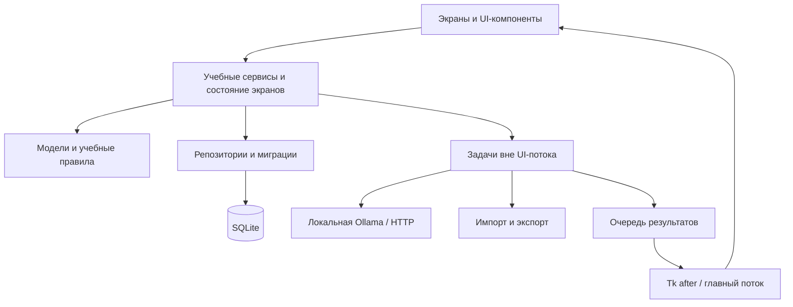

# Планируемая архитектура

**Будущий проект, а не текущая реализация.** Указанные модули и таблицы пока не существуют, если они не описаны в [текущей архитектуре](CURRENT_ARCHITECTURE.md). Сам этот план не означает начало реализации всех функций.

## Направление

Сохранить Python + CustomTkinter, локальную SQLite и необязательный AI через Ollama. Основные платформы — Windows/Linux; разработка на macOS должна продолжать работать. Обычные занятия не должны требовать облачной учётной записи, платного API или запущенного AI. Визуальный стиль развивать на основе нынешнего Dashboard.

Разделять UI, учебную логику и хранение постепенно, по мере необходимости для конкретных функций. Не создавать новый UI-фреймворк или веб-бэкенд.

## Слои



| Слой | Назначение |
| --- | --- |
| UI | Элементы интерфейса, навигация, фокус и отображение состояний; без SQL и блокирующего HTTP |
| Services | Запуск занятий, оценивание, сводки и AI-контекст; без управления элементами интерфейса |
| Domain | Предметы, вопросы, ответы и правила повторения; без зависимости от Tk |
| Persistence | Запросы, транзакции, отображение данных и миграции |
| Integrations | Ollama и форматы файлов |

Состояние экрана может оставаться простой структурой данных. Сразу вводить большой MVVM-фреймворк не требуется.

## Предлагаемые файлы

```text
pyproject.toml
src/soskuska/
    __main__.py
    bootstrap.py
    domain/             models.py, repetition.py
    services/           dashboard.py, study.py, practice.py, tutor.py
    persistence/        database.py, migrations/, repositories/
    integrations/       ollama.py, import_export.py
    ui/
        app.py, theme.py, navigation.py
        components/
        screens/        dashboard, subjects, flashcards, practice,
                        tutor, statistics, settings
    i18n/               en.json, cs.json, sk.json, ru.json
tests/
docs/
```

Перенос выполнять небольшими работающими шагами. До создания пакета действует нынешняя команда `python soskuska/app.py`; будущая `python -m soskuska` пока не работает.

## Предлагаемая модель данных

| Область | Предлагаемые таблицы |
| --- | --- |
| Материалы | `subjects`, `topics`, `questions`, `answer_options` |
| Карточки | `decks`, `flashcards`, `review_events`, `card_schedule` |
| Тесты | `test_attempts`, `attempt_answers` |
| Занятия | `study_sessions` с предметом и временными данными |
| План и настройки | `exams`, `daily_tasks`, `settings` |
| AI | `conversations`, `messages`, ссылки на подключённый контекст |
| Обслуживание | Версия схемы / журнал выполненных миграций |

Конкретные схемы должны определить внешние ключи, правила удаления, индексы и транзакции. Миграции обязаны сохранить нынешние `tasks` и `sessions`; существующему времени нельзя назначать выдуманный предмет. Локальный профиль не должен требовать серверной учётной записи.

Моменты времени сохранять с явным часовым поясом, желательно UTC; дневные суммы вычислять в местном поясе. Спроектировать разделение занятий через полночь и восстановление после сбоя. Монотонное время нельзя переносить между запусками процесса, поэтому оно не будет единственным сохраняемым значением.

## Функциональные области

**Предметы и реальный Dashboard:** CRUD предметов и тем, сохранённые экзамены и сводка по ответам/занятиям. При переходе на реальные данные убрать исходные 24 ч 35 мин / 45 мин. Пустая база показывает полезное пустое состояние; демонстрационные данные возможны только по явному выбору.

**Карточки:** колоды, переворот вопроса на ответ, Again / Hard / Good / Easy. Планирование повторений выделить в чистый модуль и покрыть тестами. Конкретный алгоритм ещё предстоит выбрать; в нынешнем приложении его нет.

**Тесты:** настройка тем, числа вопросов, сложности и времени; незавершённая попытка, оценивание и разбор ошибок. Ответы и завершение попытки сохранять транзакционно, чтобы результаты можно было проверить позднее.

**AI Tutor:** отдельный клиент Ollama с тайм-аутом, списком доступных моделей, потоковым получением ответа и отменой генерации. Подключение по умолчанию локальное, адрес настраивается и виден пользователю; без автоматического перехода на облако. Модели получать из Ollama, а не требовать одну фиксированную.

Состояния AI: сервис недоступен, нет модели, загрузка, готовность, генерация, остановлено, недостаточно памяти, модель не найдена. Сам по себе сбой подключения не доказывает, что Ollama не установлена.

Долгие операции выполняются вне главного UI-потока. Результаты передаются через очередь и `after`; рабочий поток не должен обращаться к элементам интерфейса. Не использовать одно соединение SQLite в нескольких потоках без явного решения. Вначале короткие записи можно оставить в главном потоке; будущие рабочие задачи получают собственные соединения.

Ответы AI сначала показывать как текст, моноширинные блоки кода и Unicode-математику; расширенный HTML/LaTeX не обязателен. Язык UI отделить от языка ответов AI. Планируемые языки: English, Czech, Slovak, Russian; для AI дополнительно Automatic с возможностью вручную исправить ошибочное определение. Учитывать длинные строки и кириллицу.

**Статистика и настройки:** простые графики Matplotlib только по реальным измерениям. Настройки внешнего вида, языка, занятий, AI и управления данными. Импорт сначала валидировать; резервные копии создавать как согласованные копии SQLite. Восстановление выполнять при закрытом соединении и с возможностью вернуться к предыдущему файлу.

## Этапы и критерии завершения

| Этап | Объём | Результат |
| --- | --- | --- |
| 1. Стабилизация | Разделение темы/UI, ошибки хранилища, миграции | Dashboard работает, существующие данные сохранены |
| 2. Предметы | Управление предметами, темами, экзаменами, реальные сводки | Новый предмет сохраняется после перезапуска; пустые данные показаны честно |
| 3. Материалы и карточки | Редактор/импорт, колоды, повторение | Ответ создаёт запись и план следующего повторения |
| 4. Тесты | Настройка, прохождение, результаты и ошибки | Результат можно открыть и пересчитать по ответам |
| 5. AI | Клиент Ollama и чат | UI не зависает, генерация отменяется, offline-состояние понятно |
| 6. Завершение | Статистика, языки, тема, копии и дистрибутивы | Проверенные установки на целевых системах |

Развивать экраны итеративно после обратной связи согласно исходному заданию. Этот проект не требует немедленно переписывать нынешний Dashboard.
