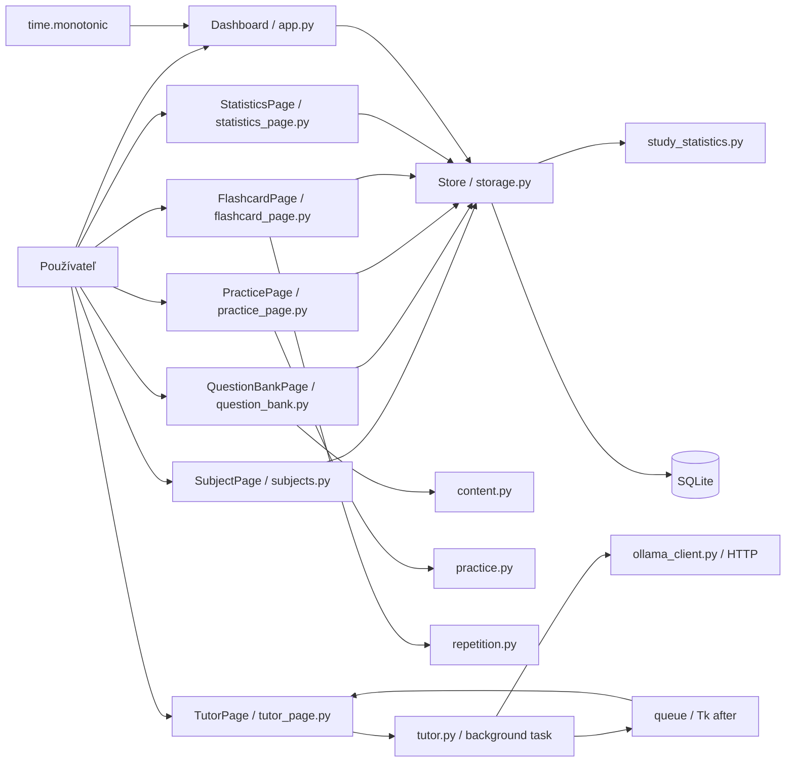

# Súčasná architektúra

[English](../CURRENT_ARCHITECTURE.md) · [Čeština](../cs/CURRENT_ARCHITECTURE.md) · [Slovenčina](CURRENT_ARCHITECTURE.md) · [Русский](../ru/CURRENT_ARCHITECTURE.md)

Výber jazyka rozhrania je dostupný vo v0.13.0: angličtina, čeština, slovenčina a ruština. Ukladá sa osobitne od jazyka AI a použije sa po reštarte. Aktuálna schéma je 8.

## Technológie a súbory

Python, CustomTkinter 5.2.2, Pillow a štandardná SQLite. Jeden proces a hlavné vlákno Tk; s voliteľným klientom Ollama vo vedľajšom vlákne. Vstup je `python soskuska/app.py`; inštalovateľný balík zatiaľ nie je.

| Súbor | Zodpovednosť |
| --- | --- |
| `soskuska/app.py` | Dashboard, navigácia obrazoviek, metriky, časovač, výber databázy a CLI |
| `soskuska/subjects.py` | My Subjects, inline formulár, validácia a potvrdenie vymazania |
| `soskuska/storage.py` | Verzia schémy, migrácie, CRUD predmetov, úlohy, relácie a prehľady |
| `soskuska/scrolling.py` | Kompatibilita kolieska a trackpadu Tk 9 |
| `tests/test_storage.py`, `tests/test_subjects.py` | Úložisko, kompatibilita pôvodnej databázy, migrácie a pravidlá predmetov |
| `soskuska/check_dashboard.py` | Natívna integračná kontrola s dočasnými údajmi |
| `soskuska/statistics_page.py` / `soskuska/study_statistics.py` | Obrazovka Statistics a konzistentné agregácie uloženej histórie |
| `soskuska/tutor_page.py`, `soskuska/tutor.py`, `soskuska/ollama_client.py` | Místní historie chatu, fronta úloh a voliteľný klient Ollama |
| `soskuska-local/index.html` | Historický vizuálny návrh; nie je súčasťou behu aplikácie |

## Tok údajov



Obrazovky volajú `Store` priamo. Samostatná servisná/doménová vrstva a spoločný modul motívu zostávajú plánované. `SubjectPage` využíva existujúce pomocné metódy aplikácie pre štýl.

## Schéma a migrácie

`PRAGMA user_version` teraz označuje verziu **7**. Otvorenie pôvodnej databázy verzie 0 vytvorí/rozpozná pôvodné tabuľky a v jednej transakcii doplní predmety a väzby. Databáza s novšou verziou sa odmietne otvoriť namiesto pokusu o downgrade. Cudzie kľúče sú zapnuté pre každé pripojenie.

```sql
CREATE TABLE tasks (
    day TEXT NOT NULL, name TEXT NOT NULL, done INTEGER NOT NULL,
    PRIMARY KEY (day, name)
);
CREATE TABLE subjects (
    id INTEGER PRIMARY KEY AUTOINCREMENT,
    name TEXT NOT NULL, name_key TEXT NOT NULL UNIQUE,
    description TEXT NOT NULL DEFAULT '', exam_date TEXT,
    created_at TEXT NOT NULL DEFAULT CURRENT_TIMESTAMP,
    updated_at TEXT NOT NULL DEFAULT CURRENT_TIMESTAMP
);
CREATE TABLE sessions (
    id INTEGER PRIMARY KEY, day TEXT NOT NULL,
    seconds INTEGER NOT NULL CHECK(seconds >= 0),
    subject_id INTEGER REFERENCES subjects(id) ON DELETE SET NULL,
    subject_name TEXT
);
CREATE INDEX sessions_subject ON sessions(subject_id);
CREATE TABLE topics (
    id INTEGER PRIMARY KEY AUTOINCREMENT,
    subject_id INTEGER NOT NULL REFERENCES subjects(id) ON DELETE CASCADE,
    name TEXT NOT NULL, name_key TEXT NOT NULL,
    UNIQUE(subject_id, name_key)
);
CREATE TABLE questions (
    id INTEGER PRIMARY KEY AUTOINCREMENT,
    subject_id INTEGER NOT NULL REFERENCES subjects(id) ON DELETE CASCADE,
    topic_id INTEGER REFERENCES topics(id) ON DELETE SET NULL,
    prompt TEXT NOT NULL,
    option_a TEXT NOT NULL, option_b TEXT NOT NULL,
    option_c TEXT NOT NULL, option_d TEXT NOT NULL,
    correct_option INTEGER NOT NULL CHECK(correct_option BETWEEN 0 AND 3),
    difficulty TEXT NOT NULL CHECK(difficulty IN ('Easy','Medium','Hard')),
    explanation TEXT NOT NULL DEFAULT '',
    created_at TEXT NOT NULL DEFAULT CURRENT_TIMESTAMP,
    updated_at TEXT NOT NULL DEFAULT CURRENT_TIMESTAMP
);
CREATE INDEX questions_subject ON questions(subject_id);
CREATE INDEX questions_topic ON questions(topic_id);
```

Staré úlohy a relácie sa zachovajú. Pôvodné relácie nemajú vymyslený predmet: nové stĺpce sú `NULL`, UI ich označí ako Unassigned session. Pri vymazaní predmetu sa zachová čas aj názov predmetu uložený pri novej relácii; cudzí kľúč sa nastaví na `NULL`. ID predmetu sa znovu nepoužíva.

Názov predmetu má 1–120 znakov; medzery sa zjednotia, jedinečný kľúč používa Unicode NFKC a `casefold()`. Popis má najviac 1 000 znakov. Dátum je voliteľný, musí presne zodpovedať platnému `YYYY-MM-DD`. Minulý dátum možno uložiť, ale nezobrazí sa medzi nadchádzajúcimi skúškami.

## Ukladanie a časovač

| Platforma | Predvolená databáza |
| --- | --- |
| macOS | `~/Library/Application Support/SOSkuska/dashboard.sqlite3` |
| Windows | `%LOCALAPPDATA%\SOSkuska\dashboard.sqlite3`; náhradný základ `~/AppData/Local` |
| Linux | `$XDG_DATA_HOME/SOSkuska/dashboard.sqlite3`; náhradný základ `~/.local/share` |

Ak nová databáza nie je a existuje pôvodná `ExamPrep/dashboard.sqlite3`, použije sa pôvodný súbor bez presunu alebo prepisu. `--data` má prednosť. Údaje sa nešifrujú ani automaticky nesynchronizujú. Zápisy bežia na hlavnom vlákne.

Časovač vyžaduje existujúci predmet. Počas relácie drží jeho ID a kópiu názvu; premenovanie nemení históriu. Má nastaviteľný limit 1–180 minút (predvolene 15), meranie cez `time.monotonic()`, aktualizáciu cez `after(250, tick)`, pauzu a dokončenie. Mazanie aktívneho predmetu UI zablokuje do dokončenia relácie. Finish, dosiahnutie limitu a bežné zatvorenie ukladajú čas. Pri chybe zápisu sa relácia pozastaví a možno skúsiť Finish znovu; okno sa nezatvorí s neuloženou reláciou.

Čas nie je priebežne ukladaný a po páde sa nemusí obnoviť. Relácia sa pripisuje ku dňu uloženia a nerozdeľuje sa cez polnoc. Zmena dňa za behu obnoví prehľad a dnešný zoznam úloh. Nový zoznam používa kľúče `review_subject` a `focus`; staré riadky zostávajú v databáze, ale nie sú mapované na nové úlohy.

## Skutočný Dashboard

Pevné vzorové predmety, percentá, profil, termíny aj základy 24 h 35 min / 45 min boli odstránené. Nová databáza je prázdna. Metriky sú celkový čas, počet uložených relácií, séria študijných dní a počet predmetov. Séria môže končiť dnes alebo včera; staršia prerušená séria ukáže nulu. Cieľ je nastaviteľný (predvolene 60 minút denne); karta ukazuje uložené minúty, pruh má presnosť na sekundy.

Karty ukazujú počet relácií a uložený čas predmetu, nie vymyslený pokrok v učení. Skúšky pochádzajú z uložených termínov, nedávna aktivita z posledných uložených relácií. Neexistujúce údaje majú prázdne stavy. Nastavenia sú implementované; AI Tutor má voliteľný chat; Statistics má vlastnú obrazovku.

## Rozloženie a ovládanie

Okno 1440 × 900, minimum 1024 × 700. Bočný panel 230 px / zbalený 72 px; pri zvyšnej šírke pod 1100 px sa Dashboard usporiada na metriky 2 × 2 a pravý panel pod obsah. My Subjects prepína medzi jedným a dvoma stĺpcami pri šírke 850 px. Dlhé názvy sa na kartách zalamujú.

Obrazovky majú nezávislé vyhľadávanie cez `casefold()`. Ctrl+K / Cmd+K zameria hľadanie aktívnej obrazovky; Escape vymaže dotaz. Formuláre pre nový/upravený predmet aj potvrdenie vymazania sú inline. Podpora `TouchpadScroll`, kolieska a staršieho Linux/X11 zostáva v adaptéri využívajúcom súkromné členy CustomTkinteru; pri aktualizácii ho znovu overiť.

## Overenie a zostávajúce obmedzenia

188 testov úložiska prešlo; integračný skript prešiel na macOS s Pythonom 3.12.13 / Tk 9.0 a dočasnou databázou. Overil CRUD cez formulár, Unicode, hľadanie, prázdne stavy, naviazanie časovača, zachovanie histórie, opätovné otvorenie, kompaktný režim a syntetické posúvanie. Nenahrádza ručné vizuálne/hardvérové overenie; Windows/Linux nie sú overené.

Zostávajú úplná obnova po páde, balíky a komplexné logovanie. Základné databázové operácie majú chybové hlásenia, ale úplné spracovanie chýb pri každom čítaní ešte chýba.


Verzia schémy sa číta až po získaní `BEGIN IMMEDIATE`, aby súbežné štarty nepoužili zastaranú hodnotu. Rozloženie My Subjects spracúva skutočné Configure udalosti CustomTkinteru; integračná kontrola overuje dva stĺpce vo veľkom okne a jeden v kompaktnom.

## Banka tém a otázok

`soskuska/question_bank.py` obsahuje obrazovku QuestionBankPage; `soskuska/content.py` čistú validáciu bez Tk. Obrazovka volá Store priamo. Schéma 3 pridáva topics a questions; existujúce tabuľky vo výpise vyššie zostávajú. Migrácia 0/1/2 → 3 prebieha v jednej transakcii a zachová predmety, úlohy aj relácie.

Názov témy je jedinečný v rámci predmetu (1–120 znakov, normalizácia medzier, NFKC/casefold). Otázka má text 1–2000 znakov, presne štyri rôzne odpovede po normalizácii (1–500 znakov), correct_option 0–3, povinnú náročnosť a vysvetlenie do 2000 znakov. Väzba na tému je voliteľná; API a SQL triggery pri zápise otázky odmietajú tému iného predmetu. Indexy pokrývajú subject_id a topic_id otázok. Témy ani otázky nemožno cez UI presúvať medzi predmetmi.

V My Subjects zvoľ pri predmete **Questions**. Pridaj tému cez New topic a otázku cez New question. Každá otázka má štyri rôzne povinné odpovede A–D, práve jednu správnu odpoveď, náročnosť Easy/Medium/Hard a voliteľné vysvetlenie. Téma je voliteľná. Formulár zachová rozpísaný obsah pri chybe validácie alebo zápisu.

Témy možno premenovať a vymazať; vyber tému vo filtri a použi Rename selected topic alebo Delete selected topic. Otázky možno upravovať a mazať. Hľadanie v texte otázky sa kombinuje s filtrom témy a náročnosti. Počty na kartách predmetov vychádzajú z uloženého obsahu. Vymazanie témy ponechá jej otázky v No topic. Vymazanie predmetu po výslovnom upozornení odstráni jeho témy a otázky, ale zachová čas aj históriu štúdia.

Ide o editor obsahu: správna odpoveď je viditeľná. Precvičovanie a hodnotenie nájdeš v Practice Tests. Import otázok z CSV je dostupný; obrázky zatiaľ nie sú implementované.

## Opravy po kontrole hlavnej vetvy

Zatvorenie okna aj príkaz Quit v ponuke macOS používajú rovnaké uloženie relácie. Ak uloženie zlyhá, aplikácia zostane otvorená so zachovaným pozastaveným časom; po odstránení problému možno skúsiť Finish alebo Quit znovu.

Opustenie obrazovky My Subjects zruší rozpracované potvrdenie vymazania predmetu. Pred vymazaním sa v jednej transakcii porovná aktuálny názov a počty tém/otázok s posledným zobrazeným upozornením. Ak sa zmenili, aplikácia najprv zobrazí aktualizované upozornenie a vyžiada nové potvrdenie.

Pri zmene dňa sa aktualizuje aj dátum v záhlaví. Chyba čítania pri obnove zoznamu úloh alebo prehľadu nezastaví plánovanie časovača; obnova sa opakuje a nový deň sa potvrdí až po úspechu. Posúvanie v dlhom textovom poli zostáva v tomto poli vrátane jeho okrajov; stránku posunieš nad inou časťou okna. Krátke pole bez vlastného posunu naďalej umožňuje posúvanie stránky.

Ak sa relácia uložila, ale následné načítanie prehľadu zlyhá, aplikácia opakuje iba načítanie aj počas rovnakého dňa; záznam relácie znovu neukladá. Po úspechu obnoví metriky aj výber predmetu a odstráni oznámenie o opakovaní. Ak sa naopak relácia neuložila, pokyn Press Finish zostane viditeľný aj pri chybe či úspešnej obnove denného prehľadu. Gestá trackpadu nad posuvníkom a okrajom dlhého editora sa odovzdajú jeho textovému poľu.

## Practice Tests — precvičovanie (v0.4.0)

`practice_page.py` obsahuje obrazovku a vlastný neblokujúci Tk callback; `practice.py` čistú validáciu a UTC časové pravidlá. Schéma 4 pridáva practice_attempts a practice_items v transakčnej migrácii z verzie 3 aj starších verzií. Rozpracovaný pokus je v databáze najviac jeden (čiastočný unikátny index). Štart, zmeny odpovedí, pozície a dokončenie používajú transakcie; po termíne nemožno odpoveď uložiť. Dokončenie je idempotentné, takže opakovanie po chybe čítania výsledku nepridá druhý výsledok. Chyba zápisu odpovede vráti výber na poslednú uloženú hodnotu.

practice_items ukladá text, všetky štyri možnosti, správnu odpoveď, náročnosť, názov témy a vysvetlenie ako kópie. Odkazy na pôvodný predmet/otázku používajú ON DELETE SET NULL. Vymazanie predmetu ponechá dokončené aj rozpracované pokusy; zahodiť možno iba rozpracovaný pokus a jeho položky sa vymažú kaskádou. Časové údaje sú UTC ISO 8601, v UI sa dokončenie prevádza do miestneho času. Skóre sa počíta zo snímok: každá otázka má rovnakú váhu, bez penalizácie, nevyplnená odpoveď má nulu. Časový limit používa systémové UTC hodiny; ručná zmena času môže zmeniť zostávajúcu dobu. Ctrl+K / Cmd+K a Escape na obrazovke testov nemenia skryté hľadanie inej obrazovky.

```sql
CREATE TABLE practice_attempts (
                    id INTEGER PRIMARY KEY AUTOINCREMENT,
                    subject_id INTEGER REFERENCES subjects(id) ON DELETE SET NULL,
                    subject_name TEXT NOT NULL,
                    topic_name TEXT NOT NULL, difficulty TEXT,
                    status TEXT NOT NULL DEFAULT 'in_progress' CHECK(status IN ('in_progress','completed')),
                    question_count INTEGER NOT NULL CHECK(question_count BETWEEN 1 AND 100),
                    current_index INTEGER NOT NULL DEFAULT 0 CHECK(current_index >= 0 AND current_index < question_count),
                    time_limit_minutes INTEGER CHECK(time_limit_minutes BETWEEN 1 AND 180),
                    started_at TEXT NOT NULL, deadline_at TEXT, completed_at TEXT);
CREATE TABLE practice_items (
                    attempt_id INTEGER NOT NULL REFERENCES practice_attempts(id) ON DELETE CASCADE,
                    position INTEGER NOT NULL CHECK(position >= 0),
                    question_id INTEGER REFERENCES questions(id) ON DELETE SET NULL,
                    prompt TEXT NOT NULL, option_a TEXT NOT NULL, option_b TEXT NOT NULL,
                    option_c TEXT NOT NULL, option_d TEXT NOT NULL,
                    correct_option INTEGER NOT NULL CHECK(correct_option BETWEEN 0 AND 3),
                    selected_option INTEGER CHECK(selected_option BETWEEN 0 AND 3),
                    explanation TEXT NOT NULL, difficulty TEXT NOT NULL, topic_name TEXT,
                    PRIMARY KEY(attempt_id, position));
CREATE INDEX practice_items_question ON practice_items(question_id);
CREATE UNIQUE INDEX practice_one_active
                    ON practice_attempts(status) WHERE status='in_progress';
```

## Priebežná integrácia (CI)

GitHub Actions kontroluje pull requesty do main, nové commity na main a ručné spustenie. Workflow `.github/workflows/ci.yml` inštaluje závislosti, overuje ich kompatibilitu, syntax Pythonu a všetky jednotkové testy s Pythonom 3.12 na Ubuntu, Windows a macOS. Samostatná úloha spúšťa štrnásť natívnych kontrolných skriptov na Ubuntu pod virtuálnym displejom Xvfb; každý proces má limit 60 sekúnd. Celá úloha má limit 10 minút. Novší beh rovnakej vetvy zruší predchádzajúci. Token má iba čítanie obsahu; workflow nič nenasadzuje ani nevydáva.

Výsledky a logy sú v [Actions](https://github.com/turcinv/SOSkuska/actions/workflows/ci.yml) a v kontrolách PR. Otvor červený stav a prečítaj prvý neúspešný krok. Po oprave pushni do rovnakej vetvy a kontroly sa spustia znovu. Ručné spustenie Run workflow je dostupné po zlúčení workflow do predvolenej vetvy. Branch protection týmto nie je zapnutá.

Automatické testy nie sú ručným overením Windows/macOS/Linux ani fyzického trackpadu. Linuxový CI beh neoveruje natívnu ponuku Quit v macOS ani Tk 9 gestá; tie treba naďalej kontrolovať na Macu.

## Kartičky a opakovanie (v0.5.0)

`flashcard_page.py` obsahuje obrazovku, `repetition.py` čistú validáciu a pravidlá. Schéma 5 pridáva decks, flashcards a review_events. Termín a interval sú priamo pri kartičke. Zápis hodnotenia, snímky oboch strán a ďalšieho termínu je jedna transakcia; kontrola revízie aj splatnosti prebieha pod zápisovým zámkom. Opakované hodnotenie rovnakej revízie nevytvorí ďalší záznam. Odkazy z histórie majú ON DELETE SET NULL, kópie obsahu zostávajú. Balíčky majú k predmetu ON DELETE SET NULL, kartičky k balíčku ON DELETE CASCADE. Migrácia z verzie 4 a starších zachová existujúce údaje a výsledky testov.

[Podrobný návod a pravidlá](FLASHCARDS.md).

```sql
CREATE TABLE decks (
                    id INTEGER PRIMARY KEY AUTOINCREMENT,
                    subject_id INTEGER REFERENCES subjects(id) ON DELETE SET NULL,
                    subject_name TEXT NOT NULL, name TEXT NOT NULL,
                    name_key TEXT NOT NULL UNIQUE, description TEXT NOT NULL DEFAULT '');
CREATE TABLE flashcards (
                    id INTEGER PRIMARY KEY AUTOINCREMENT,
                    deck_id INTEGER NOT NULL REFERENCES decks(id) ON DELETE CASCADE,
                    front TEXT NOT NULL, back TEXT NOT NULL, due_at TEXT NOT NULL,
                    interval_days INTEGER NOT NULL DEFAULT 0 CHECK(interval_days BETWEEN 0 AND 365),
                    revision INTEGER NOT NULL DEFAULT 0 CHECK(revision >= 0),
                    review_count INTEGER NOT NULL DEFAULT 0 CHECK(review_count >= 0));
CREATE TABLE review_events (
                    id INTEGER PRIMARY KEY AUTOINCREMENT,
                    card_id INTEGER REFERENCES flashcards(id) ON DELETE SET NULL,
                    deck_id INTEGER REFERENCES decks(id) ON DELETE SET NULL,
                    card_revision INTEGER NOT NULL,
                    deck_name TEXT NOT NULL, subject_name TEXT NOT NULL,
                    front TEXT NOT NULL, back TEXT NOT NULL,
                    rating TEXT NOT NULL CHECK(rating IN ('Again','Hard','Good','Easy')),
                    reviewed_at TEXT NOT NULL, previous_due_at TEXT NOT NULL,
                    due_at TEXT NOT NULL, interval_days INTEGER NOT NULL,
                    UNIQUE(card_id,card_revision));
CREATE INDEX flashcards_due ON flashcards(deck_id,due_at,id);
CREATE INDEX review_events_deck ON review_events(deck_id,id);
```

## Štatistiky (v0.6.0)

StatisticsPage volá Store.statistics(); study_statistics.py číta sessions, dokončené practice_attempts s practice_items a review_events v jednej konzistentnej čítacej transakcii. Nemení schému 5 ani údaje. UI sa obnovuje pri návrate alebo cez Refresh, pri chybe ponechá predchádzajúci report. Väzby Configure majú životnosť svojich widgetov. Ctrl+K / Cmd+K a Escape nemenia hľadanie skrytých obrazoviek.

[Podrobné pravidlá](STATISTICS.md).

## Opravy súbežných zmien (v0.6.2)

Discard test získa zápisový zámok a potom overí termín. Ak medzitým vypršal, pokus aj odpovede sa zachovajú ako dokončený výsledok namiesto zmazania; zlyhanie zápisu ponechá pôvodné údaje na opakovanie. Ak iná inštancia rozpracovaný test odstráni, Finish zastaví opakovanie a obnoví nastavenie. Chyby SQLite možno ďalej opakovať; po chybe načítania nastavenia použi Refresh subjects alebo návrat na obrazovku.

Editor otázok ukladá kópiu pôvodného obsahu. Pri uložení ju porovná s aktuálnou otázkou pod zápisovým zámkom. Novší text, možnosti, správna odpoveď, náročnosť, téma ani vysvetlenie sa neprepíšu starým formulárom. Pri konflikte zostane rozpísaný obsah; pred opätovným otvorením Edit si ho skopíruj a zmeny spoj s aktuálnou verziou. Táto oprava nepridáva migráciu; aktuálna schéma je 8.

Formulár New deck obnoví ponuku predmetov pri návrate, cez Refresh aj pred uložením, bez straty názvu a popisu. Premenovaný predmet zostane vybraný podľa ID. Ak bol vybraný predmet zmazaný, Choose a subject vyžaduje výslovne zvoliť iný; formulár ho sám nenahradí iným existujúcim predmetom.

## AI Tutor s Ollamou (v0.7.0)

tutor_page.py drží lokálny chat a widgety. tutor.py zostavuje obmedzený kontext a spúšťa daemon pracovné vlákno; výsledky odovzdáva cez queue, spracovanú Tk after každých 50 ms. ollama_client.py používa štandardné http.client/ssl, GET /api/tags a streamované POST /api/chat. Pracovné vlákna nevolajú Tk ani SQLite. Ukončenie preruší sieťovú úlohu bez čakania v UI; neúspešné uloženie focus relácie naďalej bráni zatvoreniu. História používa schému 7 bez novej externej závislosti.

[Návod AI Tutor](AI_TUTOR.md).

## Nastavenia

Konverzácie sa ukladajú do miestnej databázy a záloh. Voľby spojenia možno výslovne uložiť v [Settings](SETTINGS.md); bez Save sú dočasné.

[Nastavenia](SETTINGS.md).

Nastavenia sa ukladajú transakčne v schéme 6 s ochranou pred prepísaním zmien iného okna. Migrácia z verzie 5 zachová všetky predchádzajúce tabuľky aj údaje; staršia aplikácia novšiu schému odmietne otvoriť.

`settings_page.py` → `preferences.py` / `Store.preferences()` / `Store.save_preferences()`. `revision` + `BEGIN IMMEDIATE`.

```sql
CREATE TABLE preferences (
    id INTEGER PRIMARY KEY CHECK(id = 1),
    focus_minutes INTEGER NOT NULL CHECK(focus_minutes BETWEEN 1 AND 180),
    daily_goal_minutes INTEGER NOT NULL CHECK(daily_goal_minutes BETWEEN 1 AND 1440),
    ollama_endpoint TEXT NOT NULL, ollama_model TEXT NOT NULL,
    answer_language TEXT NOT NULL,
    revision INTEGER NOT NULL DEFAULT 0 CHECK(revision >= 0)
);
```

## Záloha a obnova

Settings teraz ponúka ručnú miestnu zálohu a overenú obnovu s bezpečnostnou kópiou pred nahradením. Aktuálna schéma je 8. Obnova zatvorí aplikáciu; potom ju spusti znovu. Pozri [Záloha a obnova](BACKUP_RESTORE.md).

backup.py a backup_validation.py overujú súkromné samostatné snímky a aplikačné hodnoty; riadky nahrádzajú v jednej transakcii bez prevzatia cudzieho DDL. database_lock.py drží zdieľané zámky Store a výhradný zámok obnovy (flock / Windows LockFileEx). backup_worker.py beží v oddelenom procese; backup_panel.py cez Tk číta dočasný výstupný súbor, takže nehrozí plná rúra ani finalizácia Tk z pracovného vlákna. Pri obnove sa Store zatvorí a periodické callbacky pozastavia. Bezpečnostná kópia vznikne pod zápisovým zámkom; pred commitom sa overia konečné riadky a ID sekvencie.

## Import otázok z CSV

Banka otázok teraz podporuje import UTF-8 CSV do existujúceho predmetu: šablóna s hlavičkou, stránkovaný náhľad, odmietnutie presných duplicít a jedno atomické uloženie. Maximum 2 MiB / 500 záznamov; zoznam ukazuje 50 otázok na stránku. Aktuálna schéma je 8. [Import otázok z CSV](QUESTION_CSV_IMPORT.md).

csv_import.py overuje ohraničené normalizované záznamy; csv_import_worker.py izoluje parsovanie, kontrolu iba na čítanie, uloženie a šablónu s výstupom do súboru. Store.open_existing používa mode=ro/rw bez vytvárania či migrácie. Store.import_questions znovu overí dávku pod BEGIN IMMEDIATE a uloží témy/otázky jednou transakciou. Úspešná dávka sa zneplatní pred čítaním prehľadov; opakovaná obnova nič neimportuje. Stránkovanie filtruje celý zoznam a potom vykreslí 50 kariet.

## Import kartičiek z CSV

Flashcards teraz podporuje import UTF-8 CSV do existujúceho balíčka: šablónu s hlavičkou, stránkovaný náhľad, odmietnutie presných duplicít a jedno atomické uloženie. Maximum 2 MiB / 500 záznamov. Nové kartičky sú ihneď splatné; pôvodné termíny a história hodnotení zostávajú zachované. Aktuálna schéma je 8. [Import kartičiek z CSV](FLASHCARD_CSV_IMPORT.md).

`flashcard_csv_import.py` validuje ohraničené záznamy front/back; `flashcard_csv_import_worker.py` izoluje čítanie, kontrolu iba na čítanie a uloženie. `CsvImportPanel` zdieľa životný cyklus a publikovanie šablón s importom otázok. `Store.import_flashcards` pod BEGIN IMMEDIATE znovu overí zobrazený názov balíčka a duplicity v celom balíčku a vloží všetky kartičky naraz s aktuálnym UTC termínom. Pôvodné termíny a hodnotenia nemení.

## Uložené konverzácie AI Tutor

AI Tutor teraz ukladá konverzácie lokálne vrátane pôvodného servera/modelu a stavu odpovede. Históriu možno otvoriť bez siete, výslovne sa pripojiť na pokračovanie alebo vybranú konverzáciu po potvrdení zmazať. Vydané vo v0.12.0 so schémou 7, ktorá transakčne migruje pôvodné študijné údaje. [Uložené konverzácie AI Tutor](TUTOR_HISTORY.md).

## Jazyk rozhrania

Výber jazyka rozhrania je dostupný vo v0.13.0: angličtina, čeština, slovenčina a ruština. Ukladá sa osobitne od jazyka AI a použije sa po reštarte. Aktuálna schéma je 8. [Jazyk rozhrania](UI_LANGUAGES.md).

## História testov

História testov teraz ponúka všetky dokončené pokusy po 20 na stránku, filter uloženého názvu predmetu a miestnych dátumov vrátane oboch hraníc a otvorenie uloženého rozboru odpovedí. Koncepty filtrov a použitá stránka prežijú navigáciu; chyba čítania zachová predchádzajúce výsledky. Schéma zostáva 8. [História testov](PRACTICE_HISTORY.md).
