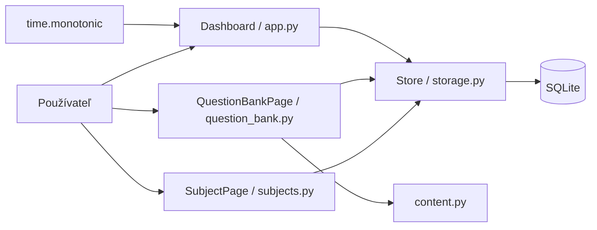

# Súčasná architektúra

Stav k 14. novembru 2026. Implementované sú Dashboard a My Subjects; ďalšie kroky opisuje [plánovaná architektúra](PLANNED_ARCHITECTURE.md).

## Technológie a súbory

Python, CustomTkinter 5.2.2, Pillow a štandardná SQLite. Jeden proces a hlavné vlákno Tk; bez sieťových požiadaviek a klienta Ollama. Vstup je `python soskuska/app.py`; inštalovateľný balík zatiaľ nie je.

| Súbor | Zodpovednosť |
| --- | --- |
| `soskuska/app.py` | Dashboard, navigácia obrazoviek, metriky, časovač, výber databázy a CLI |
| `soskuska/subjects.py` | My Subjects, inline formulár, validácia a potvrdenie vymazania |
| `soskuska/storage.py` | Verzia schémy, migrácie, CRUD predmetov, úlohy, relácie a prehľady |
| `soskuska/scrolling.py` | Kompatibilita kolieska a trackpadu Tk 9 |
| `tests/test_storage.py`, `tests/test_subjects.py` | Úložisko, kompatibilita pôvodnej databázy, migrácie a pravidlá predmetov |
| `soskuska/check_dashboard.py` | Natívna integračná kontrola s dočasnými údajmi |
| `soskuska-local/index.html` | Historický vizuálny návrh; nie je súčasťou behu aplikácie |

## Tok údajov



Obrazovky volajú `Store` priamo. Samostatná servisná/doménová vrstva a spoločný modul motívu zostávajú plánované. `SubjectPage` využíva existujúce pomocné metódy aplikácie pre štýl.

## Schéma a migrácie

`PRAGMA user_version` teraz označuje verziu **3**. Otvorenie pôvodnej databázy verzie 0 vytvorí/rozpozná pôvodné tabuľky a v jednej transakcii doplní predmety a väzby. Databáza s novšou verziou sa odmietne otvoriť namiesto pokusu o downgrade. Cudzie kľúče sú zapnuté pre každé pripojenie.

```sql
CREATE TABLE tasks (
    day TEXT NOT NULL, name TEXT NOT NULL, done INTEGER NOT NULL,
    PRIMARY KEY (day, name)
);
CREATE TABLE subjects (
    id INTEGER PRIMARY KEY AUTOINCREMENT,
    name TEXT NOT NULL, name_key TEXT NOT NULL UNIQUE,
    description TEXT NOT NULL DEFAULT '', exam_date TEXT,
    created_at TEXT NOT NULL DEFAULT CURRENT_TIMESTAMP,
    updated_at TEXT NOT NULL DEFAULT CURRENT_TIMESTAMP
);
CREATE TABLE sessions (
    id INTEGER PRIMARY KEY, day TEXT NOT NULL,
    seconds INTEGER NOT NULL CHECK(seconds >= 0),
    subject_id INTEGER REFERENCES subjects(id) ON DELETE SET NULL,
    subject_name TEXT
);
CREATE INDEX sessions_subject ON sessions(subject_id);
CREATE TABLE topics (
    id INTEGER PRIMARY KEY AUTOINCREMENT,
    subject_id INTEGER NOT NULL REFERENCES subjects(id) ON DELETE CASCADE,
    name TEXT NOT NULL, name_key TEXT NOT NULL,
    UNIQUE(subject_id, name_key)
);
CREATE TABLE questions (
    id INTEGER PRIMARY KEY AUTOINCREMENT,
    subject_id INTEGER NOT NULL REFERENCES subjects(id) ON DELETE CASCADE,
    topic_id INTEGER REFERENCES topics(id) ON DELETE SET NULL,
    prompt TEXT NOT NULL,
    option_a TEXT NOT NULL, option_b TEXT NOT NULL,
    option_c TEXT NOT NULL, option_d TEXT NOT NULL,
    correct_option INTEGER NOT NULL CHECK(correct_option BETWEEN 0 AND 3),
    difficulty TEXT NOT NULL CHECK(difficulty IN ('Easy','Medium','Hard')),
    explanation TEXT NOT NULL DEFAULT '',
    created_at TEXT NOT NULL DEFAULT CURRENT_TIMESTAMP,
    updated_at TEXT NOT NULL DEFAULT CURRENT_TIMESTAMP
);
CREATE INDEX questions_subject ON questions(subject_id);
CREATE INDEX questions_topic ON questions(topic_id);
```

Staré úlohy a relácie sa zachovajú. Pôvodné relácie nemajú vymyslený predmet: nové stĺpce sú `NULL`, UI ich označí ako Unassigned session. Pri vymazaní predmetu sa zachová čas aj názov predmetu uložený pri novej relácii; cudzí kľúč sa nastaví na `NULL`. ID predmetu sa znovu nepoužíva.

Názov predmetu má 1–120 znakov; medzery sa zjednotia, jedinečný kľúč používa Unicode NFKC a `casefold()`. Popis má najviac 1 000 znakov. Dátum je voliteľný, musí presne zodpovedať platnému `YYYY-MM-DD`. Minulý dátum možno uložiť, ale nezobrazí sa medzi nadchádzajúcimi skúškami.

## Ukladanie a časovač

| Platforma | Predvolená databáza |
| --- | --- |
| macOS | `~/Library/Application Support/SOSkuska/dashboard.sqlite3` |
| Windows | `%LOCALAPPDATA%\SOSkuska\dashboard.sqlite3`; náhradný základ `~/AppData/Local` |
| Linux | `$XDG_DATA_HOME/SOSkuska/dashboard.sqlite3`; náhradný základ `~/.local/share` |

Ak nová databáza nie je a existuje pôvodná `ExamPrep/dashboard.sqlite3`, použije sa pôvodný súbor bez presunu alebo prepisu. `--data` má prednosť. Údaje sa nešifrujú, nezálohujú ani nesynchronizujú. Zápisy bežia na hlavnom vlákne.

Časovač vyžaduje existujúci predmet. Počas relácie drží jeho ID a kópiu názvu; premenovanie nemení históriu. Má limit 900 sekúnd, meranie cez `time.monotonic()`, aktualizáciu cez `after(250, tick)`, pauzu a dokončenie. Mazanie aktívneho predmetu UI zablokuje do dokončenia relácie. Finish, dosiahnutie limitu a bežné zatvorenie ukladajú čas. Pri chybe zápisu sa relácia pozastaví a možno skúsiť Finish znovu; okno sa nezatvorí s neuloženou reláciou.

Čas nie je priebežne ukladaný a po páde sa nemusí obnoviť. Relácia sa pripisuje ku dňu uloženia a nerozdeľuje sa cez polnoc. Zmena dňa za behu obnoví prehľad a dnešný zoznam úloh. Nový zoznam používa kľúče `review_subject` a `focus`; staré riadky zostávajú v databáze, ale nie sú mapované na nové úlohy.

## Skutočný Dashboard

Pevné vzorové predmety, percentá, profil, termíny aj základy 24 h 35 min / 45 min boli odstránené. Nová databáza je prázdna. Metriky sú celkový čas, počet uložených relácií, séria študijných dní a počet predmetov. Séria môže končiť dnes alebo včera; staršia prerušená séria ukáže nulu. Cieľ zostáva 60 minút denne; karta ukazuje uložené minúty, pruh má presnosť na sekundy.

Karty ukazujú počet relácií a uložený čas predmetu, nie vymyslený pokrok v učení. Skúšky pochádzajú z uložených termínov, nedávna aktivita z posledných uložených relácií. Neexistujúce údaje majú prázdne stavy. AI, testy, kartičky, štatistická obrazovka a nastavenia zatiaľ nie sú implementované.

## Rozloženie a ovládanie

Okno 1440 × 900, minimum 1024 × 700. Bočný panel 230 px / zbalený 72 px; pri zvyšnej šírke pod 1100 px sa Dashboard usporiada na metriky 2 × 2 a pravý panel pod obsah. My Subjects prepína medzi jedným a dvoma stĺpcami pri šírke 850 px. Dlhé názvy sa na kartách zalamujú.

Obrazovky majú nezávislé vyhľadávanie cez `casefold()`. Ctrl+K / Cmd+K zameria hľadanie aktívnej obrazovky; Escape vymaže dotaz. Formuláre pre nový/upravený predmet aj potvrdenie vymazania sú inline. Podpora `TouchpadScroll`, kolieska a staršieho Linux/X11 zostáva v adaptéri využívajúcom súkromné členy CustomTkinteru; pri aktualizácii ho znovu overiť.

## Overenie a zostávajúce obmedzenia

32 testov úložiska prešlo; integračný skript prešiel na macOS s Pythonom 3.12.13 / Tk 9.0 a dočasnou databázou. Overil CRUD cez formulár, Unicode, hľadanie, prázdne stavy, naviazanie časovača, zachovanie histórie, opätovné otvorenie, kompaktný režim a syntetické posúvanie. Nenahrádza ručné vizuálne/hardvérové overenie; Windows/Linux nie sú overené.

Zostávajú testy, kartičky, Ollama, preklady UI, nastavovanie cieľa, úplná obnova po páde, zálohy, balíky a komplexné logovanie. Základné databázové operácie majú chybové hlásenia, ale úplné spracovanie chýb pri každom čítaní ešte chýba.


Verzia schémy sa číta až po získaní `BEGIN IMMEDIATE`, aby súbežné štarty nepoužili zastaranú hodnotu. Rozloženie My Subjects spracúva skutočné Configure udalosti CustomTkinteru; integračná kontrola overuje dva stĺpce vo veľkom okne a jeden v kompaktnom.

## Banka tém a otázok

`soskuska/question_bank.py` obsahuje obrazovku QuestionBankPage; `soskuska/content.py` čistú validáciu bez Tk. Obrazovka volá Store priamo. Schéma 3 pridáva topics a questions; existujúce tabuľky vo výpise vyššie zostávajú. Migrácia 0/1/2 → 3 prebieha v jednej transakcii a zachová predmety, úlohy aj relácie.

Názov témy je jedinečný v rámci predmetu (1–120 znakov, normalizácia medzier, NFKC/casefold). Otázka má text 1–2000 znakov, presne štyri rôzne odpovede po normalizácii (1–500 znakov), correct_option 0–3, povinnú náročnosť a vysvetlenie do 2000 znakov. Väzba na tému je voliteľná; API a SQL triggery pri zápise otázky odmietajú tému iného predmetu. Indexy pokrývajú subject_id a topic_id otázok. Témy ani otázky nemožno cez UI presúvať medzi predmetmi.

V My Subjects zvoľ pri predmete **Questions**. Pridaj tému cez New topic a otázku cez New question. Každá otázka má štyri rôzne povinné odpovede A–D, práve jednu správnu odpoveď, náročnosť Easy/Medium/Hard a voliteľné vysvetlenie. Téma je voliteľná. Formulár zachová rozpísaný obsah pri chybe validácie alebo zápisu.

Témy možno premenovať a vymazať; vyber tému vo filtri a použi Rename selected topic alebo Delete selected topic. Otázky možno upravovať a mazať. Hľadanie v texte otázky sa kombinuje s filtrom témy a náročnosti. Počty na kartách predmetov vychádzajú z uloženého obsahu. Vymazanie témy ponechá jej otázky v No topic. Vymazanie predmetu po výslovnom upozornení odstráni jeho témy a otázky, ale zachová čas aj históriu štúdia.

Ide o editor obsahu: správna odpoveď je viditeľná. Spúšťanie a hodnotenie cvičných testov, import a obrázky zatiaľ nie sú implementované.

## Opravy po kontrole hlavnej vetvy

Zatvorenie okna aj príkaz Quit v ponuke macOS používajú rovnaké uloženie relácie. Ak uloženie zlyhá, aplikácia zostane otvorená so zachovaným pozastaveným časom; po odstránení problému možno skúsiť Finish alebo Quit znovu.

Opustenie obrazovky My Subjects zruší rozpracované potvrdenie vymazania predmetu. Pred vymazaním sa v jednej transakcii porovná aktuálny názov a počty tém/otázok s posledným zobrazeným upozornením. Ak sa zmenili, aplikácia najprv zobrazí aktualizované upozornenie a vyžiada nové potvrdenie.

Pri zmene dňa sa aktualizuje aj dátum v záhlaví. Chyba čítania pri obnove zoznamu úloh alebo prehľadu nezastaví plánovanie časovača; obnova sa opakuje a nový deň sa potvrdí až po úspechu. Posúvanie v dlhom textovom poli zostáva v tomto poli vrátane jeho okrajov; stránku posunieš nad inou časťou okna. Krátke pole bez vlastného posunu naďalej umožňuje posúvanie stránky.
