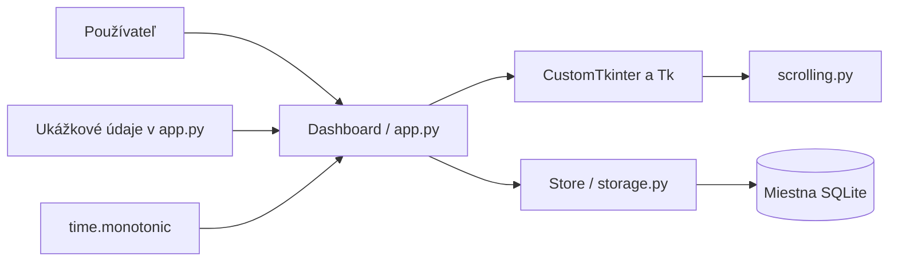

# Súčasná architektúra

Stav k 10. novembru 2026. Tento dokument opisuje existujúci kód. Budúci návrh je v [plánovanej architektúre](PLANNED_ARCHITECTURE.md).

## Technológie a moduly

Python, CustomTkinter 5.2.2 a Pillow podľa `soskuska/requirements.txt`; SQLite cez štandardný modul `sqlite3`. Jeden proces, jedno vlákno, natívna slučka udalostí Tk. Bez sieťových požiadaviek, klienta Ollama, cloudového účtu a webového servera.

| Súbor | Zodpovednosť |
| --- | --- |
| `soskuska/app.py` | Vstupný bod, `Dashboard`, UI, udalosti, časovač, ukážkové metriky, cesta databázy a CLI |
| `soskuska/storage.py` | `Store`, otvorenie SQLite, vytvorenie tabuliek, denné úlohy a súčty relácií |
| `soskuska/scrolling.py` | `DashboardScrollFrame`, obsluha kolieska a presných udalostí trackpadu |
| `soskuska/check_dashboard.py` | Krátka natívna kontrola s dočasnou databázou |
| `soskuska/run-macos.command` | Spustenie cez `.venv-macos` |
| `soskuska-local/index.html` | Starší samostatný vizuálny návrh, nie je súčasťou behu aplikácie |

Projekt zatiaľ nemá `pyproject.toml`, inštalovateľný balík ani príkaz `soskuska`. Platný vstup je `python soskuska/app.py`.

## Tok údajov



`Dashboard` priamo vytvára a volá `Store`. Samostatná servisná vrstva, model obrazovky ani smerovač zatiaľ neexistujú. Farby, písma, rozloženie a ukážkové predmety sú prevažne v `app.py`.

Pri štarte skript na macOS odmietne Tk staršie než 8.6 ešte pred vytvorením okna. Potom nastaví tmavý režim, otvorí databázu, vytvorí prvky rozhrania a spustí `mainloop()`.

## SQLite

```sql
CREATE TABLE tasks (
    day TEXT NOT NULL,
    name TEXT NOT NULL,
    done INTEGER NOT NULL,
    PRIMARY KEY (day, name)
);

CREATE TABLE sessions (
    id INTEGER PRIMARY KEY,
    day TEXT NOT NULL,
    seconds INTEGER NOT NULL CHECK(seconds >= 0)
);
```

Tabuľky sa vytvárajú cez `CREATE TABLE IF NOT EXISTS`. Verzia schémy a migrácie zatiaľ chýbajú. Jediné pripojenie používa hlavné vlákno. Dátum je miestny deň vo formáte ISO `YYYY-MM-DD`.

Úlohy majú kľúče `cards` a `test`; ich popisy sú v kóde. Zaškrtnutie volá `save_task → Store.set_task → INSERT OR REPLACE`. Predvolený ukážkový stav `cards` je zaškrtnutý, `test` nezaškrtnutý.

| Platforma | Predvolený súbor |
| --- | --- |
| macOS | `~/Library/Application Support/SOSkuska/dashboard.sqlite3` |
| Windows | `%LOCALAPPDATA%\SOSkuska\dashboard.sqlite3`; náhradný základ `~/AppData/Local` |
| Linux | `$XDG_DATA_HOME/SOSkuska/dashboard.sqlite3`; náhradný základ `~/.local/share` |

`--data` prepíše cestu. Relatívna cesta sa vyhodnocuje voči pracovnému adresáru. Údaje aplikácia nešifruje, nezálohuje ani nesynchronizuje.

## Časovač

- Pevný limit je 900 sekúnd. Start Studying a Resume session spúšťajú rovnakú funkciu, nejde o obnovenie predchádzajúceho učiva.
- `time.monotonic()` meria uplynulý čas. `running_since` drží začiatok bežiaceho úseku; `session_seconds` čas uplynulý pred pauzou.
- `after(250, tick)` aktualizuje text približne každých 250 ms. Meranie nezávisí od počtu týchto volaní.
- Pauza mení iba stav v pamäti. Finish, vypršanie limitu alebo bežné zatvorenie uloží celé sekundy, najviac 900.
- Záznam relácie nemá predmet ani presný čas začiatku. Pripíše sa ku dňu uloženia; cez polnoc sa nerozdeľuje.
- Po uložení sa obnovia minútové prehľady. Predvolené ukážkové hodnoty sú 24 h 35 min celkovo a 45 min dnes; ostatné metriky zostávajú pevné.
- Pri páde môže rozpracovaná relácia zmiznúť. Stav časovača sa po reštarte neobnoví.

## Rozloženie, vyhľadávanie a posúvanie

Počiatočné okno 1440 × 900, minimum 1024 × 700; titulok poskytuje systém. Bočný panel má 230 px, zbalený 72 px. Široké rozloženie sa zapne pri aspoň 1100 px po odčítaní panelu: štyri metriky vedľa seba a pravý prehľad široký najmenej 300 px. V kompaktnom režime sú metriky 2 × 2 a pravý prehľad pod hlavným obsahom. Predmety zostávajú v dvoch stĺpcoch. Zmena veľkosti sa spracúva s odkladom 120 ms.

Vyhľadávanie porovnáva podreťazec názvu pomocou `casefold()`. Hľadá iba v štyroch vzorových predmetoch, nie v databáze. Ctrl+K a na macOS Cmd+K zamerajú vyhľadávanie, Escape vymaže dotaz. Všetky skratky ešte nie sú overené na všetkých platformách.

`scrolling.py` dopĺňa udalosť Tk 9 `TouchpadScroll`, rozbaľuje 16-bitové X/Y delty so znamienkom a nastavuje krok plátna na 1 px. Koliesko normalizuje približne na 40 px na krok; pre starší macOS a Linux/X11 má samostatné obsluhy. Posúva iba obsah pod cieľovým prvkom; gesto nad bočným panelom obsah neposunie a čisto vodorovné gesto ignoruje.

Adaptér používa interné členy CustomTkinteru `_parent_canvas`, `_scrollbar`, `_shift_pressed`; pri aktualizácii je nutná kontrola kompatibility. Formát udalosti definuje [Tk TIP 684](https://core.tcl-lang.org/tips/doc/main/tip/684.md).

## Overenie a známe obmedzenia

Natívna kontrola prešla na macOS, Python 3.12.13 / Tk 9.0: zobrazené prvky, vyhľadávanie, prázdny výsledok, bočný panel, kompaktný režim, syntetické udalosti kolieska/trackpadu, časovač a uloženie času. Syntetické udalosti nenahrádzajú ručný test gest na zariadení. Windows/Linux ani inštalátor nie sú overené.

Predmety, percentá pokroku, profil, skúšky, aktivita, séria dní štúdia, počet otázok a úspešnosť sú ukážkové. Skúšky sa pri štarte generujú relatívne k dnešku. AI je odpojená a žiadne pripojenie sa neskúša. Ostatná navigácia iba zobrazí oznámenie.

Chýba automatické ošetrenie zmeny dňa za behu, obnova relácie po páde, používateľské chybové stavy pre zápis do databázy, migrácie, import/export, zálohy, lokalizácia, prepínanie motívu, úplné logovanie a distribučné balíky.


Kompatibilita s pôvodným názvom: ak nová databáza v `SOSkuska` neexistuje a pôvodná `ExamPrep/dashboard.sqlite3` existuje, aplikácia použije tento pôvodný súbor. Nič automaticky nekopíruje, nepresúva ani neprepisuje. Výslovné `--data` má vždy prednosť.
