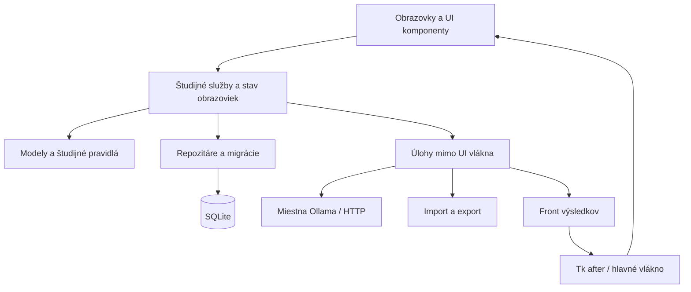

# Plánovaná architektúra

**Budúci návrh, nie dnešná implementácia.** Uvedené moduly a tabuľky zatiaľ neexistujú, ak ich nepotvrdzuje [súčasná architektúra](CURRENT_ARCHITECTURE.md). Tento plán sám osebe neznamená začatie implementácie všetkých funkcií.

**Aktuálny postup (11. novembra 2026):** základný CRUD predmetov, termíny skúšok, migrácie a skutočný Dashboard sú hotové vo feature vetve. Témy, otázky, precvičovanie, kartičky a AI naďalej patria do plánu. Neznamená to implementáciu samostatnej servisnej vrstvy alebo inštalátora.

## Smer

Zachovať Python + CustomTkinter, miestnu SQLite a voliteľnú AI cez Ollamu. Primárne platformy Windows/Linux, ponechať funkčný vývoj na macOS. Bežné štúdium nesmie vyžadovať cloudový účet, platené API ani spustenú AI. Vizuálny jazyk ďalej rozvíjať z dnešného Dashboardu.

Oddeľovať UI, študijné pravidlá a ukladanie postupne podľa potrieb konkrétnych funkcií. Nevytvárať nový UI framework ani webový backend.

## Vrstvy



| Vrstva | Zodpovednosť |
| --- | --- |
| UI | Prvky rozhrania, navigácia, zameranie, zobrazenie stavov; bez SQL a blokujúceho HTTP |
| Services | Spustenie štúdia, hodnotenie, prehľady a kontext AI; bez manipulácie s prvkami UI |
| Domain | Predmety, otázky, odpovede a pravidlá opakovania; bez závislosti od Tk |
| Persistence | Dotazy, transakcie, mapovanie údajov a migrácie |
| Integrations | Ollama a formáty súborov |

Stav obrazovky môže zostať jednoduchou dátovou štruktúrou. Nie je potrebné hneď zavádzať rozsiahly MVVM framework.

## Navrhované súbory

```text
pyproject.toml
src/soskuska/
    __main__.py
    bootstrap.py
    domain/             models.py, repetition.py
    services/           dashboard.py, study.py, practice.py, tutor.py
    persistence/        database.py, migrations/, repositories/
    integrations/       ollama.py, import_export.py
    ui/
        app.py, theme.py, navigation.py
        components/
        screens/        dashboard, subjects, flashcards, practice,
                        tutor, statistics, settings
    i18n/               en.json, cs.json, sk.json, ru.json
tests/
docs/
```

Presun robiť po malých funkčných krokoch. Do vytvorenia balíka zostáva platný dnešný príkaz `python soskuska/app.py`; budúci `python -m soskuska` zatiaľ nefunguje.

## Navrhovaný dátový model

| Oblasť | Návrh tabuliek |
| --- | --- |
| Obsah | `subjects`, `topics`, `questions`, `answer_options` |
| Kartičky | `decks`, `flashcards`, `review_events`, `card_schedule` |
| Testy | `test_attempts`, `attempt_answers` |
| Štúdium | `study_sessions` s predmetom a časovými údajmi |
| Plán a nastavenia | `exams`, `daily_tasks`, `settings` |
| AI | `conversations`, `messages`, referencie pripojeného kontextu |
| Údržba | Verzia schémy / evidencia vykonaných migrácií |

Konkrétne schémy musia doplniť cudzie kľúče, pravidlá mazania, indexy a transakcie. Migrácie musia zachovať dnešné `tasks` a `sessions`; existujúci čas nesmie dostať vymyslený predmet. Lokálny profil nemá vyžadovať serverový účet.

Časové okamihy ukladať s jasným časovým pásmom, ideálne UTC; denné súčty počítať v miestnom pásme. Navrhnúť rozdelenie relácie cez polnoc a obnovu po páde. Monotónny čas sa nedá preniesť medzi spusteniami procesu, preto nebude jediným uloženým údajom.

## Funkčné celky

**Predmety a skutočný Dashboard:** CRUD predmetov, termíny a skutočné súčty relácií sú implementované. Ďalším krokom je správa tém a otázok; úspešnosť odpovedí možno pridať až s ich ukladaním. Nové databázy sú prázdne, bez automatických demo údajov.

**Kartičky:** balíčky, otočenie otázky na odpoveď, Again / Hard / Good / Easy. Plánovanie opakovania oddeliť do čistého modulu a testovať. Konkrétny algoritmus ešte treba vybrať; dnešná aplikácia žiadny nemá.

**Testy:** nastavenie tém, počtu otázok, náročnosti a času; rozpracovaný pokus, vyhodnotenie a kontrola chýb. Odpovede a dokončenie pokusu ukladať transakčne, aby bolo možné spätne overiť výsledky.

**AI Tutor:** samostatný klient Ollama s časovým limitom, zoznamom dostupných modelov, priebežným prijímaním odpovede a zrušením generovania. Predvolené spojenie miestne, adresa nastaviteľná a viditeľná; žiadny automatický prechod na cloud. Modely načítať z Ollamy, nevyžadovať jeden pevný model.

Stavy AI: nedostupná služba, žiadny model, načítavanie, pripravené, generovanie, zastavené, nedostatok pamäte, model nenájdený. Samotné zlyhanie pripojenia nesmie byť vydávané za istotu, že Ollama nie je nainštalovaná.

Dlhé operácie bežia mimo hlavného UI vlákna. Výsledky prichádzajú cez front a `after`; pracovné vlákno nesmie volať prvky UI. SQLite pripojenie bez návrhu nezdieľať medzi vláknami. Prvé riešenie môže ponechať krátke zápisy v hlavnom vlákne; prípadné pracovné úlohy dostanú vlastné pripojenie.

Odpovede AI najskôr ako text, bloky kódu s písmom s pevnou šírkou a Unicode matematika; pokročilé HTML/LaTeX nie je podmienkou. Jazyk UI oddeliť od jazyka odpovedí AI. Plánované jazyky: English, Czech, Slovak, Russian; AI navyše Automatic s možnosťou ručne prepísať chybnú detekciu. Počítať s dlhšími textami a cyrilikou.

**Štatistiky a nastavenia:** jednoduché grafy Matplotlib až nad skutočnými meraniami. Nastavenia vzhľadu, jazyka, štúdia, AI a správy údajov. Import najprv validovať; zálohy vytvárať ako konzistentné kópie SQLite. Obnovu robiť so zatvoreným pripojením a možnosťou návratu k predchádzajúcemu súboru.

## Etapy a kritériá dokončenia

| Etapa | Rozsah | Výsledok |
| --- | --- | --- |
| 1. Stabilizácia | Oddeliť motív/UI, chyby úložiska, migrácie | Dashboard funguje a existujúce údaje zostanú zachované |
| 2. Predmety | Správa predmetov, tém, skúšok, skutočné prehľady | Nový predmet prežije reštart; prázdne údaje sa zobrazia pravdivo |
| 3. Obsah a kartičky | Editor/import, balíčky, opakovanie | Odpoveď vytvorí záznam a plán ďalšieho opakovania |
| 4. Testy | Nastavenie, priebeh, výsledky a chyby | Výsledok možno otvoriť a znovu vypočítať z odpovedí |
| 5. AI | Klient Ollama a chat | UI nezamŕza, generovanie možno zastaviť, offline stav je zrozumiteľný |
| 6. Dokončenie | Štatistiky, jazyky, motív, zálohy a balíky | Overené inštalácie na cieľových systémoch |

Obrazovky rozvíjať iteratívne po spätnej väzbe podľa pôvodného zadania. Tento návrh nevyžaduje okamžitý prepis súčasného Dashboardu.
