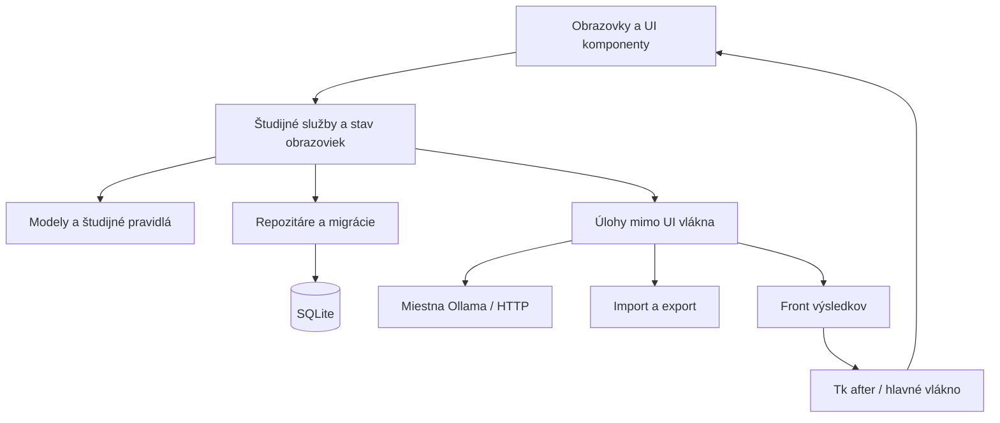

# Plánovaná architektúra

[English](../PLANNED_ARCHITECTURE.md) · [Čeština](../cs/PLANNED_ARCHITECTURE.md) · [Slovenčina](PLANNED_ARCHITECTURE.md) · [Русский](../ru/PLANNED_ARCHITECTURE.md)

**Budúci návrh, nie dnešná implementácia.** Uvedené moduly a tabuľky zatiaľ neexistujú, ak ich nepotvrdzuje [súčasná architektúra](CURRENT_ARCHITECTURE.md). Tento plán sám osebe neznamená začatie implementácie všetkých funkcií.

Vydaná základná verzia je v0.31.1 s jazykmi rozhrania, uloženými konverzáciami AI a schémou 10. Sprievodcovia nižšie opisujú implementované funkcie. Uloženie nastavení nespúšťa sieťové pripojenie.

Nastavenia sa ukladajú do rovnakej databázy ako študijné údaje. [Settings](SETTINGS.md). Nastavenia sa ukladajú transakčne v schéme 6 s ochranou pred prepísaním zmien iného okna. Migrácia z verzie 5 zachová všetky predchádzajúce tabuľky aj údaje; staršia aplikácia novšiu schému odmietne otvoriť.
## Smer

Zachovať Python + CustomTkinter, miestnu SQLite a voliteľnú AI cez Ollamu. Primárne platformy Windows/Linux, ponechať funkčný vývoj na macOS. Bežné štúdium nesmie vyžadovať cloudový účet, platené API ani spustenú AI. Vizuálny jazyk ďalej rozvíjať z dnešného Dashboardu.

Oddeľovať UI, študijné pravidlá a ukladanie postupne podľa potrieb konkrétnych funkcií. Nevytvárať nový UI framework ani webový backend.

## Vrstvy



| Vrstva | Zodpovednosť |
| --- | --- |
| UI | Prvky rozhrania, navigácia, zameranie, zobrazenie stavov; bez SQL a blokujúceho HTTP |
| Services | Spustenie štúdia, hodnotenie, prehľady a kontext AI; bez manipulácie s prvkami UI |
| Domain | Predmety, otázky, odpovede a pravidlá opakovania; bez závislosti od Tk |
| Persistence | Dotazy, transakcie, mapovanie údajov a migrácie |
| Integrations | Ollama a formáty súborov |

Stav obrazovky môže zostať jednoduchou dátovou štruktúrou. Nie je potrebné hneď zavádzať rozsiahly MVVM framework.

## Navrhované súbory

```text
pyproject.toml
src/soskuska/
    __main__.py
    bootstrap.py
    domain/             models.py, repetition.py
    services/           dashboard.py, study.py, practice.py, tutor.py
    persistence/        database.py, migrations/, repositories/
    integrations/       ollama.py, import_export.py
    ui/
        app.py, theme.py, navigation.py
        components/
        screens/        dashboard, subjects, flashcards, practice,
                        tutor, statistics, settings
    i18n/               en.json, cs.json, sk.json, ru.json
tests/
docs/
```

Presun robiť po malých funkčných krokoch. Do vytvorenia balíka zostáva platný dnešný príkaz `python soskuska/app.py`; budúci `python -m soskuska` zatiaľ nefunguje.

## Navrhovaný dátový model

| Oblasť | Návrh tabuliek |
| --- | --- |
| Obsah | `subjects`, `topics`, `questions`, `answer_options` |
| Kartičky | `decks`, `flashcards`, `review_events`, `card_schedule` |
| Testy | `test_attempts`, `attempt_answers` |
| Štúdium | `study_sessions` s predmetom a časovými údajmi |
| Plán a nastavenia | `exams`, `daily_tasks`, `settings` |
| AI | `conversations`, `messages`, referencie pripojeného kontextu |
| Údržba | Verzia schémy / evidencia vykonaných migrácií |

Konkrétne schémy musia doplniť cudzie kľúče, pravidlá mazania, indexy a transakcie. Migrácie musia zachovať dnešné `tasks` a `sessions`; existujúci čas nesmie dostať vymyslený predmet. Lokálny profil nemá vyžadovať serverový účet.

Obnova sústredenia po páde je dostupná vo v0.17.0; pozri [Obnova sústredenia](FOCUS_RECOVERY.md). Rozdelenie cez polnoc zostáva návrhom. Všetok čas teraz patrí miestnemu dňu dokončenia.

## Funkčné celky

**Predmety a skutočný Dashboard:** správa predmetov, tém/otázok a skutočné súčty relácií sú implementované. Úspešnosť jednotlivých pokusov je v Practice Tests; základné celkové štatistiky sú implementované. Nová databáza je prázdna.

**Kartičky:** balíčky, editor, odhalenie odpovede, Again / Hard / Good / Easy, uložený termín a história sú implementované. Pravidlá sú v repetition.py a dokumente FLASHCARDS.md; nejde o SM-2 ani FSRS. CSV import je implementovaný; pokročilejšie plánovanie zostáva možnosťou do budúcna.

**Testy:** výber témy, náročnosti, počtu a času; uložený pokus, skóre a rozbor odpovedí sú implementované. Import otázok z CSV je implementovaný; stránkovaná história s filtrami predmetu a dátumov je implementovaná.

**AI Tutor:** samostatný klient Ollama s časovým limitom, zoznamom dostupných modelov, priebežným prijímaním odpovede a zrušením generovania. Predvolené spojenie miestne, adresa nastaviteľná a viditeľná; žiadny automatický prechod na cloud. Modely načítať z Ollamy, nevyžadovať jeden pevný model.

Stavy AI: nedostupná služba, žiadny model, načítavanie, pripravené, generovanie, zastavené, nedostatok pamäte, model nenájdený. Samotné zlyhanie pripojenia nesmie byť vydávané za istotu, že Ollama nie je nainštalovaná.

**AI generovanie:** generovanie kartičiek/otázok z poznámok s kontrolou a atomickým uložením je implementované (v0.30.0–v0.30.1) vrátane ručného nástroja na hodnotenie so skutočným modelom. Možná budúca práca zahŕňa použitie materiálov vybraného predmetu ako kontextu Tutora s náhľadom, „Vysvetliť túto kartičku“ v Kartičkách a študijný plán podľa slabých tém zo Štatistík. Každá možnosť musí zachovať výslovný súhlas skôr, než sa čokoľvek odošle.

**Integrácie:** voliteľné miestne rozhranie len na čítanie pre externých asistentov, napríklad server MCP cez stdio, by mohlo sprístupniť predmety, kartičky na opakovanie a štatistiky. Vyžadovalo by výslovné zapnutie, žiadny sieťový poslucháč v predvolenom stave, zápisy len cez skontrolované návrhy a existujúce pravidlá zámkov/lease. Server len na čítanie cez stdio (`soskuska/mcp_server.py`) je vydaný vo v0.31.0; pozri [návod](MCP_SERVER.md). Zostáva: zaznamenaný beh so skutočným hostiteľom MCP, voliteľný pomocník pre Windows a akákoľvek cesta k zápisu, ktorá by musela viesť cez skontrolované návrhy.

Dlhé operácie bežia mimo hlavného UI vlákna. Výsledky prichádzajú cez front a `after`; pracovné vlákno nesmie volať prvky UI. SQLite pripojenie bez návrhu nezdieľať medzi vláknami. Prvé riešenie môže ponechať krátke zápisy v hlavnom vlákne; prípadné pracovné úlohy dostanú vlastné pripojenie.

Odpovede AI najskôr ako text, bloky kódu s písmom s pevnou šírkou a Unicode matematika; pokročilé HTML/LaTeX nie je podmienkou. Jazyk UI oddeliť od jazyka odpovedí AI. Plánované jazyky: English, Czech, Slovak, Russian; AI navyše Automatic s možnosťou ručne prepísať chybnú detekciu. Počítať s dlhšími textami a cyrilikou.

**Štatistiky a nastavenia:** jednoduché grafy Matplotlib až nad skutočnými meraniami. Nastavenia vzhľadu, jazyka, štúdia, AI a správy údajov. Import najprv validovať; zálohy vytvárať ako konzistentné kópie SQLite. Obnovu robiť so zatvoreným pripojením a možnosťou návratu k predchádzajúcemu súboru.

## Etapy a kritériá dokončenia

| Etapa | Rozsah | Výsledok |
| --- | --- | --- |
| 1. Stabilizácia | Oddeliť motív/UI, chyby úložiska, migrácie | Dashboard funguje a existujúce údaje zostanú zachované |
| 2. Predmety | Správa predmetov, tém, skúšok, skutočné prehľady | Nový predmet prežije reštart; prázdne údaje sa zobrazia pravdivo |
| 3. Obsah a kartičky | Editor/import, balíčky, opakovanie | Odpoveď vytvorí záznam a plán ďalšieho opakovania |
| 4. Testy | Nastavenie, priebeh, výsledky a chyby | Výsledok možno otvoriť a znovu vypočítať z odpovedí |
| 5. AI | Klient Ollama a chat | UI nezamŕza, generovanie možno zastaviť, offline stav je zrozumiteľný |
| 6. Dokončenie | Štatistiky, jazyky, motív, zálohy a balíky | Overené inštalácie na cieľových systémoch |

Obrazovky rozvíjať iteratívne po spätnej väzbe podľa pôvodného zadania. Tento návrh nevyžaduje okamžitý prepis súčasného Dashboardu.

## Nastavenia

Konverzácie sa ukladajú do miestnej databázy a záloh. Voľby spojenia možno výslovne uložiť v [Settings](SETTINGS.md); bez Save sú dočasné.

[Nastavenia](SETTINGS.md).

## Záloha a obnova

Settings teraz ponúka ručnú miestnu zálohu a overenú obnovu s bezpečnostnou kópiou pred nahradením. Aktuálna schéma je 10. Obnova zatvorí aplikáciu; potom ju spusti znovu. Pozri [Záloha a obnova](BACKUP_RESTORE.md).

## Import otázok z CSV

Banka otázok teraz podporuje import UTF-8 CSV do existujúceho predmetu: šablóna s hlavičkou, stránkovaný náhľad, odmietnutie presných duplicít a jedno atomické uloženie. Maximum 2 MiB / 500 záznamov; zoznam ukazuje 50 otázok na stránku. Aktuálna schéma je 10. [Import otázok z CSV](QUESTION_CSV_IMPORT.md).

## Import kartičiek z CSV

Flashcards teraz podporuje import UTF-8 CSV do existujúceho balíčka: šablónu s hlavičkou, stránkovaný náhľad, odmietnutie presných duplicít a jedno atomické uloženie. Maximum 2 MiB / 500 záznamov. Nové kartičky sú ihneď splatné; pôvodné termíny a história hodnotení zostávajú zachované. Aktuálna schéma je 10. [Import kartičiek z CSV](FLASHCARD_CSV_IMPORT.md).

## Uložené konverzácie AI Tutor

AI Tutor teraz ukladá konverzácie lokálne vrátane pôvodného servera/modelu a stavu odpovede. Históriu možno otvoriť bez siete, výslovne sa pripojiť na pokračovanie alebo vybranú konverzáciu po potvrdení zmazať. Vydané vo v0.12.0 so schémou 7, ktorá transakčne migruje pôvodné študijné údaje. [Uložené konverzácie AI Tutor](TUTOR_HISTORY.md).

## Jazyk rozhrania

Výber jazyka rozhrania je dostupný vo v0.13.0: angličtina, čeština, slovenčina a ruština. Ukladá sa osobitne od jazyka AI a použije sa po reštarte. Aktuálna schéma je 10. [Jazyk rozhrania](UI_LANGUAGES.md).

## História testov

História testov teraz ponúka všetky dokončené pokusy po 20 na stránku, filter uloženého názvu predmetu a miestnych dátumov vrátane oboch hraníc a otvorenie uloženého rozboru odpovedí. Koncepty filtrov a použitá stránka prežijú navigáciu; chyba čítania zachová predchádzajúce výsledky. Schéma zostáva 8. [História testov](PRACTICE_HISTORY.md).

## Prenosná verzia Windows a preberacia kontrola

v0.15.0 pridáva nepodpísaný prenosný ZIP pre Windows x64, zostavený a overený piatou úlohou CI. Pribalený pomocný program zachová oddelené CSV/zálohovacie procesy; cieľový počítač nepotrebuje Python. Automatické hostované kontroly a ručný zoznam pre čistý počítač sú oddelené; ručná preberacia kontrola zatiaľ nie je dokončená. Vydaná verzia je v0.31.1, schéma 10. [Prenosná verzia Windows a preberacia kontrola](WINDOWS_PORTABLE.md) · [Kontrolný zoznam](WINDOWS_ACCEPTANCE.md).

## Nastavenie vzhľadu

v0.16.0 pridáva uložené Light/Dark/System, použité po Save bez obnovy obrazoviek a straty aktívnej práce. System sleduje Windows/macOS, na Linuxe používa Light. Aktuálna schéma je 10. Používateľ 22. novembra 2026 potvrdil dokončenie testovania základu a schválil zlúčenie PR #32. [Nastavenie vzhľadu](APPEARANCE.md).

## Ďalšie kroky · 22. novembra 2026

Stav 22. novembra 2026: používateľ potvrdil dokončenie testovania v0.15.0 a schválil PR #32. Tento zoznam teraz cieli na v0.19.0; jednotlivé výsledky čistého počítača/DPI tu nie sú zaznamenané. Nezaškrtnuté body zostávajú neoverené; pri testovaní nového vydania doplň dôkazy pre konkrétne zariadenie. [Ďalšie kroky · 22. novembra 2026](NEXT_STEPS.md).

## Obnova sústredenia po páde

v0.17.0 pridáva obnovu sústredenia po páde so schémou **10**. Pred otvorením pôvodných dát vytvor zálohu: migrácia je transakčná, ale v0.16.0 databázu schémy 10 neotvorí. [Obnova sústredenia po páde](FOCUS_RECOVERY.md).

## Plánované miestne zálohy

Plánované miestne zálohy sú dostupné vo **v0.18.0**. Schéma SQLite zostáva **10**. Ručná záloha a obnova fungujú samostatne. [Plánované miestne zálohy](SCHEDULED_BACKUPS.md).


## Nový študijný priestor · v0.27.0

Nová kompozícia Dashboardu nahrádza predchádzajúce postupné úpravy: štyri súhrnné dlaždice, výrazná časť sústredenia so živými kruhovými hodinami, karty predmetov s monogramami a mesačný prehľad uložených termínov. Bočný panel používa miestne kreslené ikony a vlastné tmavé farby; zdieľané plochy a párový Dark/Light vzhľad sa menia v celej aplikácii. Táto fáza zavádza Dashboard a spoločný rámec; ostatné stránky nadviažu po vizuálnej spätnej väzbe. [Ukážky a rozsah](../agents/design/study-studio-dashboard/README.md).

Hodiny ukazujú skutočný zostávajúci čas a pôvodný cieľ aktívneho sedenia. Kalendár používa úplnú snímku predmetov; najbližšie skúšky zachovajú presné dátumy a limit piatich položiek. Klávesové hľadanie, chyba uloženia a obnova sústredenia posunú ovládanie do viditeľnej časti kompaktného okna; čakajúci posun zruší navigácia či hľadanie. Zmena rozloženia nečíta dáta. Schéma zostáva 10, vydaná verzia v0.31.1. Kontajnerové a simulované mierky neoverujú natívnu platformu; test skutočného modelu zostáva odložený.
