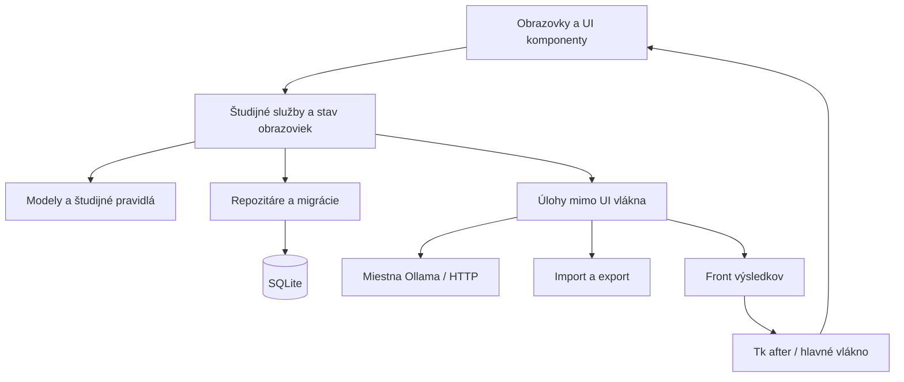

# Plánovaná architektúra

[English](../PLANNED_ARCHITECTURE.md) · [Čeština](../cs/PLANNED_ARCHITECTURE.md) · [Slovenčina](PLANNED_ARCHITECTURE.md) · [Русский](../ru/PLANNED_ARCHITECTURE.md)

**Budúci návrh, nie dnešná implementácia.** Uvedené moduly a tabuľky zatiaľ neexistujú, ak ich nepotvrdzuje [súčasná architektúra](CURRENT_ARCHITECTURE.md). Tento plán sám osebe neznamená začatie implementácie všetkých funkcií.

Vydaná základná verzia je v0.15.0 s jazykmi rozhrania, uloženými konverzáciami AI a schémou 8. Sprievodcovia nižšie opisujú implementované funkcie. Uloženie nastavení nespúšťa sieťové pripojenie.

## Rozhodnutie · 21. novembra 2026: vývoj súbežne s testovaním vydania

Používateľ súhlasí s pokračovaním vývoja funkcií počas ručného testovania vydanej **v0.15.0**. Toto vydanie zostáva stabilným základom kontroly; nevydané zmeny nepatria do jeho dôkazov preberacej kontroly Windows.

Ďalšia plánovaná funkcia je **nastavenie vzhľadu: Light, Dark a System**. Voľba sa uloží nezávisle od jazyka rozhrania aj odpovedí AI. Zachovať rozpísané formuláre, bežiace sústredenie/testy a prácu AI Tutor. Overiť čitateľnosť a stavy ovládacích prvkov na všetkých obrazovkách v štyroch jazykoch vrátane kompaktného okna. Ide o plán, nie implementovanú funkciu ani schválenie zlúčenia/vydania.

Použiť samostatnú vetvu a PR. Spustiť zodpovedajúce jednotkové/kontajnerové kontroly, pri dotknutom balení aj Windows kontroly a nezávislú revíziu Sol so stredným úsilím. PR funkcie nezlučovať, kým používateľ nepotvrdí dokončenie testovania v0.15.0 a výslovne neschváli zlúčenie. Zelené CI túto podmienku neruší. Chyby v0.15.0 opravovať samostatnými PR; relevantné opravy prevziať do vetvy funkcie a znovu overiť.

Ďalšie kroky: implementovať vzhľad vo vlastnej vetve, zatiaľ čo používateľ prejde [kontrolu Windows](WINDOWS_ACCEPTANCE.md); chyby základu riešiť samostatne; dokončiť revíziu/CI funkcie; po potvrdení testovania požiadať o zlúčenie. Vydanie vyžaduje samostatné schválenie. GUI kontroly štandardne v kontajneri; potrebný viditeľný natívny beh najprv dohodnúť.

Nastavenia sa ukladajú do rovnakej databázy ako študijné údaje. [Settings](SETTINGS.md). Nastavenia sa ukladajú transakčne v schéme 6 s ochranou pred prepísaním zmien iného okna. Migrácia z verzie 5 zachová všetky predchádzajúce tabuľky aj údaje; staršia aplikácia novšiu schému odmietne otvoriť.
## Smer

Zachovať Python + CustomTkinter, miestnu SQLite a voliteľnú AI cez Ollamu. Primárne platformy Windows/Linux, ponechať funkčný vývoj na macOS. Bežné štúdium nesmie vyžadovať cloudový účet, platené API ani spustenú AI. Vizuálny jazyk ďalej rozvíjať z dnešného Dashboardu.

Oddeľovať UI, študijné pravidlá a ukladanie postupne podľa potrieb konkrétnych funkcií. Nevytvárať nový UI framework ani webový backend.

## Vrstvy



| Vrstva | Zodpovednosť |
| --- | --- |
| UI | Prvky rozhrania, navigácia, zameranie, zobrazenie stavov; bez SQL a blokujúceho HTTP |
| Services | Spustenie štúdia, hodnotenie, prehľady a kontext AI; bez manipulácie s prvkami UI |
| Domain | Predmety, otázky, odpovede a pravidlá opakovania; bez závislosti od Tk |
| Persistence | Dotazy, transakcie, mapovanie údajov a migrácie |
| Integrations | Ollama a formáty súborov |

Stav obrazovky môže zostať jednoduchou dátovou štruktúrou. Nie je potrebné hneď zavádzať rozsiahly MVVM framework.

## Navrhované súbory

```text
pyproject.toml
src/soskuska/
    __main__.py
    bootstrap.py
    domain/             models.py, repetition.py
    services/           dashboard.py, study.py, practice.py, tutor.py
    persistence/        database.py, migrations/, repositories/
    integrations/       ollama.py, import_export.py
    ui/
        app.py, theme.py, navigation.py
        components/
        screens/        dashboard, subjects, flashcards, practice,
                        tutor, statistics, settings
    i18n/               en.json, cs.json, sk.json, ru.json
tests/
docs/
```

Presun robiť po malých funkčných krokoch. Do vytvorenia balíka zostáva platný dnešný príkaz `python soskuska/app.py`; budúci `python -m soskuska` zatiaľ nefunguje.

## Navrhovaný dátový model

| Oblasť | Návrh tabuliek |
| --- | --- |
| Obsah | `subjects`, `topics`, `questions`, `answer_options` |
| Kartičky | `decks`, `flashcards`, `review_events`, `card_schedule` |
| Testy | `test_attempts`, `attempt_answers` |
| Štúdium | `study_sessions` s predmetom a časovými údajmi |
| Plán a nastavenia | `exams`, `daily_tasks`, `settings` |
| AI | `conversations`, `messages`, referencie pripojeného kontextu |
| Údržba | Verzia schémy / evidencia vykonaných migrácií |

Konkrétne schémy musia doplniť cudzie kľúče, pravidlá mazania, indexy a transakcie. Migrácie musia zachovať dnešné `tasks` a `sessions`; existujúci čas nesmie dostať vymyslený predmet. Lokálny profil nemá vyžadovať serverový účet.

Časové okamihy ukladať s jasným časovým pásmom, ideálne UTC; denné súčty počítať v miestnom pásme. Navrhnúť rozdelenie relácie cez polnoc a obnovu po páde. Monotónny čas sa nedá preniesť medzi spusteniami procesu, preto nebude jediným uloženým údajom.

## Funkčné celky

**Predmety a skutočný Dashboard:** správa predmetov, tém/otázok a skutočné súčty relácií sú implementované. Úspešnosť jednotlivých pokusov je v Practice Tests; základné celkové štatistiky sú implementované. Nová databáza je prázdna.

**Kartičky:** balíčky, editor, odhalenie odpovede, Again / Hard / Good / Easy, uložený termín a história sú implementované. Pravidlá sú v repetition.py a dokumente FLASHCARDS.md; nejde o SM-2 ani FSRS. CSV import je implementovaný; pokročilejšie plánovanie zostáva možnosťou do budúcna.

**Testy:** výber témy, náročnosti, počtu a času; uložený pokus, skóre a rozbor odpovedí sú implementované. Import otázok z CSV je implementovaný; stránkovaná história s filtrami predmetu a dátumov je implementovaná.

**AI Tutor:** samostatný klient Ollama s časovým limitom, zoznamom dostupných modelov, priebežným prijímaním odpovede a zrušením generovania. Predvolené spojenie miestne, adresa nastaviteľná a viditeľná; žiadny automatický prechod na cloud. Modely načítať z Ollamy, nevyžadovať jeden pevný model.

Stavy AI: nedostupná služba, žiadny model, načítavanie, pripravené, generovanie, zastavené, nedostatok pamäte, model nenájdený. Samotné zlyhanie pripojenia nesmie byť vydávané za istotu, že Ollama nie je nainštalovaná.

Dlhé operácie bežia mimo hlavného UI vlákna. Výsledky prichádzajú cez front a `after`; pracovné vlákno nesmie volať prvky UI. SQLite pripojenie bez návrhu nezdieľať medzi vláknami. Prvé riešenie môže ponechať krátke zápisy v hlavnom vlákne; prípadné pracovné úlohy dostanú vlastné pripojenie.

Odpovede AI najskôr ako text, bloky kódu s písmom s pevnou šírkou a Unicode matematika; pokročilé HTML/LaTeX nie je podmienkou. Jazyk UI oddeliť od jazyka odpovedí AI. Plánované jazyky: English, Czech, Slovak, Russian; AI navyše Automatic s možnosťou ručne prepísať chybnú detekciu. Počítať s dlhšími textami a cyrilikou.

**Štatistiky a nastavenia:** jednoduché grafy Matplotlib až nad skutočnými meraniami. Nastavenia vzhľadu, jazyka, štúdia, AI a správy údajov. Import najprv validovať; zálohy vytvárať ako konzistentné kópie SQLite. Obnovu robiť so zatvoreným pripojením a možnosťou návratu k predchádzajúcemu súboru.

## Etapy a kritériá dokončenia

| Etapa | Rozsah | Výsledok |
| --- | --- | --- |
| 1. Stabilizácia | Oddeliť motív/UI, chyby úložiska, migrácie | Dashboard funguje a existujúce údaje zostanú zachované |
| 2. Predmety | Správa predmetov, tém, skúšok, skutočné prehľady | Nový predmet prežije reštart; prázdne údaje sa zobrazia pravdivo |
| 3. Obsah a kartičky | Editor/import, balíčky, opakovanie | Odpoveď vytvorí záznam a plán ďalšieho opakovania |
| 4. Testy | Nastavenie, priebeh, výsledky a chyby | Výsledok možno otvoriť a znovu vypočítať z odpovedí |
| 5. AI | Klient Ollama a chat | UI nezamŕza, generovanie možno zastaviť, offline stav je zrozumiteľný |
| 6. Dokončenie | Štatistiky, jazyky, motív, zálohy a balíky | Overené inštalácie na cieľových systémoch |

Obrazovky rozvíjať iteratívne po spätnej väzbe podľa pôvodného zadania. Tento návrh nevyžaduje okamžitý prepis súčasného Dashboardu.

## Nastavenia

Konverzácie sa ukladajú do miestnej databázy a záloh. Voľby spojenia možno výslovne uložiť v [Settings](SETTINGS.md); bez Save sú dočasné.

[Nastavenia](SETTINGS.md).

## Záloha a obnova

Settings teraz ponúka ručnú miestnu zálohu a overenú obnovu s bezpečnostnou kópiou pred nahradením. Aktuálna schéma je 8. Obnova zatvorí aplikáciu; potom ju spusti znovu. Pozri [Záloha a obnova](BACKUP_RESTORE.md).

## Import otázok z CSV

Banka otázok teraz podporuje import UTF-8 CSV do existujúceho predmetu: šablóna s hlavičkou, stránkovaný náhľad, odmietnutie presných duplicít a jedno atomické uloženie. Maximum 2 MiB / 500 záznamov; zoznam ukazuje 50 otázok na stránku. Aktuálna schéma je 8. [Import otázok z CSV](QUESTION_CSV_IMPORT.md).

## Import kartičiek z CSV

Flashcards teraz podporuje import UTF-8 CSV do existujúceho balíčka: šablónu s hlavičkou, stránkovaný náhľad, odmietnutie presných duplicít a jedno atomické uloženie. Maximum 2 MiB / 500 záznamov. Nové kartičky sú ihneď splatné; pôvodné termíny a história hodnotení zostávajú zachované. Aktuálna schéma je 8. [Import kartičiek z CSV](FLASHCARD_CSV_IMPORT.md).

## Uložené konverzácie AI Tutor

AI Tutor teraz ukladá konverzácie lokálne vrátane pôvodného servera/modelu a stavu odpovede. Históriu možno otvoriť bez siete, výslovne sa pripojiť na pokračovanie alebo vybranú konverzáciu po potvrdení zmazať. Vydané vo v0.12.0 so schémou 7, ktorá transakčne migruje pôvodné študijné údaje. [Uložené konverzácie AI Tutor](TUTOR_HISTORY.md).

## Jazyk rozhrania

Výber jazyka rozhrania je dostupný vo v0.13.0: angličtina, čeština, slovenčina a ruština. Ukladá sa osobitne od jazyka AI a použije sa po reštarte. Aktuálna schéma je 8. [Jazyk rozhrania](UI_LANGUAGES.md).

## História testov

História testov teraz ponúka všetky dokončené pokusy po 20 na stránku, filter uloženého názvu predmetu a miestnych dátumov vrátane oboch hraníc a otvorenie uloženého rozboru odpovedí. Koncepty filtrov a použitá stránka prežijú navigáciu; chyba čítania zachová predchádzajúce výsledky. Schéma zostáva 8. [História testov](PRACTICE_HISTORY.md).

## Prenosná verzia Windows a preberacia kontrola

v0.15.0 pridáva nepodpísaný prenosný ZIP pre Windows x64, zostavený a overený piatou úlohou CI. Pribalený pomocný program zachová oddelené CSV/zálohovacie procesy; cieľový počítač nepotrebuje Python. Automatické hostované kontroly a ručný zoznam pre čistý počítač sú oddelené; ručná preberacia kontrola zatiaľ nie je dokončená. Vydaná verzia je v0.15.0, schéma 8. [Prenosná verzia Windows a preberacia kontrola](WINDOWS_PORTABLE.md) · [Kontrolný zoznam](WINDOWS_ACCEPTANCE.md).
